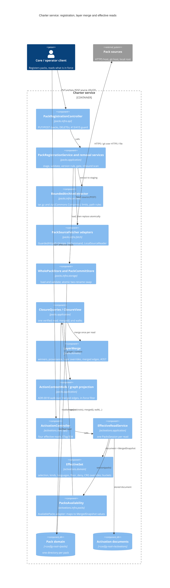

# Implementation Plan: Layer merge, pack registration and effective reads

**Branch**: `issue-10-layer-merge-effective-reads` (stacked on #399, the activation register's PR B; not yet on `main`) | **Date**: 2026-11-06 | **Spec**: [spec.md](spec.md)
**Input**: Mission specification from `kitty-specs/layer-merge-and-effective-reads-01M6R0J6/spec.md`, the ten resolved
decisions in [decisions/](decisions/) and the operator's planning rulings of 2026-11-06 (recorded in research.md).
**Folded 2026-11-06:** the operator's rulings on the ruleset review (A1–A15, B1–B8; research R13–R18) and the
post-plan squad's security, architecture and contract findings. See [the fold section](#fold-of-the-ruleset-rulings-and-the-post-plan-squad-2026-11-06).
**Folded 2026-11-07 (phase A):** `main`'s #403 (ADR-0064) and #390, the phase A delta squad's findings and two
operator rulings (`DM-01M6TQ62HXYF362GAFS2BZ3PGF`, `DM-01M6TQ67C9ZTNGZB9CY28JS54F`). See
[the delta fold](#fold-of-the-phase-a-delta-squad-2026-11-07).

**Note**: This template is filled in by the `/spec-kitty.plan` command. See `packs/built-in/missions/mission-steps/software-dev/plan/prompt.md` for the execution workflow.

The planner will not begin until all planning questions have been answered—capture those answers in this document before progressing to later phases.

**Planning questions.** Every decision of the operator is answered in research.md (R1 to R12 and R-lock). The
operator ruled Q1 to Q9 on 2026-11-06. No question is open.

## Summary

The charter service gains three things: whole-pack registration with removal, the layer merge, and the four
effective reads. Together they finish ADR-0055 steps 3 and 4.

- **PR A0 (own PR, stacked on #399, before PR A): changes to #399's built behaviour** that the ruleset rulings make
  (FR-026, FR-028, FR-031, FR-033 to FR-035) and the A7 kind model (IC-20). Ruled, decision `DM-01M6RFGB9NVD9MDWZ6AP0PBYH7`; see
  [Changes to built behaviour](#changes-to-built-behaviour-from-399).
- **PR A, registration and removal.** Registration is asynchronous (`202` and a status URI, FR-024) and runs an
  impact check over every closure the pack joins (FR-025). The write generation and the read retry move here from
  IC-07, because PR A's writes open the race.
  - A new ADR, **ADR-0065**, records the rule: registering a pack fully replaces it, the per-artifact writes are
    helpers, and removal is by `DELETE`. It supersedes ADR-0026 D2 and stays distinct from the derived-pack removal
    of ADR-0030. ADR-0063 is ours (the policy file), and ADR-0064 (graph documents are the only source of
    relationships, merged as #403) is on `main`, so 0065 is the next free number on this branch and on `origin/main`
    (plan delta squad, 2026-11-07). ADR-0065 also amends ADR-0064 D4 and ADR-0063 (IC-01).
  - `PUT /packs/{packId}` takes a `tar.gz` or `zip` archive of the authored pack directory. One bounded, path-safe
    extractor stages it; `WholePackStore.load` validates it; `PackCommitStore` swaps it in atomically.
  - `POST /packs` fetches the pack from one of three sources: an allowlisted HTTPS archive URL, a git repository and
    ref fetched with the system `git` binary, or a local path under a configured root.
  - `DELETE /packs/{packId}/artifacts/{kind}/{artifactId}` and a `DELETE` of one registered relationship (the edge
    `putPackRelationship` wrote into `registered.graph.yaml`; an authored or derived edge is refused, IC-06). PR A stays
    strict: a registration or `DELETE` whose resulting closures fail to compose or break a rule is refused, and #404
    (repair writes) is out of scope (`DM-01M6TQ67C9ZTNGZB9CY28JS54F`).
- **PR B, the merge and the first two reads.**
  - The layer merge lives in `packs`. `ClosureView` gains a merged closure: each artifact id with its winning version,
    `packId` and `level`, and the layer overrides applied, with edges resolved through them. #357 puts a settled
    sibling's version in force.
  - `listEffectiveArtifacts` and `getActivationSkippedReport` are built in `activations` on the existing
    `AvailablePacks` port. The skipped report gains typed buckets.
- **PR C, the graph and the action context.** `getEffectiveGraph`, with its list of layer overrides, and
  `getEffectiveActionContext`. IC-13 (the deny-satisfied-by-override write rule) moves here, so PR B changes no
  write rule. Both walk the merged edges in `packs`, through the same port.

Each read composes the closure once, from one verified read (NFR-007). The cascade stays a write-time operation. The
offering stays an unmerged catalog (FR-023).

## Technical Context

**Language/Version**: Java 25 (Temurin 25.0.5), Gradle 9.8.1 wrapper, Kotlin DSL build-logic conventions
**Primary Dependencies**:

- The existing stack: Spring Boot 4.1.1 web and validation, the generated `charter-api` interfaces and DTOs,
  Jackson 3, snakeyaml-engine 3.2, networknt JSON Schema 3.0.8, re2j 1.8.
- **New: Apache Commons Compress 1.28.0**, for the tar and zip readers (operator, Q4), with its compile
  dependencies commons-io, commons-lang3 and commons-codec. See the [supply-chain section](#supply-chain-directive_051).
- The JDK for the rest: `GZIPInputStream` (gzip), `java.net.http` (HTTPS fetch, through the
  existing guarded exchange) and `ProcessBuilder` (git).
- **Host requirement: the system `git` binary**, 2.50.1 or later (C-008, NFR-011; no JGit). It is used only by
  `POST /packs` with a git source; the service starts without it, and a git source then answers
  `503 pack_source_unavailable`.

**Storage**:

- The packs live in `<config-root>/packs/<packId>/`, one directory per pack (ADR-0038).
- A whole-pack write stages a sibling `.pack-commit-*` directory. It is swapped in with `PackCommitStore`'s two-rename
  swap and repaired by the #281 crash repair. A new pack is created with `WholePackStore.write`'s reserve and move.
- The activations are unchanged.

**Testing**:

- `@contract` Cucumber scenarios, red first:
  - `registration/whole-pack-registration.feature`, which replaces the `@WIP` `register-pack.feature` (#374);
  - `pack-removal.feature`;
  - `layer-merge.feature`;
  - `effective-reads.feature`.
- Fixture packs authored inline per rule (ADR-0055 D3), with the existing "the org pack … with the file …" steps and
  an archive step that builds `tar.gz` or `zip` from them.
- JUnit 5 unit tests per domain rule, and a crafted-archive corpus (NFR-005).
- The concurrency tests of research R-lock (NFR-006, FR-007). Each runs 100 times from a `CyclicBarrier`, with a
  30 s timeout:
  - mixed reads: 8 writers cycling A, B and C, ABA included, against 8 readers, with marker files and a slow rename;
  - a `DELETE A::X` against a relationship `PUT B → A::X`;
  - 8 creates of one `pack_id`;
  - a replace against `PUT`s with `If-Match`, giving one linear `ETag` chain;
  - starvation: 16 `PUT`s and one replace.
- A git-runner test against a local bare repository served over HTTPS by a test server. Hostile refs, URLs and
  repository content are among its cases.
- ArchUnit:
  - `HexagonalArchitectureTest`;
  - `NetworkCodeBoundaryTest`, extended to `ProcessBuilder`;
  - `ReservedOperationCoverageTest`, whose count goes 4 → 2 → 0;
  - `ReservedRefusalCodesTest`.
- A report-only timing budget, `:activations:timingBudgets` (NFR-003).
- The per-PR gate, `./gradlew verifyAll`.

**Target Platform**: the charter service (JVM jar and GraalVM native image, loopback daemon per worktree, container
profile of ADR-0041). Linux and macOS hosts; the git source needs `git` on `PATH` or at a configured absolute path.
**Project Type**: single multi-module Gradle service (`service/*`)
**Performance Goals**:

- An effective read over 10 packs and 2,000 artifacts answers in under 300 ms CPU at p95 over 50 runs. The budget is
  report-only (ADR-0057).
- A 32 MiB archive is extracted and validated in one pass with bounded memory: entries are streamed to disk and never
  held whole.

**Constraints**:

- The Checkstyle limits: CC ≤ 15, NPath ≤ 1000, ≤ 60 lines, nested-if depth ≤ 1 (NFR-001).
- No new suppressions and no disabled tests (C-006).
- Contract first, with a changelog fragment before the code (C-001).
- No shadow merge or walk in `activations` (C-002).
- No core change (C-003).
- Native-image friendly: no reflection-driven archive factory, and no `ServiceLoader` providers.

**Scale/Scope**:

- Four new operations: `PUT /packs/{packId}`, `POST /packs`, the artifact `DELETE` and the relationship `DELETE`.
- Four operations unreserved: the effective reads.
- Changes in `packs` (domain, application, `infra.storage`, `infra.fetch`, new `infra.archive`, `infra.api`),
  `activations` (domain, application, `infra.packs`, `infra.api`), `deployable`, contracts and docs.
- No new Gradle module.

## Charter Check

| Charter rule | How the plan meets it |
|---|---|
| Missions, and squads on contract, architecture and domain changes | A squad runs after this plan, after tasks, and before each of the three PRs. |
| BDD and specification by example | Each operation's `@contract` scenario is written and failing before its code: IC-02, IC-08 and IC-11 come before the code concerns of their PR. The fixture packs are authored per rule (C-004). |
| DDD and hexagonal slices | The merge is a pure `packs.domain` function (`LayerMerge`). The effective-set algebra is a pure `activations.domain` function over snapshot values. Only `activations.infra.packs` names `packs.application`. The new `infra.archive` and the git runner are adapters behind application ports. |
| Never diverge from the charter's model; honour the contract | The layer override replaces whole (ADR-0059 D3). Every behaviour that differs from core is a divergence entry (C-007). Every contract change is 0.x with a `### Breaking` entry where it breaks (ADR-0022). |
| No unverified dependency (DIRECTIVE_051, PROJECT_002) | One new library. Its five threat-class controls are answered in the supply-chain section, and its checksums enter `verification-metadata.xml` by hand review. The git binary is a host requirement, with its own threat model. |
| NO_FULL_HEAVY_SUITES_IN_MISSION | Each work package runs its module's tasks and the named architecture tests. `verifyAll` runs once per PR, at closeout. |
| Living documentation (DIRECTIVE_037) | IC-12 updates the ADRs, the architecture pages, the README host requirement, the divergence register and the changelog fragments in the PR that changes the behaviour. |

No violations. The departures are justified below.

## Project Structure

### Documentation (this mission)

```text
kitty-specs/layer-merge-and-effective-reads-01M6R0J6/
├── plan.md              # This file (/spec-kitty.plan command output)
├── research.md          # Phase 0 output (/spec-kitty.plan command)
├── data-model.md        # Phase 1 output (/spec-kitty.plan command)
├── quickstart.md        # Phase 1 output (/spec-kitty.plan command)
├── contracts/           # Phase 1 output (/spec-kitty.plan command)
│   └── contract-delta.md
└── tasks.md             # Phase 2 output (/spec-kitty.tasks command - NOT created by /spec-kitty.plan)
```

### Source Code (repository root)

```text
service/
├── packs/   domain:      LayerMerge (new, pure): merged winners per URN, provenance, LayerOverride records,
│                         sibling settlement (#357), the override mutability check (ADR-0063 D3); MergedClosure
│                         (value); PackCompositionFacts gains `languages` (applies_to_languages per held URN)
│            application: ClosureView.merged() (lazy, from the same verified read); EdgeIndex.merged(...) (edges
│                         from an overridden place dropped, edges into it resolved to the winner);
│                         ActionContextWalk (ADR-0018's five steps over the merged index, filtered by a node
│                         predicate); PackRegistrationService (whole pack: stage → load → gate → commit);
│                         ArtifactRemovalService, RelationshipRemovalService; InboundReferences (new, created by
│                         WP14: the scan of every configured pack, built from `edges()`, presets and descriptor
│                         `overrides`); ports PackArchiveReader, PackSourceFetcher, WholePackWriteStore;
│                         WritePolicyGate.Operation gains REMOVE, plus a gate variant over the staged closure
│            infra.archive (new): BoundedArchiveExtractor (tar.gz and zip, both via Commons Compress),
│                         ArchiveLimits, StagedPack
│            infra.fetch: GuardedHttpsExchange (extracted from HttpsGuideFetcher, shared), HttpsArchiveFetcher,
│                         git/GitSourceFetcher + GitCommand (ProcessBuilder, fixed argv, sanitised env),
│                         LocalSourceReader, PackSourceProperties (charter.pack-sources.*)
│            infra.storage: PackCommitStore.replaceWhole(...) and create(...) (both new: the class has only
│                         commit(pack, ifMatch, artifact, shardText) today); StorageRootLocations.writableLevel
│            infra.api:   PackRegistrationController (PUT /packs/{packId}, POST /packs, both DELETEs),
│                         ArchiveBodyAdvice (413/415 before binding), mappers
├── activations/
│            domain:      EffectiveSet (the effective-set algebra: selection × languages × floor −
│                         deny, CRG overrides, enhances read), EffectiveSkippedReport (typed buckets), MergedSnapshot
│                         (value), EffectiveTag (the read ETag)
│            application: EffectiveReadService (the four reads, one PacksSession each); AvailablePacks /
│                         PacksSession gain merged() and actionContext(...)
│            infra.packs: PacksAvailability / ClosureViewSession map MergedClosure and the walk into domain values
│            infra.api:   ActivationController: four @ReservedOperation marks removed; EffectiveReadMapper
├── kernel/  RefusalCode gains pack_version_conflict, artifact_referenced, relationship_not_found,
│            relationship_not_registered (IC-06) and the codes of IC-02/IC-14/IC-15
└── deployable/ HexagonalArchitectureTest (infra.archive is an adapter ring); NetworkCodeBoundaryTest extended to
             ProcessBuilder (only packs.infra.fetch.git); step glue (archive builder, git fixture server)
contracts/charter/  paths/packs.yaml (new), packs_packId.yaml (new), packs_packId_relationships.yaml (+DELETE,
                    beside putPackRelationship), packs_packId_artifacts_kind_artifactId.yaml (+DELETE, beside
                    getPackArtifact), the four effective-read paths; parameters/IfMatch.yaml (extended);
                    schemas PackRegistration, PackSource (new), EffectiveArtifact (+packId, level),
                    EffectiveArtifactReason, SkippedReport (+buckets), EffectiveGraph (+layerOverrides),
                    LayerOverride (new), CharterRefusalCode; scenarios (four files above); changes/ fragments
contracts/packs/    no change (the archive is the pack directory as authored)
docs/adr/0065-*.md (new); amendment notes on ADR-0026, ADR-0005, ADR-0019, ADR-0064 D4, ADR-0063, ADR-0059,
ADR-0053 d5;
docs/architecture/{offering-and-activation,resolution-model,logical-model,hexagonal-service}.md;
docs/guides/{compose-packs,run-in-a-container,service-build}.md; docs/development/http-status-codes.md;
docs/conformance/divergence-register.md (DIV-209 to DIV-211); README.md (host requirement: git)
gradle/libs.versions.toml, gradle/verification-metadata.xml (Commons Compress and its dependencies)
```

**Structure Decision:**

- **The merge belongs to `packs`.** It is a fact about pack content: which version of an id is in force across
  levels, and why.
- **The effective-set algebra belongs to `activations`.** It is a rule about the activation document: selection,
  kinds, languages, the floor and deny entries. It runs on values the port hands over: winners, provenance, merged
  edges and languages. It never sees a packs type and never walks.
- **Walks stay in `packs`.** The graph projection and the action-context walk run there, over the merged index, with
  a node predicate supplied by `activations` (C-002).
- **The registration adapters are new rings of `packs.infra`.** `infra.archive` holds archive reading and
  `infra.fetch` holds fetching. The application ring sees ports only, which keeps `NetworkCodeBoundaryTest` and the
  onion rule whole.

## Complexity Tracking

| Departure | Why needed | Simpler alternative rejected because |
|---|---|---|
| A new library (Apache Commons Compress) | The tar format (ustar, PAX, GNU long names) needs a reader. The operator ruled both formats. | A hand-written tar reader is a parser of hostile input with a worse record than a maintained library. |
| A host binary (`git`) run as a subprocess | The operator ruled the git source with the system binary and no JGit. | JGit was ruled out. Cloning in-process otherwise needs a git implementation. |
| `HttpsGuideFetcher`'s guarded exchange extracted into a shared class | The archive fetch must keep every SSRF guard: allowlist, global addresses only, rebinding closed, one deadline, a bounded body. | A second fetcher would duplicate the guards and could drift from them. |

## Implementation Concern Map

The concerns are listed in dependency order; IC-13, added after the Q9 ruling, follows IC-09 and now ships in PR C.
IC-14 to IC-20 come from the 2026-11-06 fold and are described in the fold section. Each belongs to PR **A**, **B** or **C** (C-005). The stack is #399 →
A → B → C.

### IC-01 (A) — ADR-0065 and the registration record

- **Purpose:** record the registration rule before the code serves it (FR-008).
- **The rule:**
  - registration of a whole pack fully replaces the known pack, removals included;
  - any version replaces, an identical re-send is a no-op, and the same version with other content is `409`;
  - the per-artifact registrations are helpers;
  - removal is by `DELETE`, of an artifact (with its outgoing edges and its preset items in that pack) or of one
    relationship;
  - only org and project packs are writable;
  - the three source kinds;
  - the archive limits.
  - the write coordination of research R-lock: one registry write lock, then the pack's lock, and the in-JVM
    assumption of one replica, to revisit with ADR-0061's cross-process lock item.
  - PR A stays strict (`DM-01M6TQ67C9ZTNGZB9CY28JS54F`): a registration or `DELETE` whose resulting closures fail to
    compose or break a rule is refused. ADR-0063's 2026-11-06 amendment (repair writes, #404) is not applied here.
- **What it supersedes and what it amends:**
  - It supersedes ADR-0026 D2 ("no `DELETE`").
  - It leaves ADR-0030's derived-pack removal untouched: that is a removal across packs, recorded in a policy file,
    while this one is the pack's own author removing its own content.
  - It amends ADR-0005 D1: the HTTPS archive, git and filesystem kinds are built, the service-stored kind is
    `PUT /packs/{packId}`, and the published-artifact kind is deferred.
  - It amends ADR-0019 D2's table.
  - **It amends ADR-0064 D4** ("`putPackRelationship` is the only operation that writes an edge"). A whole-pack `PUT`
    now writes graph documents (the authored shards and `drg/fragment.yaml`, replaced whole), and a `DELETE` of a
    relationship removes a registered edge from `registered.graph.yaml`. ADR-0064 D1 and D2 stand: no artifact field
    mints an edge, and the author's graph documents remain the home of an authored edge (plan delta squad, finding 2,
    2026-11-07).
  - **It amends ADR-0063** with the new REMOVE operation of the write gate (ADR-0012 decision 1, ADR-0030 D3: removal
    is allowed on `open` and `extendable`, refused on `locked`), judged along the closure the written pack builds on.
- **Scenarios it retires or rewrites:**
  - It rewrites `register-pack.feature` PR-PACK-REGISTER-003 ("two sources claiming one pack id are refused"):
    FR-004 replaces instead.
  - PR-PACK-REGISTER-004 is already superseded by ADR-0053 d6.
- **Relevant requirements:** FR-008, C-001.
- **Affected surfaces:** `docs/adr/0065-pack-registration-replaces-the-whole-pack.md`, `docs/adr/README.md`, and
  the amendment notes on ADR-0026, ADR-0005 and ADR-0019.
- **Sequencing/depends-on:** none.
- **Numbering (plan delta squad, 2026-11-07):** ADR-0064 is on `main` (#403), 0065 is free on this branch, on
  `origin/main` and on the A0 head. WP10 still re-checks open PRs before writing.

### IC-02 (A) — Contract A and the registration scenarios, red first

- **Purpose:** declare the four new operations and their refusals, and write their failing scenarios.
- **The operations:**
  - `PUT /packs/{packId}`: request body `application/gzip` or `application/zip`, raw bytes. It answers `202` and a
    `PackRegistrationStatus` with `Location` (IC-14); the `PackRegistration` (outcome `created`, `replaced` or
    `unchanged`) and its `ETag` come with a `succeeded` status. It takes `If-Match`.
  - `POST /packs`: request body a `PackSource` (`https_archive`, `git`, `filesystem`). Like the `PUT`, it answers
    `202` and a status URI (IC-14).
  - `DELETE /packs/{packId}/artifacts/{kind}/{artifactId}` and `DELETE /packs/{packId}/relationships?from=&to=`:
    `204`, `404`, `409`, `422`. They are declared in the existing path files, beside `getPackArtifact`
    (`packs_packId_artifacts_kind_artifactId.yaml`) and `putPackRelationship` (`packs_packId_relationships.yaml`).
    Like every sub-resource write, they require `If-Match`: absent is `428` and stale is `412`. There is no
    `PackIfMatch` parameter in the contract (the pack writes declare `If-Match` inline): the new operations reuse
    `parameters/IfMatch.yaml`, whose description is extended to cover a pack revision (its pattern already admits the
    quoted `sha256:` tag). Its `required: false` stays, as on the activation sub-resource writes, and the `428` rule is
    stated in each operation's description (plan delta squad, finding 14, 2026-11-07).
- **Refusal codes** (plan delta squad, findings 1 and 9, 2026-11-07):
  - New: `pack_version_conflict` (409), `artifact_referenced` (409, with `packs`), `relationship_not_found` (404),
    `relationship_not_registered` (409, IC-06), `registration_not_found` (404), `pack_source_refused` (422),
    `pack_source_unavailable` (503), `registration_timed_out` (504, the planner's proposal: no earlier text gave it a
    status; WP11 confirms) and `pack_storage_full` (503), and the five registration
    relation codes of IC-15 (`override_not_permitted`, `enhances_cycle`, `conflicting_relations`, `self_override`,
    `override_cycle`, all 422). `registration_timed_out` is the job's end state at the source deadline plus 30 s
    (NFR-008); `pack_storage_full` is the refusal when the free space falls short of the job's per-job peak (NFR-009, as amended by #418). Both appear in
    WP11's list and are now in this concern and in IC-14.
  - Existing, marked as such: `kind_not_found` (404, raised; `CharterRefusalCode.yaml` and `RefusalCode.KIND_NOT_FOUND`),
    `pack_not_found`, `artifact_not_found`, `registration_conflict`, `validation_failed` and
    `governance_policy_violation`. These gain the new operations in their `x-refusal` text.
  - **A `409` or `422` from the registration flow is a `refused` registration status, not a synchronous answer of the
    `PUT` or `POST` (IC-14).** The synchronous answers of `PUT`/`POST /packs` are `202`, `400`, `401`, `403`, `412`
    (at acceptance), `413`, `415`, `428` (the git branch-ref rule only) and `503`. The `DELETE`s answer `409` and `422`
    synchronously, because they are synchronous.
  - **Where the codes are declared (ADR-0056).** The codes a `refused` status carries are returned in the `200` body of
    `getPackRegistration`, so `getPackRegistration` is the operationId whose `x-refusal.operations` entries state the
    status each code carries in `problem.status` (for the eleven composition codes, `422` in place of the entry's
    `500`). `registerPackFromArchive` and `registerPackFromSource` declare only their synchronous answers. This is the
    planner's recommendation; WP11 may move it, but must state it in the `x-refusal` text.
  - `413` and `415` answer a plain `Problem`.
- **Scenarios:**
  - `registration/whole-pack-registration.feature` covers US1 AS1 to AS7 and the edge case of a changed level.
  - `pack-removal.feature` covers US2 AS1 to AS4.
  - Each scenario comes with its negative control.
- **Relevant requirements:** FR-001 to FR-006, NFR-004, C-001, SC-001, SC-003.
- **Affected surfaces:** `contracts/charter/{paths,schemas,parameters,examples,scenarios}`, `changes/`, the
  `CharterRefusalCode` `x-refusal` table (ADR-0056 per-operation status), `ReservedRefusalCodesTest`.
- **Sequencing/depends-on:** IC-01.
- **Risks:** the generated Spring interface for a binary body is `Resource`. The body limit must hold before Spring
  buffers the body, so `ArchiveBodyAdvice` reads `Content-Length` and wraps the stream. (The collision risk with PR #393's
  `ProblemHandler` edits is dropped: #393 is merged, plan delta squad, 2026-11-07.)

### IC-03 (A) — The bounded, path-safe archive extractor

- **Purpose:** turn a hostile archive into a staged pack directory, or refuse it before any file is written outside
  staging (NFR-004, NFR-005).
- **Formats:** `Content-Type` picks the format: `application/gzip` (also `application/x-gzip`, `application/x-tar+gzip`) or `application/zip`.
  - For tar.gz, the JDK's `GZIPInputStream` feeds Commons Compress's `TarArchiveInputStream`, created directly
    without the factory.
  - For zip, the body is spooled to a temporary file and read with Commons Compress's `ZipFile` (operator, Q4). It
    reads the central directory, and each `ZipArchiveEntry` exposes its type (`isUnixSymlink()`, the Unix mode). Only
    the `STORED` and `DEFLATED` methods are accepted, so the optional codecs (zstd, xz, brotli) are never loaded.
- **Limits** (`charter.registration.archive.*`):
  - the body is at most 32 MiB, else `413` before reading;
  - the expanded bytes are at most 32 MiB, else `422`;
  - at most 10,000 entries, else `422`.
  Each limit is counted while streaming.
- **Path rules.** An entry is refused when:
  - it is anything but a regular file or a directory: a symlink, a hard link, a device, a FIFO or a sparse file;
  - its path is absolute, has a drive letter, a backslash, a NUL, a `..` or `.` segment or an empty segment, or is
    longer than 4,096 bytes;
  - its name collides with another entry's after NFC and case folding;
  - it is an encrypted zip entry.
  Each refusal is a `422 validation_failed` violation, listing at most 100.
- **Writing.** Entries are written with `CREATE_NEW` and `NOFOLLOW_LINKS` under a fresh staging directory, with
  owner-only permissions.
- **Archive shape.** One leading directory, the pack directory as authored, is stripped when every entry shares it.
- **Hardening (post-plan security squad 4, 5, 6, 11).**
  - tar: the decompressed stream is wrapped in a counting bound, so a bomb stops at 32 MiB + 64 KiB read; an
    entry's type is classified from the raw link flag against an allowlist (`0`, NUL, `5`, and the PAX/GNU
    long-name headers), and any other flag is refused; the reader runs in strict mode (no lenient header parsing).
  - zip: the end-of-central-directory entry count is read before any entry, and over 10,000 is refused;
    `setUseUnicodeExtraFields(false)`; a name must be ASCII or carry the EFS flag; the local and central names must
    match; overlapping entries are refused; the body is spooled to an owner-only file in staging.
  - Names: each segment matches `[A-Za-z0-9._-]+`, one leading `./` is stripped, and files are written `0600`,
    directories `0700`.
  - `packId`: the path segment matches `^[a-z0-9][a-z0-9-]{0,62}$`, is unique after case folding among the
    configured packs, and the resolved directory's real path must have that name under the writable root.
- **The corpus:** NFR-005's crafted archives are kept as tests, each built by code and not committed as a binary.
  They include zip-slip, absolute paths, symlink and hardlink chains, a device entry, a PAX path override, a GNU
  long name with `..`, a duplicate after case folding, a zip bomb, a 10,001-entry archive, a local-header and
  central-directory name mismatch, and an encrypted entry.
- **Relevant requirements:** FR-001, FR-003, NFR-004, NFR-005.
- **Affected surfaces:** `packs.infra.archive` (new), `PackArchiveReader` (application port), `gradle/libs.versions.toml`,
  `verification-metadata.xml`, `HexagonalArchitectureTest`.
- **Sequencing/depends-on:** IC-02 (the refusal shapes).
- **Risks:**
  - A zip written on a host that records no Unix mode carries no link flag. Such an entry is written as a plain
    file, never as a link, so the path rules still hold.
  - A tar PAX header can rename an entry after the name check, so names are checked after the PAX and GNU long-name
    headers are applied (the library's `getName()`), never on the raw header.

### IC-04 (A) — Whole-pack registration: validate, version rule, gate, atomic replace

- **Purpose:** make `PUT /packs/{packId}` hold exactly the uploaded pack, or change nothing (FR-001 to FR-003,
  FR-007).
- **Asynchronous (FR-024, IC-14).** The controller does the synchronous checks (access, body size, media type and
  magic bytes, `If-Match` against the current revision) and answers `202`; the flow below runs as the registration
  job.
- **Locks (research R-lock).** The slow work runs first, outside every lock: the download, the extraction, the
  staging, the load and the revision (steps 1, 2 and 4). Steps 3 and 5 to 10 then run under `RegistryWriteLock`,
  taken with a 5 s `tryLock` (else `refused` `503`), then the pack's lock, always in that order (NFR-009).
- **The flow:**
  1. Extract to staging (IC-03), outside the locks.
  2. `WholePackStore.load(staging)`. A read violation, an unmodelled file or an unreadable graph is `422` with its
     violations. Plan delta squad, finding 3, 2026-11-07: the load also refuses each of the following, and the
     registration answers `422 validation_failed`, never `500`:
     - a `registered.graph.yaml` without the registration stamp (`generated_by: charter-registration`) is a reserved
       shard and is refused (`FileSystemPackInspector.shard`, ~643, through `RelationshipShard.isWrittenByRegistration`).
       A stamped one is accepted, and the replace drops every registered edge the archive leaves out, as it drops any
       other absent content (SC-003);
     - a removed field is refused as an unknown field (ADR-0064 D5): a directive's `references`, `procedures` or
       `relationships`, for example. Every pack file is closed by its schema;
     - a preset with `activated_kinds` (A7, no kind gate), and a preset item id outside the id grammar
       `^[A-Za-z0-9][A-Za-z0-9_/.-]*$` (d5bcf030, `contracts/packs/schemas/preset.schema.json`). On a stored pack the
       grammar breach is `500 pack_unreadable` at read; in an upload it is a `422` violation;
     - `PACK_UNREADABLE` thrown by the load itself: `WholePackStore.load` ~175 (a directory with no parent) and
       `FilesystemPackStore.read` ~649-656 (no readable `pack.yaml`). On a staging directory the registration maps
       it to `422`, since the fault is in the upload. (`WholePackStore` ~540 and ~544 are companion refusals of the
       write path, `putArtifact`, not of `load`.)
  3. Check the identity:
     - `pack_level` must be org or project, else `409 registration_conflict` (built-in is read-only);
     - on a replace, it must equal the stored pack's level, else `422`. The shared `<config-root>/packs` directory
       is the one writable root (operator, Q5);
     - `pack_id` must equal the stored pack's, else `422`;
     - for a new pack, no other configured pack may hold its `pack_id` (`409`) or its name (`409`).
  4. Compute the revision of the staged tree (research R4).
  5. Apply the version rule:
     - the stored revision is the same: `200` and nothing written;
     - the same `pack_version` with another revision: `409 pack_version_conflict`;
     - any other version: proceed.
  6. Check `If-Match` against the stored revision (`412`), or `If-None-Match: *` against the pack's existence (`412`
     when it exists). Because step 5 comes first, an identical archive is a `200` no-op for this check under the lock.
     A stale `If-Match` is already a synchronous `412` at acceptance (the controller's check above; spec US1 AS6), so
     an identical re-send under a stale `If-Match` never reaches the job.
  7. Run the write gate over the diff of artifacts added (`REGISTER`), changed (`REPLACE`) and removed (`REMOVE`),
     along the staged pack's own closure (ADR-0063 D3): an operation the level does not allow is `409
     governance_policy_violation`. Plan delta squad, finding 5, 2026-11-07:
     - `WritePolicyGate.Operation` has only `REGISTER`, `REPLACE` and `RELATIONSHIP` (`WritePolicyGate.java` ~16-23).
       It gains `REMOVE`, and `MutabilityLevel.permits` gains `REMOVE -> this != LOCKED` (ADR-0012 decision 1,
       ADR-0030 D3);
     - `PackMutabilityPolicy.authorize(pack, operation, target)` composes the live closure of `pack.id()`
       (`rootOf(catalog, descriptors, pack)`). That is wrong for a staged `depends_on`, and a create gives
       `PACK_NOT_FOUND` because the pack is not configured yet. The registration therefore needs a gate variant that
       judges over the closure composed with the staged pack in place. `judgingOf(ComposedClosure, root)` already
       works over a given closure; the new entry point takes it as an argument (the name is WP14's);
     - after B8/A15 a pack's own policy never binds it, and a lock covers only the artifacts of the packs it builds on,
       so the gate refuses only when an ancestor of the written pack (a pack of its closure other than itself) holds the id,
       or builds on a pack that holds it, and locks it (or makes it `extendable`, for a `REPLACE`). A pack that
       registers its own artifact is never refused by its own policy.
  8. Check the inbound references of every removed artifact, with IC-06's scan run against the staged tree
     (FR-036): a reference from another pack refuses the replace with `409 artifact_referenced` (operator, Q3),
     listing the referrers. The scan runs before the compose, so a removal of a referenced artifact is answered
     `409`, not a composition `422`. The scan is built as IC-06 step 3 says: from `edges()`, preset items and
     descriptor `overrides`, never from `PackCompositionFacts.references`.
  9. The impact check (IC-15): compose every closure the staged pack joins. A refusal answers `422` with its code,
     naming the packs. PR A stays strict: a replace whose resulting closures fail to compose or break a rule is
     refused, and #404's repair writes are out of scope (`DM-01M6TQ67C9ZTNGZB9CY28JS54F`).
  10. Commit: `PackCommitStore.replaceWhole` (new), the staging swapped in by the two-rename swap. A new pack goes
      through `create` (new). The write generation is odd for the duration of the swap.
- **The registry lock on the existing writes.** `RegistryWriteLock` is introduced here for every pack write: the
  per-kind artifact writes (`registerPack{Directive,Paradigm,Styleguide,Toolguide}` and
  `putPack{Directive,Paradigm,Styleguide,Toolguide}`; there is no `putPackArtifact`), `putPackRelationship` (so
  `ComposedRelationshipTargetCheck` cannot race a `DELETE`), the new registrations and both `DELETE`s.
- **The answer:** the job ends `succeeded` with the `PackRegistration` and the revision as its `ETag`, plus the
  floor and lock notices (FR-027). The `(pack_version, revision)` pair is appended to the version history (IC-16).
- **Relevant requirements:** FR-001, FR-002, FR-003, FR-007, NFR-006, SC-003.
- **Affected surfaces:** `packs.application.PackRegistrationService`, `packs.infra.storage.PackCommitStore`,
  `WholePackStore`, `StorageRootLocations` (the writable level), `PackMutabilityPolicy`, `PackWriteLocks`,
  `RegistryWriteLock` and `PackWriteGeneration` (new), the existing registration services,
  `PackRegistrationController`.
- **Sequencing/depends-on:** IC-02, IC-03.
- **Risks:**
  - NFR-006: a mixed answer fails, and a `stale_input` answer passes (operator, Q7). The guarantee comes from the
    write generation and the retry (IC-07).
  - One replica only: the locks and the generation are in-JVM. Revisit with ADR-0061's cross-process lock item.
  - (The collision risk of PR #377 and PR #390 on `PackCommitStore` and `FilesystemPackStore` is dropped: both are
    merged, plan delta squad, 2026-11-07.) `PackCommitStore` has only `commit(pack, ifMatch, artifact, shardText)`
    (`PackCommitStore.java` ~152). `replaceWhole` and `create` are new methods, not existing ones.

### IC-05 (A) — `POST /packs` sources: HTTPS archive, git, local path

- **Purpose:** fetch a pack from a source and hand it to IC-04 unchanged (FR-004).
- **HTTPS archive.**
  - The exchange of `HttpsGuideFetcher` is extracted into `GuardedHttpsExchange`. Its guards are the exact
    allowlist, global unicast addresses only, `GlobalAddressResolverProvider` against rebinding, no redirects but
    checked hops, one deadline, no proxy and no credentials.
  - The exchange is parametrised by a body policy: for guides, Markdown and 1 MiB; for archives,
    `application/gzip`, `application/zip` or `application/octet-stream` (the format then sniffed from the magic
    bytes) and 32 MiB (research R9).
  - `HttpsGuideFetcher` becomes a thin user of it, and its tests stay as they are.
  - Its allowlist is its own: `charter.pack-sources.https.allowed-hosts`. `GlobalAddressResolverProvider` guards
    the union of every named allowlist (guides, archives, git), checked at startup, so a host added for archives
    cannot escape the rebinding guard (squad 1).
  - When the request names a `sha256`, the downloaded body must match it, else `refused`
    `422 pack_source_refused`.
- **Git.**
  - `GitSourceFetcher` validates the URL and the ref (research R9).
  - It resolves and checks the host as the HTTPS guard does, then pins the checked address with
    `http.curloptResolve`. The pin is built from the canonical URL the service rebuilt from parsed parts (lower-case
    host, IPv6 bracketed, port 443), never from the URL as sent, so another spelling of the host cannot slip past
    the pin (squad 3).
  - It runs `git` through `GitCommand`: `ProcessBuilder` with a fixed argument list and no shell, a sanitised
    environment, hooks off, `https` only, no submodules and no LFS.
  - It does `init --bare --template=`, then a `fetch --depth 1 --no-tags` of the ref into a private refspec
    (`refs/charter/fetched`), then `rev-parse --end-of-options` to resolve the commit, with a deadline and a size
    watch. It never checks out a work tree (C-008).
  - It reads the tree with `ls-tree -r -z` and the blobs with `cat-file --batch`, accepting only modes `100644`,
    `100755` and `040000` (a link `120000` or a submodule `160000` is refused), and writes each blob into staging
    through IC-03's path rules and limits.
  - When the request names a commit, the resolved commit must equal it; a branch ref without a commit requires
    `If-Match` on the target pack (post-plan security squad 7).
  - The resolved commit is answered in `PackRegistration.source.commit`.
- **Local path.**
  - The path is relative to `charter.pack-sources.filesystem.root`, read through `toRealPath()` and confined to that
    root.
  - Links inside it are refused, as in an archive.
- **Refusals.** A refused source ends the registration `refused` with `422 pack_source_refused` and a fixed reason
  (host not allowed, address not global, bad ref, wrong media type, digest mismatch); an upstream failure is `502`,
  an upstream timeout `504`, and a disabled or missing source kind `503 pack_source_unavailable`. Reasons come from
  a fixed set, never raw stderr (NFR-012).
- **The target.** `POST /packs` names the target `packId`; the fetched descriptor's `name` must match it.
- **Local path TOCTOU (squad 10).** The path is walked with a `SecureDirectoryStream` opened on the root; only
  regular files with one link (`nlink == 1`) are read; a root under `/proc`, `/sys` or `/dev` or overlapping the
  config root is refused at startup; every refusal reads the same, so the answer does not reveal what exists.
- **Locks.** The fetch, the git run and the copy into staging all happen before any lock is taken. Only IC-04's
  locked steps follow. `POST /packs` takes the same `If-Match` and `If-None-Match: *` as the `PUT`.
- **ArchUnit.** `NetworkCodeBoundaryTest` gains a rule: only `packs.infra.fetch.git` names `ProcessBuilder` or
  `Process`.
- **Relevant requirements:** FR-004, NFR-004, NFR-005.
- **Affected surfaces:** `packs.infra.fetch` (`GuardedHttpsExchange`, `HttpsArchiveFetcher`, `git/`,
  `LocalSourceReader`, `PackSourceProperties`), `PackSourceFetcher` (application port), README.md and
  `docs/guides/run-in-a-container.md` (the git host requirement).
- **Sequencing/depends-on:** IC-03, IC-04.
- **Risks:**
  - git's own resolver is outside the JVM. The pinned address closes rebinding. The service checks `git` ≥ 2.50.1
    at startup and disables the git source below it (NFR-011).
  - Test seams: `GitCommand` and `GuardedHttpsExchange` sit behind ports, so the scenarios run against a local
    bare repository served over a test HTTPS server and a stub exchange, never the network.
  - Extracting `GuardedHttpsExchange` touches the most security-reviewed class in `packs`. It needs its own review
    lens.

### IC-06 (A) — `DELETE` of an artifact and of a relationship

- **Purpose:** remove one artifact or one registered edge from a pack without re-sending it (FR-005, FR-006, FR-007).
- **Folded 2026-11-07** (phase A delta squad; decisions `DM-01M6TQ62HXYF362GAFS2BZ3PGF` and
  `DM-01M6TQ67C9ZTNGZB9CY28JS54F`).
- **Locks.** Both `DELETE`s run entirely under `RegistryWriteLock`, then the pack's lock (research R-lock). The
  inbound scan therefore cannot race a relationship `PUT` that adds a reference.
- **Precondition.** `If-Match` on the pack revision is required: `428` when absent, `412` when stale, checked under
  the locks. The header is `parameters/IfMatch.yaml`, extended to cover a pack revision; there is no `PackIfMatch`
  parameter (IC-02).
- **Activations.** A `DELETE` does not consult activations. A saved selection of the removed artifact reads as
  stale, and is dropped on the next write.
- **PR A stays strict (`DM-01M6TQ67C9ZTNGZB9CY28JS54F`).** A `DELETE` whose resulting closures fail to compose or break
  a rule is refused with `422` and the composition or relation code of IC-15 (an enhancer that loses its route to a
  non-enhancer, a settled sibling conflict that loses its winner, and so on), naming the packs. #404 (repair writes
  under ADR-0063's 2026-11-06 amendment) is out of scope for PR A; the `DELETE` never accepts a result that is already
  broken because it repairs one.
- **Author files are never rewritten by a `DELETE` of a graph edge (`DM-01M6TQ62HXYF362GAFS2BZ3PGF`).** A `DELETE`
  touches `registered.graph.yaml`, the shard `putPackRelationship` writes, and nothing the author wrote in a source
  shard or `drg/fragment.yaml`.
- **Artifact `DELETE`:**
  1. Load the pack.
  2. `404` when it does not hold the artifact (`pack_not_found`, `kind_not_found`, or the per-kind not-found code, as `getPackArtifact` answers on the same path (`directive_not_found`, ...; decision `DM-01M6TWVNN6EXVYWVVM9M2GZP3C`)).
  3. Scan for inbound references (`InboundReferences`, new, research R6; plan delta squad, finding 4). The scan is
     built from the `edges()` of `PackCompositionFacts` of every configured pack, the pack being edited included,
     with each edge attributed to its source artifact and to the pack whose graph documents hold it; from the
     presets of every configured pack; and from the descriptor `overrides` entries (`PackDescriptor.overrides()`, as
     `PackCompositionResolver` reads them). It is **not** built from `PackCompositionFacts.references`: since ADR-0064
     that list holds both ends of every edge with no source attached (`DomainRepositoryService` ~494-501), and
     `CharterArtifact.writtenReferences()` now holds derived relations only (`CharterArtifact.java` ~74), so neither
     can say who refers. A reference counts when it resolves to the removed artifact through
     `PackCompositionResolver.holderOf` (~389) over the referring pack's closure as it will be after the change (B3):
     - an edge held by another pack, whose source or target resolves to it: `409 artifact_referenced`, naming the
       packs and each source artifact;
     - an edge of the edited pack whose target is the artifact, from another artifact of the same pack: the same
       `409`, naming that artifact (operator, Q2). An edge whose source is the removed artifact goes with it (step 5)
       and does not count;
     - a preset item of another pack that names it (A10), and a descriptor `overrides` entry that names it;
     - **the data-only fields of ADR-0064 D11 do not count**: an agent profile's `directive-references` and its other
       references, a skill's `enhances` and `overrides`, a mission step's delegations and a glossary term's `see_also`
       say nothing about how two artifacts relate and are not inbound references.
  4. Run the write gate with the new `REMOVE` operation (IC-04 step 7 sets out the operation, `MutabilityLevel.permits`
     and the staged-closure gate variant). After B8/A15 a pack's own policy never binds it and a lock covers only the
     artifacts of the packs the edited pack builds on, so "a removal of a `locked` target answers
     `409 governance_policy_violation`" (ADR-0030 D3) fires only when an ancestor holds the id and locks it. A pack
     removes its own artifact freely.
  5. Mutate the staging copy:
     - remove the artifact file and its companions;
     - remove its outgoing edges from `registered.graph.yaml`;
     - remove every preset item naming it. Every preset list has `minItems: 1`
       (`contracts/packs/schemas/preset.schema.json`), so "an emptied key reads as not listed" means the key is
       **deleted** from the preset file. Writing `[]` would make the pack unreadable.
  6. Revalidate the whole aggregate, then run IC-15's impact check over every closure containing the pack as it will
     be (strict: `422` on a failure, see above).
  7. Commit with the atomic swap.
  - **Decision `DM-01M6TR1KDAJ64GMJD6AYNZKT59`.** The ruling states that a `DELETE` never rewrites author
    files. The plan applies it to the artifact `DELETE` too: when a source shard or `drg/fragment.yaml` writes an edge
    from the artifact, or declares its node, the `DELETE` answers `409 registration_conflict` with the fixed reason
    "written in the pack's graph documents: register the whole pack". A refused `DELETE` changes nothing: the preset
    items of step 5 are removed only when the `DELETE` is accepted (FR-005, FR-007, A10).
- **Relationship `DELETE`** (`DM-01M6TQ62HXYF362GAFS2BZ3PGF`, replacing the old "an edge that is a field of an
  artifact's own body is `409 registration_conflict`" case, which can no longer happen: ADR-0064 D1 and D2 dropped the
  edge-minting fields).
  - It removes the one edge of the unordered `{from, to}` pair **only from `registered.graph.yaml`**, and answers `204`.
  - `404 relationship_not_found` when no graph document of the pack holds an edge on the pair and no derived relation
    joins it.
  - **`409 relationship_not_registered`** (new, precise code) when the pack holds an edge on the pair but not in
    `registered.graph.yaml`: the author wrote it in a source shard or `drg/fragment.yaml`, or it is a derived relation
    (a guard's `implemented_by`, ADR-0064 D7). The fixed reason says to register the whole pack. Nothing is rewritten.
    The `409` is the same code in contract-delta, WP11 (T049) and WP19 (T095).
  - When the pair is held both in `registered.graph.yaml` and in an author-written document, the `DELETE` answers
    `409 relationship_not_registered` and changes nothing: the author wrote it (decision `DM-01M6TR1KDAJ64GMJD6AYNZKT59`); a `204` that left
    the edge in force would mislead.
  - Strict as above: a removal that leaves a closure broken is `422`.
- **Relevant requirements:** FR-005, FR-006, FR-007, FR-036.
- **Affected surfaces:** `ArtifactRemovalService`, `RelationshipRemovalService`, `InboundReferences`,
  `RelationshipShard`, `GraphShardWriter`, `PresetFiles`, `PackCommitStore`, `WritePolicyGate`, `MutabilityLevel`,
  `PackRegistrationController`.
- **Sequencing/depends-on:** IC-02, IC-04 (the commit path), IC-15 (the impact check).
- **Risks:** the scan reads every configured pack once per delete. Deletes are rare, so the cost is accepted, as
  ADR-0063 accepted the write gate's compose.

### IC-07 (B) — packs: the layer merge

- **Purpose:** answer, for a closure, which version of each artifact id is in force across levels, and record every
  override (FR-009 to FR-012).
- **`LayerMerge`** is a pure domain function over the composed closure, its facts and its policies.
  1. **Per level,** a sibling contest that a descriptor `overrides` entry settles puts the named member's version in
     force (#357). An unsettled contest still refuses in the compose, as today.
  2. **Across levels,** in merge order (built-in, then org, then project), the level that applies wins. Its artifact
     replaces the other whole, and no field is inherited (ADR-0059 D3).
  3. **Each override is checked against the owner's mutability level** along the closure, the winning pack
     excluded (research R3). `locked` or `extendable` refuses the read with `pack_unreadable`, naming the artifact,
     both packs and the level (FR-011, ADR-0063 D3).
- **What it answers:** a `MergedClosure`:
  - per URN, the winner (configured `packId`, descriptor `pack_id`, `level`);
  - the `LayerOverride` records (artifact, winning pack and level, losing pack and level);
  - the merged `EdgeIndex`. Edges starting at a losing place are dropped. Edges ending at a losing place, bare or
    `<pack>::`-qualified, resolve to the winner (FR-010).
- **Presets.** `LayerMerge` is the one winner function for every id, presets included; a preset id's requirement is
  the union over every governing copy (A1, FR-028), computed beside the winner.
- **Facts cache.** `PackCompositionFacts` is cached per pack, keyed by the pack's revision, with a per-pack write
  generation, so a read recomposes only what changed.
- **The cascade (FR-038).** Once the merge exists, the write cascade walks the merged `EdgeIndex` (decision
  `DM-01M6R4W1H9P3451V89KHP97XKM`), so it never follows an edge of an overridden artifact.
- **`self_override` again (A12, plan delta squad, 2026-11-07).** IC-15 judges an `overrides` edge that resolves to its
  own source on the `holderOf` resolution at registration. The layer re-pointing exists only here, so the merge judges
  it a second time on the merged `EdgeIndex` (FR-010) and refuses the read with `pack_unreadable`.
- **Facts.** `PackCompositionFacts` gains `languages` (each held URN's `applies_to_languages`), read in the same
  assembly. `ClosureView.merged()` builds the merge lazily from the read it already holds (NFR-007). `/offering`
  never builds it and does not change (FR-023, SC-004). The activation write cascade does build it, because it walks
  the merged edges (FR-038, the cascade bullet above), so a write over a closure whose merge refuses answers `500`
  (corrected 2026-11-08 after the WP23 review; contract fragment `2026-11-08-b-write-cascade-merged-edges.md`).
- **The read guard (research R-lock)** now ships in PR A (IC-04's writes open the race); IC-07 relies on it.
  - `ConsistentRead` checks the write generation as well as the two digests. An odd or changed generation is
    `STALE_INPUT`, and so is a first-digest failure while it moves.
  - `ClosureQueries.snapshot` retries a stale read up to three times, which is new.
  - Every closure read gains this, `/offering` and `listActivationPacks` included. Their answers do not change; only
    the window for a mixed read closes.
- **Relevant requirements:** FR-009, FR-010, FR-011, FR-012, FR-023, NFR-007., NFR-006.
- **Affected surfaces:** `packs.domain.LayerMerge`, `MergedClosure`, `PackCompositionFacts`,
  `DomainRepositoryService.compositionFacts`, `packs.application.ClosureView`, `ClosureQueries`, `EdgeIndex`,
  `ConsistentRead`, `PackWriteGeneration`.
- **Sequencing/depends-on:** none in PR B. It needs only #399's `ClosureView`.
- **Risks:**
  - `holderOf` today answers the first holder in closure order. The merged view must answer the winner without
    changing the compose's reference checks, which keep the first-holder rule.
  - The write cascade now walks the merged index (FR-038); open item 3 is closed.

### IC-08 (B) — Contract B and the read scenarios, red first

- **Purpose:** declare what the two reads answer and write their failing scenarios.
- **`EffectiveArtifact`.** It gains the required `packId` and `level`.
- **`EffectiveArtifactReason`.** It drops `kind_default` (FR-022, ADR-0053 d10) and gains `overridden` and
  `mission_type_not_in_force`.
- **`SkippedReport`.** It gains the required `staleIds`, `denyNotApplied`, `languageFiltered`, `overridden` and
  `missionTypeNotInForce` buckets. A write's `ActivationChange.skipped` answers them empty. `skippedByScope` stays
  as the write report of the `cascade` scope, always empty at read (decision `DM-01M6RN5MTWC98PXEVJNFQSRRJX`).
- **The two operations.**
  - `x-reserved` is removed from `listEffectiveArtifacts` and `getActivationSkippedReport`.
  - Their `501` pins are retired, so `ReservedOperationCoverageTest` goes 4 → 2.
  - `pack_unreadable` is documented for an override the policy refuses and for an override cycle.
- **Scenarios.** `layer-merge.feature` covers US3 AS1 and US6. `effective-reads.feature` covers US3 AS2 to AS7 and
  US4.
- **Fixtures.** The fixture packs are authored inline at built-in, org and project.
- **Relevant requirements:** FR-013 to FR-017, FR-020 to FR-022, NFR-002, C-001.
- **Affected surfaces:** `contracts/charter/schemas/{EffectiveArtifact,EffectiveArtifactReason,SkippedReport,…}`, the
  two paths, examples, `changes/`, `activations.feature` (the pins), the scenarios.
- **Sequencing/depends-on:** IC-07 (shapes).
- **Ruling.** The list keeps ADR-0020 D7's shape: every closure artifact with a `state`, and "in force" is
  `state=active` (operator, Q1).
- **`required` and `summary.required`.** Their descriptions change: a required artifact's requirement is
  satisfied by itself or by an active override of it, never by an enhancement. It is no longer "always active"
  (research R11).
- **New members.**
  - `EffectiveArtifact` gains an optional `satisfiedBy`, which names an override only.
  - `EffectiveArtifactReason` gains `enhanced_target_not_in_force`.
  - `SkippedReport` gains `overrideNotApplied` (an override of a locked artifact) and `enhancedTargetNotInForce`.
- **New scenarios.**
  - A required `T` hidden by an active override is satisfied.
  - An enhancer alone does not satisfy a required `T`, which is put in force.
  - An enhancer whose target is out of force is `inactive` with `enhanced_target_not_in_force`.
  - An override of a locked `T` is not applied.

### IC-09 (B) — activations: the effective set and the first two reads

- **Purpose:** answer what an activation puts in force, and why the rest is not, from one session (FR-013 to FR-017,
  FR-020, FR-021).
- **The port.** `AvailablePacks.session(...)` answers `merged()`, a `MergedSnapshot` value. It holds the winners with
  provenance and policy level, the languages per URN, the `overrides` and `enhances` edges among the winners, and
  the layer overrides.
- **Where it lives (post-plan architecture squad; C-002).** The override, floor and enhancer steps walk edges, so
  they live in `packs.domain.InForceResolution`; `activations` passes the document's selection, deny entries,
  kinds, languages and mission types through the port and gets the states back. `EffectiveSet` in `activations`
  keeps only the precedence and the buckets.
- **A stratified fixed point (research R13).** Strata: (1) the candidate set; (2) overrides, transitive top to
  bottom (A3); (3) the floor, iterated to a fixed point on the final set (A2); (4) enhancers, as a least fixed point
  grounded in a non-enhancer in force (A8). A stratum never changes an earlier one; a requirement that cannot be met
  without a cycle is reported, not looped.
- **`EffectiveSet`** is a pure domain function over the document and the `MergedSnapshot` (research R2):
  1. The base set: the selected ids of the merged closure (every kind, IC-20) within the language filter, minus
     the deny entries, plus every locked artifact. A deny entry on a locked artifact is not applied.
  2. Overrides: every target of an `overrides` edge from the base set leaves force (FR-016). A locked target stays,
     and the override is reported in `overrideNotApplied` (operator, Q6). An override cycle refuses with
     `pack_unreadable`.
  3. The requirement: a required, not locked artifact is satisfied when it, or an active override of it, is in
     force (operator, Q6 and Q8). An unsatisfied one is put in force with reason `required`, and a deny entry on it
     is not applied (`denyNotApplied`). The floor is judged on the final set, to a fixed point (stratum 3).
  4. `enhances` (FR-015): an enhancer is in force only by its own route and only with a target in force (operator,
     Q8). Otherwise it is `inactive` with `enhanced_target_not_in_force`. The pruning repeats down chains, and a
     step enhancer is judged by its mission type. The reads report "T is enhanced by E" both ways, and pull nothing
     in.
  5. An artifact that both enhances and overrides one target is refused at registration (A11, FR-025), so this
     step no longer exists.
  6. Each closure artifact gets one state and one reason, and each skipped one goes in one bucket, by a fixed
     precedence (data-model.md).
- **`EffectiveReadService`.** It serves the reads:
  - `listEffectiveArtifacts` is paged by a stable order (kind, then id in code points), filtered by `kind` and
    `state`, and carries `summary`;
  - `getActivationSkippedReport`.
- **ETag and refusals.**
  - `ETag` = `EffectiveTag(revision, fingerprint)` (research R5), with `304` on a match.
  - `404 activation_not_found`.
  - A closure that cannot compose or merge answers `500` with its code.
- **Timing.** `:activations:timingBudgets` gains the NFR-003 case.
- **Concurrency.** The reads take no lock. They rely on IC-07's generation check and retry; a `stale_input` answer
  is acceptable (Q7).
- **Relevant requirements:** FR-013 to FR-017, FR-020, FR-021, NFR-003, NFR-007, SC-001, SC-002.
- **Affected surfaces:** `activations.domain.{EffectiveSet, EffectiveSkippedReport, MergedSnapshot, EffectiveTag}`,
  `activations.application.{EffectiveReadService, AvailablePacks, PacksSession}`,
  `activations.infra.packs.{PacksAvailability, ClosureViewSession}`, `activations.infra.api.ActivationController`.
- **Sequencing/depends-on:** IC-07, IC-08.
- **Write rule.** IC-13 relaxes the activation write rule (operator, Q9).
- **Risks:**
  - `MergedSnapshot` must hold values only. ArchUnit's "only `infra.packs` names `packs`" rule catches a leak.
  - Paging over a set recomputed per request is stable only for one `ETag`. The cursor carries the tag, and a
    cursor from another tag answers `400`, as the artifact listing's cursor does.

### IC-13 (C) — activations: a deny entry on a required artifact, satisfied by an override

- **Purpose:** accept a deny entry on a required `T` when an active override of `T` satisfies the requirement and
  `T` is not locked (operator, Q9; research R12).
- **The rule.**
  - It lives in `activations.domain.DocumentRules`, the floor refusal of #398 and #399. Locked `T`: `409
    artifact_locked`, unchanged. Required `T`: accepted when an override of `T` is active in the document as it will
    be stored after the write, else `409 artifact_required`.
  - "Active" is selected or on the floor, within the languages, bound to a mission type in force, not denied, and
    not hidden. It is judged by `EffectiveSet` over the `MergedSnapshot`.
  - The judgement's scope is DIV-204's:
    - create judges every deny entry of the document; replace judges only the deny entries it adds (A4, FR-031);
    - deactivate, apply-preset with `force` and select with `includeDeactivated` judge only the deny entries they
      add;
    - removing the override later is not refused, and the read then lists the deny entry in `denyNotApplied`.
- **The port.**
  - The override facts come from `PacksSession.merged()`, through the existing `AvailablePacks` port (C-002). It is
    consulted only when a write adds a deny entry on a required artifact.
  - `CascadeRules` is unchanged: a floor artifact is never a cascading-deactivate candidate (F2).
- **Contract, red first.**
  - The descriptions of `deactivateActivationArtifact`, `createActivation` and `replaceActivation`.
  - `responses/ArtifactPolicyRefused.yaml`, and the `artifact_required` text in `CharterRefusalCode`.
  - A `### Changed` changelog fragment.
- **Scenarios**, in `activation-register.feature` and `activation-selections.feature`:
  - a deactivate of a required `T` with an active `E overrides T` answers `200`;
  - the same with only an enhancer of `T` active answers `409 artifact_required`;
  - a deactivate of a locked `T` with an active override answers `409 artifact_locked`;
  - a replace whose document adds both the override and the deny entry answers `200`;
  - a replace with the deny entry and no override answers `409`;
  - an unselect of `E` afterwards answers `200`, and the skipped report lists the deny entry in `denyNotApplied`.
- **The record.**
  - An ADR-0059 amendment R6 (2026-11-06): the write rule, and R11's read rules for D2 and D3. It is not ADR-0065,
    which is about registration.
  - DIV-204 is updated.
- **Relevant requirements:** FR-013, FR-014, FR-016, C-002, C-007.
- **Affected surfaces:** `activations.domain.{DocumentRules, EffectiveSet}`, `activations.application.ActivationWrites`,
  the write services, `PacksSession`, contracts (`paths/activations*.yaml`, `responses/ArtifactPolicyRefused.yaml`,
  `CharterRefusalCode`), the scenarios, `docs/adr/0059-*.md`, `docs/conformance/divergence-register.md`.
- **Sequencing/depends-on:** IC-09 (`EffectiveSet`, `merged()` on the port).
- **Risks:**
  - It changes #399's shipped write behaviour inside PR C. The `### Changed` entry says so.
  - A merge refusal now reaches the writes that add a deny entry on a required artifact.

### IC-10 (C) — packs: the graph projection and the action-context walk

- **Purpose:** walk the merged edges for the last two reads, in `packs` only (C-002).
- **The graph projection.** `ClosureView.mergedGraph(Predicate<Urn> inForce)` answers the merged edges whose
  endpoints are both in force (FR-018).
- **The action-context walk.** `ActionContextWalk.walk(missionType, action, depth, inForce)` runs ADR-0018's five
  breadth-first steps from `action:<missionType>/<action>` over the merged index, with `depth` (0 or 1) counting
  `suggests` hops. A node the predicate refuses is neither listed nor walked through. Each listed artifact brings its
  active enhancers, both ways (FR-015, FR-019).
- **Unknown names.** An unknown mission type answers `mission_type_not_found`, and an unknown action
  `action_not_found`. Both are judged against the merged closure.
- **Relevant requirements:** FR-015, FR-018, FR-019, NFR-007.
- **Affected surfaces:** `packs.application.{ActionContextWalk, ClosureView, EdgeIndex, GraphWalk}`.
- **Sequencing/depends-on:** IC-07.
- **Risks:** FR-019 says the context is what "the step contract names". The plan reads that as what ADR-0018's walk
  reaches from the action node, which the contract's `depth` parameter already assumes. It is logged as open review
  item 4.

### IC-11 (C) — Contract C, the last two reads and their scenarios

- **Purpose:** serve `getEffectiveGraph` and `getEffectiveActionContext`, and retire the last reserved operations.
- **Contract.**
  - `EffectiveGraph` gains the required `layerOverrides: [LayerOverride]`: the overrides whose artifact is in force.
  - `EffectiveActionContext.skipped` uses the extended `SkippedReport`. A mission type not in force answers an empty
    `artifacts` list and lists the mission type in `missionTypeNotInForce`.
  - `x-reserved` is removed from both operations. `action_not_found` becomes raised.
  - `ReservedOperationCoverageTest` goes 2 → 0, and the interceptor stays for future reservations.
- **Activations.** `EffectiveReadService` gains the two reads: graph nodes and edges come from the projection, and
  the action context from the walk.
- **Scenarios.** `effective-reads.feature` gains US5 AS1 to AS5.
- **Relevant requirements:** FR-018, FR-019, FR-020, FR-021, NFR-002, SC-001, SC-002.
- **Affected surfaces:** `contracts/charter/schemas/{EffectiveGraph,LayerOverride,EffectiveActionContext}`, the two
  paths, `CharterRefusalCode`, the `ActivationController` marks, `EffectiveReadService`, the scenarios.
- **Sequencing/depends-on:** IC-09, IC-10.
- **Risks:** with no reserved operation left, `ReservedOperationCoverageTest` must still hold the machinery honest.
  It keeps one bad-fixture control.

### PR C scope added by operator rulings (2026-11-09)

Phase 2 (#438) of the step-enhancements mission (`adr-0066-step-enhancement-service-alignment-01M6ZRYK`) depends on PR C. Its plan point
ruled (plan "Operator decisions (plan point, 2026-11-09): ruled"; relayed on #429) that these land here:

- **#429 (D3, D4(a), D15, D16).** A new `NodeReference {kind: NodeKind, id}` types `EnhancerWithoutTarget.targets`
  (`minItems: 1`, `### Breaking`), introduced once for reuse; `ClosureViewSession` carries step targets; each part of
  the skipped report that dropped a step reference is pinned by a unit test; `requiredNotInForce` covers activatable
  kinds only, because the floor cannot name a step (rules page E14, C31; a divergence entry). IC-11, WP28.
- **OD-6, the E6 amendment.** A selected step enhancer is in force exactly when the mission type of its single
  `enhances` target is in force, else pruned with the reason `MISSION_TYPE_NOT_IN_FORCE`: `enhancerOut` skips
  `action:` targets and `bindingOf` reads the step enhancement's `enhances` edge, in `packs.domain`. IC-10, WP27; the
  rules page in WP29.
- **OD-9, one step predicate.** "P defines `mission_type:M` and declares `action:M/s`", once in `packs.domain`
  (`StepHolding`), used by `EdgeIndex.stepsOf`, `action_not_found` and the walk; the other mission's FR-009 calls it.
  IC-10, WP27.
- **D4b (#436).** The Java type behind `RequiredNotInForce.reason` is narrowed to the two pruning reasons, in both
  slices, and the parity row pins the contract to it. WP27 and WP28.
- **The node predicate of E15 and E16 (runner decision, amended at the plan-point squad).** `Eff` never holds a step:
  the walk starts at a held step whose mission type is in `Eff` and lists and walks through `Eff` only; the graph's
  nodes are `Eff` plus those held steps. Built in `packs` from the in-force states. Kinds that are not activatable are
  absent from the effective reads, and so are their layer overrides (a divergence entry).
- **OD-6 scope (squad).** Only a `step_enhancement` with exactly one `enhances` target, an `action:`; a held target
  binds it to `M`, an unheld target prunes it with `ENHANCED_TARGET_NOT_IN_FORCE`; every other shape keeps E6.
- **OD-9 forms (squad).** Per pack (the operator's wording) and on the closure (some pack holds it; the place is the
  merged winner, so a layer override of a held step counts).

The other mission's boundary (the other mission's C-004, not this spec's C-004): it edits no PR C-owned file and rebases after PR C merges; the PR C symbols
it consumes (`NodeReference`, `StepHolding`, the action-context walk and name checks, `ACTION_NOT_FOUND`, the OD-6
reason) stay stable once reviewed.

### IC-12 (A, B, C) — documentation, divergences and changelogs

- **Purpose:** keep every reader's picture current in the PR that changes behaviour (DIRECTIVE_037, C-007).
- **PR A.**
  - ADR-0065 (IC-01).
  - The README.md and `run-in-a-container.md` host requirement: `git` 2.50.1 or later for git sources, no JGit
    (C-008). The image must carry it. This is an IC-12 deliverable; nothing is edited before PR A.
  - The A13 note: a cascading deactivate removes `t` and what its walk reached unless something else active keeps
    it; prior selections are not remembered (accepted and documented, `DM-01M6RA8XSM9CZZX1ADX6G80T3X`).
  - `http-status-codes.md`: `413` and `415`.
  - `compose-packs.md`: register and remove.
  - `hexagonal-service.md`: the `infra.archive` ring and the process rule.
  - A docs changelog fragment.
- **PR B.**
  - `resolution-model.md`: the merge is built, and #357's "not yet in force" note is removed.
  - `offering-and-activation.md`: two reads no longer answer `501`.
  - The divergence register:
    - **DIV-209**: a layer override replaces whole (core merges fields);
    - **DIV-210**: an active `E overrides T` hides `T` at read, and satisfies a requirement on `T`;
    - **DIV-211**: the typed skipped report;
    - **DIV-212**: an enhancer is in force only with a target in force;
    - DIV-204 is updated for the relaxed write rule (IC-13).
  - The DIV-205 entry is ratified.
  - The ADR-0053 d5 note on #357.
  - The ADR-0059 follow-up ticks, and the ADR-0059 amendment R6 (IC-13).
- **PR C.**
  - `offering-and-activation.md` and `logical-model.md`: the graph and the context.
  - The issue comments on #10, #11, #103, #357 and #374.
- **Relevant requirements:** FR-008, FR-014, C-007.
- **Affected surfaces:** `docs/**`, `README.md`, `contracts/charter/changes/`, `docs/changelog/`.
- **Sequencing/depends-on:** the code concern of each PR.
- **Risks:** the docs checks (`check_docs.py`, markdownlint, cspell) run on every new term, for example `curlopt`.
  Add the cspell words with the change.

## Fold of the ruleset rulings and the post-plan squad (2026-11-06)

The operator ruled every item of the ruleset review (research/ruleset-review-2026-11-06.md) on 2026-11-06, recorded
as decisions `DM-01M6RA7F…` to `DM-01M6RAA6…` (research R13 to R18). The post-plan squad's findings are folded into
IC-03 to IC-09 above and into the concerns below.

### IC-14 (A) — Asynchronous registration and its status resource

- **Purpose:** FR-024 (A5, `DM-01M6RA8225EXG6GAT1MM2R9T6C`).
- **Accept.** `PUT /packs/{packId}` and `POST /packs` run the synchronous checks (access, `charter.registration.enabled`
  and the source kind's flag, the `packId` grammar, body size, media type and magic bytes, `If-Match` /
  `If-None-Match: *` against the current revision), then answer `202 Accepted` with `Location:
  /api/v1/pack-registrations/{registrationId}` and a `PackRegistrationStatus` body.
- **Run.** A bounded executor (2 running, 8 waiting; the next is `503` with `Retry-After`, NFR-009) runs IC-04's
  flow, and IC-05's fetch first for a source. `If-Match` is checked again under the lock; a revision moved since
  acceptance ends `refused` `412`.
- **Status.** `GET /pack-registrations/{registrationId}` answers `pending`, `running`, `succeeded` (with the
  `PackRegistration`, the notices of FR-027 and `_links.pack`) or `refused` (with the `Problem` the synchronous API
  would have answered). Status is kept in memory for 1 hour after it ends, at most 1,000 entries (one replica,
  ADR-0061). The client polls the URI; there is no outbound callback (SSRF).
- **Identical re-send.** Ends `succeeded` with outcome `unchanged`.
- **Refusal codes of the job (plan delta squad, finding 9, 2026-11-07).** The `409` and `422` answers of IC-04 and
  IC-05 are the `problem` of a `refused` status, never a synchronous answer (IC-02). The job also ends `refused` with
  `registration_timed_out` (504; NFR-008: at the source deadline plus 30 s, pinned by a fake-clock test) or
  `pack_storage_full` (503; NFR-009 as amended by #418: the free space falls short of the per-job peak on the staging
  or the pack volume, judged at admission and again when the job runs, before anything is written). Both
  are declared in IC-02's list and in contract-delta. `getPackRegistration` is the operation whose `x-refusal.operations`
  entries carry them (IC-02).
- **`DELETE`s stay synchronous**: they read no source and do one bounded compose.
- **Relevant requirements:** FR-001, FR-004, FR-024, NFR-008, NFR-009.
- **Affected surfaces:** `packs.application.RegistrationJobs` (new), `PackRegistrationController`, the contract
  (`paths/pack-registrations_registrationId.yaml`, `PackRegistrationStatus`).
- **Sequencing/depends-on:** IC-02, IC-04.
- **Risks:** a restart forgets pending jobs (their URI then answers `404`); clients re-send, which the version rule
  makes idempotent.

### IC-15 (A) — The registration impact check and the registration-time refusals

- **Purpose:** FR-025 and the registration half of FR-027 (A5, A6, A8, A11, A12, B4).
- **Which closures** (plan delta squad, finding 7, 2026-11-07). An activation's closure has several roots
  (`AvailablePacks.session(Optional<List<String>> packIds)`, `AvailablePacks.java` ~19), so a reverse `depends_on`
  index alone misses a sibling conflict between packs that are only listed together in one activation: `a` and `b`
  each compose, and conflict together. The check therefore composes two sets: (1) the closures found from the
  reverse `depends_on`/lineage index, rooted at each pack whose closure holds the staged pack; (2) the root set of
  each **stored activation** whose closure holds the staged pack (an activation without `packs` roots at every
  configured pack), asked through the `ActivationImpact` port and composed once per distinct root set. This keeps
  FR-025's promise: no activation turns into a `500` after the fact. The port is declared in PR A with
  `activationRoots()`; its `activations.infra` adapter ships in PR A with that one method, and PR B adds the
  affected-activations notice (below) to the same adapter.
- **What it judges,** over every closure that contains the staged pack (not one global compose; ruleset G8), with the
  staged pack in place. The same check runs for a `DELETE` over the pack as it will be after the removal (IC-06).
  **The per-artifact writes too (operator, 2026-11-07, decision `01M6VG6GC40AKYYFRR35SV8HVW`):** a `PUT`/`POST` of one
  artifact or relationship (`/packs/{packId}/artifacts/...`) runs the same check over the pack as it will be after the
  write, under the registry lock, so a per-artifact write can no longer leave a closure that fails to compose (for
  example two packs of one level defining one id) or breaks a relation rule. Built in WP19, beside the `DELETE` check.
  **PR A stays strict (`DM-01M6TQ67C9ZTNGZB9CY28JS54F`):** a registration or `DELETE` whose resulting closures fail to
  compose or break a rule is refused. ADR-0063's 2026-11-06 repair-write amendment (refuse only new violations, #404) is
  out of scope for PR A, so a pack that is already broken cannot be repaired by a write that leaves a closure broken.
  - the compose rules (C17–C21) and the mutability rules, with the lock scope of FR-033;
  - an `overrides` edge onto a target that is not `open` (A6): `422 override_not_permitted`;
  - an `enhances` cycle, or an enhancer with no route to a non-enhancer (A8): `422 enhances_cycle`;
  - an artifact that both enhances and overrides one target (A11): `422 conflicting_relations`;
  - an `overrides` edge that resolves to its own source (A12): `422 self_override`. The layer re-pointing is IC-07
    (PR B), so PR A judges the edge on the `holderOf` resolution (`PackCompositionResolver.holderOf`, ~389), and PR B
    judges it again on the merged index (FR-010). Every relation check of this list reads `EdgeIndex` or the facts'
    `edges()`, never `GraphWalk`, which sees only derived relations (#397);
  - an `overrides` cycle (C28): `422 override_cycle`.
  Each violation names the closure's root pack and the packs involved.
- **Notices (B4).** On success, the status lists the must-have items and locks added and removed. The activations
  whose in-force set changes are listed from PR B on, through the `ActivationImpact` port that `packs` declares and
  `activations.infra` implements, so the dependency direction is kept (C-002). The port's `activationRoots()` is used
  from PR A (above); its notice method is a no-op in PR A.
- **Read side.** Stored packs registered before this rule are not re-judged; a read that meets one of these shapes
  answers `500 pack_unreadable` naming the pack, as today. The startup census logs them.
- **Relevant requirements:** FR-025, FR-027.
- **Affected surfaces:** `packs.application.RegistrationImpact` (new), `PackCompositionResolver`, `CharterRefusalCode`.
- **Sequencing/depends-on:** IC-04.
- **Risks:** the check composes every closure containing the pack under the registry lock, and each distinct root set
  of a stored activation; the closures are found from the reverse `depends_on` index and from `activationRoots()`, and
  NFR-009's lock budget bounds it. WP25's `ActivationImpactAdapter` file is created in PR A by WP15 (a one-line
  hand-off to WP25's prompt, which this fold does not edit).

### IC-16 (A) — The version→digest history

- **Purpose:** FR-026's registration half (B1).
- **Shape.** `<config-root>/packs/.history/<packId>.json`, a list of `(pack_version, revision, registeredAt)`, written
  in the same swap as the pack. A registration whose version appears with another revision ends `refused`
  `409 pack_version_conflict`, whether or not that version is the stored one. A `DELETE` keeps the history.
- **Relevant requirements:** FR-002, FR-026.
- **Sequencing/depends-on:** IC-04.

### IC-17 (B) — Write warnings and the activation's deny notice

- **Purpose:** FR-032 (B6/B7) and the activation half of FR-027 (B4).
- **Warnings.** `ActivationChange` gains `warnings: [{code, artifact}]`, codes `enhanced_target_not_in_force`,
  and `overridden` (`kind_not_activated` is gone with IC-20), computed from `InForceResolution` over the document as stored.
- **Notice.** `Activation` gains `denyNotApplied: [urn]`, the deny entries the floor or a lock overrides.
- **Sequencing/depends-on:** IC-09.

### IC-18 (A) — Registration access, flags and audit

- **Purpose:** FR-037, NFR-010 (post-plan security squad 8).
- **Rules (restated, plan delta squad, finding 11, 2026-11-07).** There is no "principal" in this service. Every
  request already needs the worktree bearer token, which `WorktreeGuard` checks before routing and answers `401`
  (`responses/Unauthorized.yaml`) for a missing, malformed or wrong credential, also for a path the service does not
  have; a `401` is never the registration's own answer. Registration (and the two `DELETE`s) therefore requires the
  token **plus** `charter.registration.enabled` (default `false`) **plus** the source kind's own flag
  `charter.pack-sources.<kind>.enabled` (`503 pack_source_unavailable` when a flag is off); the git allowlist is empty
  by default. Under the development flag no token is configured and the guard passes every request: the flags still gate
  registration, and the audit record says the request carried no token.
- **Audit.** Every attempt writes one audit record through an `AuditLog` port (structured log by default). The record
  names the worktree identity the guard knows (`ServiceInfoQuery.worktree()`, the `Charter-Worktree` value) and not a
  principal: the code exposes no caller identity beyond the worktree token's own, and the plan invents none. The other
  fields are as NFR-010 lists them.
- **Sequencing/depends-on:** IC-02.

### IC-19 (A0) — The ruling changes to #399's built behaviour

- **Purpose:** apply the rulings that change behaviour #399 already ships, before PR A's new surface. See the table
  below. A0 ships as its own PR stacked on #399, before PR A (decision `DM-01M6RFGB9NVD9MDWZ6AP0PBYH7`).
- **Contract.** One `### Changed` fragment per behaviour, and a `### Breaking` block where a `422` becomes a drop.
- **Sequencing/depends-on:** #399.

### IC-20 (A, slice A0) — The kind model revision (A7)

- **Purpose:** FR-040 and FR-041 (A7 `DM-01M6RA8BJ0FZV9BHFJ1MV4SVJY`; Q1 `DM-01M6RCXTS0SMDNTWZ8G7GJ2P5S`, Q2 `DM-01M6RCXZ9HSHT4K3443YYZ8ZFC`, Q3 `DM-01M6RCY40CQQTHC130RWF43W0D`, Q4 `DM-01M6RCY8MYNGNPJ247M2Y4880N`;
  research R18 and research/a7-kind-model-2026-11-06.md). Mission types, steps and agent profiles follow the same
  activation, override and enhancement rules as any artifact.
- **Placement:** PR A0 (its own PR, stacked on #399, before PR A), after IC-19 and before PR B's reads, which are
  built on this model (decision `DM-01M6RFGB9NVD9MDWZ6AP0PBYH7`). Core must regenerate its DTOs before this ships
  (Q4).
- **The document.** `⟨packs, sel, deny, langs⟩`: `mission_type` joins `selected` and `deactivated`.
  `ActivatableKind` and `SelectableKind` merge into one kind enum. A mission type can be denied like any kind,
  except when it is required or locked (Q2): `409 artifact_required` / `artifact_locked`, as for other kinds.
- **Refuse now (Q4).** `activatedKinds` and `missionTypes` on any activation write (create, replace, the
  per-artifact writes, apply-preset) answer `422 validation_failed`, with a violation per member naming its
  replacement (`selected.mission_type`). There is no deprecation window. Neither is stored or answered.
- **Storage.** `schemaVersion: 2`. A stored v1 document is upgraded on read: `missionTypes` move to
  `selected.mission_type`, every selection is kept and `activatedKinds` is discarded (decision `DM-01M6RMJHDKNTXAM055Q8WR6SDN`; the gate was never enforced, and
  locks and the floor were never gated, so nothing observable changes). Reads upgrade in memory only and never write;
  the upgrade is stored on the next write (decision `DM-01M6RFGMDH859CJP3RHHF9YC3H`). Every `ETag` changes once (one `412` per client holding an old tag).
- **The mission-type cascade and binding (Q1).** Selecting a mission type cascades to the steps it holds, as
  `requires` does. A step, and any artifact bound to mission type M (including `action:M/s`), is in force only while
  M is: the binding prunes in the same stratum and shape as an enhancer that needs its target (research R13
  stratum 4), and replaces the `stepEnh` exemption. Rule W32 ("a mission type never cascades") is withdrawn. E16
  stays in `packs` with "M is in force" as its predicate; the second definition of "mission type in force" (`mts`)
  is deleted.
- **Presets (Q3).** A preset may name any kind; the skill and glossary_pack exclusion is dropped. The preset key
  `activated_kinds` is refused at registration (`422`), and `activated_mission_types` becomes a plain member list
  under `mission_type`.
- **Kernel.** One kind registry for activations, presets, packs and the contract. The unused `orgRequirable`,
  `selectionOverlayable` and `InForceWhenAbsent` are deleted. `MISSION_TYPE` becomes requirable, matching
  `RequiredFloor`.
- **Reads.** The reason `kind_not_activated` is dropped (with `kind_default`, FR-022); `skippedByScope` keeps only
  its write meaning (the `cascade` scope's report) (decision `DM-01M6RN5MTWC98PXEVJNFQSRRJX`). `EffectiveArtifact.kind` takes the merged enum, so the listing shows mission types. B7's question
  disappears: a select brings its artifact into force.
- **Contract (breaking, allowed on 0.x).** `ActivationDocument`, `CreateActivationRequest`,
  `ReplaceActivationRequest` and `ActivationChange` lose `activatedKinds` and `missionTypes`; `selected` and
  `deactivated` gain `mission_type`; the kind enums merge; `EffectiveArtifactReason` drops `kind_not_activated`;
  preset schemas accept every kind. One `### Breaking` block. There is no
  `contract-charter-v*` baseline yet (0.2.0-SNAPSHOT), so `-PcontractBaseline=none` stands. The corpus
  `valid/02`, `valid/03`, `valid/08` and `invalid/14` are rewritten, and new invalid cases pin the `422` for each
  removed member.
- **Divergences.** DIV-203 and DIV-501 are updated; a new DIV records that core's `activated_kinds` narrowing is
  not honoured (a core project that narrows it sees a larger effective set).
- **ADR amendments.** ADR-0020 (D4, D7, rulings 4–5), ADR-0042 D2, ADR-0050 decision 6 (marked built; "absent"
  reconciled with ADR-0053 d10), ADR-0059 D2.2 and D6. The ruleset page's W2, W5, W17, W32 (withdrawn), E2, E9, E14
  and E16 follow (owned by the ruleset fork, IC-12).
- **Core (C-003: nothing changes in core in this mission).** Core's strict DTOs must be regenerated from the new
  contract before it calls a server with this change, and a note goes into core's migration notes: `activatedKinds`
  and `missionTypes` are refused, mission types are selected under `selected.mission_type`, and `activated_kinds`
  narrowing is gone. Both are handed over in the PR description and an issue comment, not edited in core here.
- **Tests.** About 45 test methods in 22 classes are rewritten or deleted (squad estimate); main code shrinks by
  roughly 300 to 350 lines. Scenarios: a mission type selected cascades to its steps; a step of a denied mission type
  is not in force; a deny on a required mission type is `409`; `activatedKinds` on a write is `422`; a v1 document
  reads as its v2 upgrade with the same in-force set.
- **Relevant requirements:** FR-013, FR-017, FR-019, FR-022, FR-040, FR-041, C-001, C-007.
- **Affected surfaces:** `kernel` (the kind registry), `activations.domain.{ActivationDocument, DocumentRules,
  CascadeRules, StaleIds}`, the document store (schema v2 and the upgrade), `packs` preset reading,
  `packs.application.ActionContextWalk`, the contracts and corpus, `client-java`, `docs/adr/{0020,0042,0050,0059}`,
  `docs/conformance/divergence-register.md`.
- **Sequencing/depends-on:** IC-19.
- **Risks:** one `412` per client after the upgrade; a client not yet regenerated gets `422` on every write. Its
  reads still work.

### IC-21 (A0) — Cascade depth (#408 ruling 1, 2026-11-07)

- **Purpose:** give a cascading select and a cascading deactivate an optional `depth`, so a client can deepen a cascade
  step by step (FR-043). Absent means unlimited, as ADR-0059 D2 rules (core parity).
- **Meaning (decision `DM-01M6TDH0SY5Q224GX709DXWG8K`):** `depth` counts `suggests` hops, as ADR-0018 D4's `depth`
  does. `requires`, the other hard relations, `enhances` and the lineage pass-through are walked in full; `depth: 0`
  follows no `suggests` edge. The walk is layered by `suggests` hops (a 0-1 BFS): each place is expanded once, in its
  lowest layer, and pass-through and step places inherit their producer's hop count (plan squad, 2026-11-07).
- **Contract.** `depth` (integer, minimum 0) on `SelectionRequest` and `ExclusionRequest`; a `### Added` fragment; a
  scenario pinning depth 0 and 1 against the unlimited walk, and the round trip of a cascading deactivate at the same
  depth. A negative or non-integer `depth` is `422 validation_failed`.
- **Code.** `ReachPlan` carries the bound; `Reachability` honours it, before entering a place and in the behind-stop
  walk; the deactivate's shared walk stays unlimited (decision `DM-01M6TF3BA808JMW0W0A0CPXBNW`), so a kept candidate
  is never dropped by the bound, and the round trip is exact only in what it removes. The skipped report gains an
  optional `skippedByDepth` (the next `suggests` frontier) when `depth` was sent. Refusals use the body advice's
  `422 activation_invalid` (`unreadable_body`, and a new minimum check).
- **Read side.** The language filter at read (ruling 2) and the conditional `suggests` entries (ruling 3) are folded
  into FR-013, FR-017 and FR-019, for PR B and C.
- **Sequencing/depends-on:** WP08 (the shared scenario glue and the request mapping).

### Test coverage: the generated client's absent lists (side finding of the A7 squad)

- **Hazard (exists in #399).** The generated client (`ActivationConfig.java:63-73`) turns an absent list into `[]`,
  so a GET then PUT through the client changes the stored document and its revision. No test covers it.
- **Item (FR-042, IC-19).** Add a client round-trip test: GET then PUT through `client-java` leaves the revision
  unchanged. The fix (an absent list stays absent, or the server treats `[]` and absent alike when canonicalising)
  follows from the test; no behaviour is assumed here.

### Changes to built behaviour (from #399)

Code areas are in the #399 worktree (`.worktrees/fold-b`, head `1d37ccd9`), read only. Placement: PR A0, its
own PR stacked on #399 before PR A (decision `DM-01M6RFGB9NVD9MDWZ6AP0PBYH7`), unless the row says otherwise.

| Ruling | Change | Code area (#399) | Placement |
|---|---|---|---|
| B5 (`DM-01M6RA9XQSH3E07C7VCPCVD6R4`) | `includeDeactivated` clears deny entries only on artifacts the walk reaches and selects, not on lineage ancestors it passes | `activations/domain/CascadeRules.java` (clearing, lines 28–33), `ActivationSelectionService.java:63-77` | A0 |
| A4 (`DM-01M6RA7XC5HC8915GZT2R3H83W`) | replace judges the floor only on added deny entries and drops stale ids, reported in `dropped` | `activations/domain/DocumentRules.java` (`check`, `checkWrite`, `addedDenies`), `ActivationService.java` (replace) | A0 |
| B1 (`DM-01M6RA9BKJY7X9BFV93QW1KM1T`) | writes drop an unsatisfiable version pin (reported in `dropped`) instead of `422 version_not_held`; reads report `pinNotHeld` | `DocumentRules.java:36,151-165` (`version_not_held`), `StaleIds.java` | A0 (writes), B (reads) |
| A15 (`DM-01M6RA97220XBR7RR447FE2JXD`) | a pack's policy locks only artifacts of itself and its `depends_on`/lineage ancestors | `packs/application/PackMutabilityPolicy.java`, `ClosureView.java` (locked set) | A0 |
| B8 (`DM-01M6RAA6Y7NVVGKVKQV05GZYES`) | a pack's own policy never binds the pack itself (C25 aligned with C21) | `PackMutabilityPolicy.authorize` (line 157) | A0 |
| A10 (`DM-01M6RA8MG55V8C2V9PXWDTRNQS`) | the floor holds only held ids; unheld must-have items are reported | `packs/domain/RequiredFloor.java`, `ClosureQueries.java` | A0 |
| A14 (`DM-01M6RA92BS6GGCYTRCFQDYYY5S`) | `enhances` is not a sibling conflict; a settlement names exactly one winner | the sibling-conflict check in `packs` composition (`PackCompositionResolver`) | A0 |
| A7 (IC-20; Q1–Q4) | the kind model revision: `mission_type` in `sel`/`deny`, one kind enum and registry, `activatedKinds`/`missionTypes` refused `422`, storage v2 with upgrade on read, mission-type cascade and binding, presets name any kind | kernel kind enums, `ActivationDocument`, `DocumentRules`, `CascadeRules`, the document store, preset reading | A0 |
| FR-042 (A7 side finding) | test: a GET then PUT through the generated client keeps the revision | `client-java` `ActivationConfig.java:63-73` | A0 |
| B6/B7 (`DM-01M6RAA2B2G9PNXN2F9SJ7B1CR`) | `ActivationChange.warnings` | `ActivationChangeMapper.java`, `ActivationChange` | B (needs the in-force resolution) |
| A8, A11, A12, A6 | new registration refusals; stored packs are not re-judged | `packs` registration services | A (IC-15), new surface |

### PR slicing after the fold

- **PR A:** A0 (IC-19, IC-20) → IC-01, IC-02, IC-03, IC-04 (with the write generation and read retry), IC-14, IC-15,
  IC-16, IC-18, IC-05, IC-06.
- **PR B:** IC-07 (merge, presets, facts cache, merged cascade), IC-08, IC-09 (`InForceResolution` in `packs`),
  IC-17.
- **PR C:** IC-10, IC-11, IC-13.
- IC-20 (A7) is in PR A0, after IC-19 (decision `DM-01M6RFGB9NVD9MDWZ6AP0PBYH7`).
- IC-21 (cascade depth, #408) is in PR A0, after IC-20 (decision `DM-01M6TDH0SY5Q224GX709DXWG8K`).

### Contract findings folded (post-plan contract squad)

- `GET /packs/{packId}` (`getPack`) is declared, so `Location` and `_links.self` point at a declared read (FR-039).
- (Superseded 2026-11-07, plan delta squad finding 14: there is no `PackIfMatch` parameter in the contract. The new
  operations reuse `parameters/IfMatch.yaml`, extended to cover a pack revision; it stays `required: false` and each
  `DELETE` states its `428` rule in its description. `PackIfMatchRequired` is dropped.)
- Each removal `404` carries its own code: `pack_not_found`, `kind_not_found`, the per-kind artifact code (decision `DM-01M6TWVNN6EXVYWVVM9M2GZP3C`),
  `relationship_not_found`.
- New source codes: `pack_source_refused` (422), `pack_source_unavailable` (503), and `502`/`504` for an upstream
  failure or timeout, as plain `Problem`s.
- The body's magic bytes must match `Content-Type`, else `415`.
- `PackSource` is one closed object with `kind` in snake case (`https_archive`, `git`, `filesystem`), the target
  `packId`, and the optional `sha256` or `commit`.
- The effective list's cursor is a keyset (`kind`, `id`, `ETag`); `summary` counts are the same on every page.
- Each fragment carries one `### Breaking` block listing every break of that PR.

### Traceability

| FR | IC | PR | Decision |
|---|---|---|---|
| FR-024 | IC-14 | A | DM-01M6RA8225EXG6GAT1MM2R9T6C |
| FR-025 | IC-15 | A | DM-01M6RA8225…, DM-01M6RA86QPBM1VE5QZTB9AZ195, DM-01M6RA8G0RGRWSFW4DERH8W319, DM-01M6RA8S9G57W4BW55SNVHBQ10 |
| FR-026 | IC-16, IC-19 | A0, A, B | DM-01M6RA9BKJY7X9BFV93QW1KM1T |
| FR-027 | IC-15, IC-17 | A, B | DM-01M6RA9SAKCBSKGX165JM3CAGS |
| FR-028 | IC-07, IC-09, IC-19 | A0, B | DM-01M6RA7FHRC5K8QPX7KN5FZ4S8, DM-01M6RA8MG55V8C2V9PXWDTRNQS |
| FR-029 | IC-09 | B | DM-01M6RA7RPNZS810FTFC98Z13GH, DM-01M6RA7M56M1409EV9JX1EW83K |
| FR-030 | IC-09 | B | DM-01M6RA8G0RGRWSFW4DERH8W319, DM-01M6R4W3ZMSESETMQ0ZQTCZCFJ |
| FR-031 | IC-19 | A0 | DM-01M6RA7XC5HC8915GZT2R3H83W |
| FR-032 | IC-17 | B | DM-01M6RAA2B2G9PNXN2F9SJ7B1CR |
| FR-033 | IC-19 | A0 | DM-01M6RA97220XBR7RR447FE2JXD, DM-01M6RAA6Y7NVVGKVKQV05GZYES |
| FR-034 | IC-19 | A0 | DM-01M6RA9XQSH3E07C7VCPCVD6R4 |
| FR-035 | IC-19 | A0 | DM-01M6RA92BS6GGCYTRCFQDYYY5S |
| FR-036 | IC-04, IC-06 | A | DM-01M6RA9MQ6YAP048KD43DNFS4F, DM-01M6RA8MG55V8C2V9PXWDTRNQS |
| FR-037 | IC-18 | A | post-plan security squad 7–8 |
| FR-038 | IC-07 | B | DM-01M6R4W1H9P3451V89KHP97XKM |
| FR-039 | IC-02 | A | post-plan contract squad |
| FR-040 | IC-20 | A0 | DM-01M6RA8BJ0FZV9BHFJ1MV4SVJY, DM-01M6RCXTS0SMDNTWZ8G7GJ2P5S, DM-01M6RCXZ9HSHT4K3443YYZ8ZFC |
| FR-041 | IC-20 | A0 | DM-01M6RCY40CQQTHC130RWF43W0D, DM-01M6RCY8MYNGNPJ247M2Y4880N |
| FR-042 | IC-19 | A0 | A7 squad side finding |

A13 (`DM-01M6RA8XSM9CZZX1ADX6G80T3X`) is documentation only (IC-12); B2 (`DM-01M6RA9G56DTA5GFY5Z28S0DB1`) keeps the
built eager drop.

### Fixtures

The scenario fixtures are authored per rule, inline: a built-in pack with a locked directive and an extendable one;
an org pack overriding, enhancing and holding a preset that shadows a built-in preset id; a project pack with a layer
override, a CRG chain `F → E → T`, an enhancer ring, a dual-edge artifact and a self-override (the last three only in
refused registrations); a pack pinned at 1.0 and re-registered at 2.0; and a corpus of at least 20 hostile archives
and git trees (NFR-005).

## Fold of the phase A delta squad (2026-11-07)

The plan predates `main`'s #403 (ADR-0064: graph documents are the only source of relationships, D1 to D12), #390 and
the merge of #377 and #393. The phase A plan-point squad checked it against the A0 head
(`issue-10-a0-kind-model-and-rulings`, synced with `main`) and the operator ruled on two points. Every code reference
below was read on that head. Finding numbers are the squad's; the two rulings are findings 1 and 6.

| # | Finding | Disposition | Folded in |
|---|---|---|---|
| 1 | The relationship `DELETE` after ADR-0064: one pair can sit in several graph documents | **Ruled, `DM-01M6TQ62HXYF362GAFS2BZ3PGF`.** It removes the edge only from `registered.graph.yaml`; an authored or derived edge answers `409`; author files are never rewritten. The old "edge is a field of an artifact's body" `409` is deleted. Precise code chosen: new `relationship_not_registered` (409); `relationship_not_found` (404) stays. | IC-06, IC-02, contract-delta (`deletePackRelationship`, codes), data-model (RelationshipRemoval), spec (US2 AS3, FR-006), WP11 T047/T049, WP19 T095 |
| 2 | ADR-0065 must amend ADR-0064 D4; stale numbering | Accepted. ADR-0065 amends ADR-0064 D4 and ADR-0063 (REMOVE); the "#240 holds 0064" text is deleted; 0065 is free on this branch, `origin/main` and the A0 head. | Summary, IC-01, WP10 (context, T044, T045) |
| 3 | IC-04 step 2 and the `422` list | Accepted, with one correction: `WholePackStore` ~540/~544 are the write path's companion refusals, not `load`'s. The `load`'s own `PACK_UNREADABLE` sites are ~175 and `FilesystemPackStore.read` ~649-656. | IC-04 step 2, contract-delta (`422`), spec (FR-001, FR-003), WP14 T065 |
| 4 | R6 and `InboundReference` | Accepted. The scan is built from `edges()`, presets and descriptor `overrides`, not from `PackCompositionFacts.references`; the data-only fields of ADR-0064 D11 do not count. | IC-06 step 3, IC-04 step 8, data-model (InboundReference), spec (FR-036), WP14 T067, WP19 T094 |
| 5 | The write gate | Accepted. `REMOVE` joins `Operation` and `MutabilityLevel.permits` (`!= LOCKED`); a gate variant over the staged closure; the lock wording follows B8/A15. | IC-04 step 7, IC-06 step 4, WP14 (T067, shared files), WP19 T094 |
| 6 | Repair writes (#404) | **Ruled, `DM-01M6TQ67C9ZTNGZB9CY28JS54F`.** PR A stays strict; #404 is out of scope. | Summary, IC-01, IC-04 step 9, IC-06, IC-15, contract-delta (DELETE `422`), WP15 and WP19 prompts |
| 7 | Impact check closures | Accepted. The check also composes each stored activation's root set, through `ActivationImpact`, which PR A now implements for `activationRoots()`. FR-025 is kept. | IC-15, WP15 (T070, shared files) |
| 8 | A12 `self_override` | Accepted. PR A judges on the `holderOf` resolution, PR B again on the merged index; relation checks read `EdgeIndex` or `edges()`, never `GraphWalk` (#397). | IC-15, IC-07, WP15 T072 |
| 9 | Refusal codes | Accepted. `override_cycle`, `registration_timed_out` and `pack_storage_full` are in contract-delta's list and IC-02/IC-14; `kind_not_found` is marked existing; `https_archive` spelled everywhere; 409/422 are `refused` statuses; the codes are declared on `getPackRegistration`'s `x-refusal`. `registration_timed_out` carries the planner's proposed `504`. | IC-02, IC-14, contract-delta, data-model (PackSourceRecord), WP11 T049 |
| 10 | Emptied preset keys | Accepted. Every preset list has `minItems: 1`, so the key is deleted; `[]` makes the pack unreadable. | IC-06 step 5, data-model, spec (edge case), WP19 T094 |
| 11 | No "principal" | Accepted. The worktree bearer token (checked before routing) plus the two flags; the audit record names the worktree identity (`ServiceInfoQuery.worktree()`). | IC-18, spec (FR-037, NFR-010), contract-delta, WP11 T051, WP16 |
| 12 | #377, #390, #393 merged | Accepted. The collision risks are dropped. All three were checked: #390 on the A0 head, #377 and #393 through the GitHub REST API. | IC-02 and IC-04 risks, WP11, WP14 |
| 13 | Names | Accepted. `replaceWhole` and `create` are new on `PackCommitStore` (only `commit(pack, ifMatch, artifact, shardText)` exists, ~152); `InboundReferences` is created by WP14; there is no `putPackArtifact` (the per-kind `registerPack*` and `putPack*` operations). | structure tree, IC-04, IC-06, contract-delta, WP14 |
| 14 | Contract paths | Accepted. The `DELETE`s go into the existing path files; there is no `PackIfMatch` parameter, so `IfMatch.yaml` is reused and extended. WP11's owned files swap the two `PackIfMatch*` files for `IfMatch.yaml`. | IC-02, contract-delta, WP11 T047, "Contract findings folded" |

Open points the squad left to the plan, all marked where they appear:

- the artifact `DELETE` and author-written graph documents (IC-06, "planner's reading"): the plan applies the
  "never rewrites author files" ruling to the artifact `DELETE` and refuses with `409 registration_conflict`;
- a pair held both in `registered.graph.yaml` and in an author document: the first reading removed the registered
  edge and kept the authored edge. Decision `DM-01M6TR1KDAJ64GMJD6AYNZKT59` overruled it: the answer is
  `409 relationship_not_registered` and nothing changes (IC-06);
- the status of `registration_timed_out` (`504`, IC-02);
- WP25's prompt must learn that WP15 creates `ActivationImpactAdapter` in PR A (IC-15); `research.md` (R-numbers and the
  `PackIfMatch` line near 266) is not amended by this fold and is superseded where it disagrees.

## Component view (C4, level 3: the charter service, merge and read flow)



## Supply chain (DIRECTIVE_051)

### Apache Commons Compress

- **What and why.**
  - Coordinates: `org.apache.commons:commons-compress:1.28.0`.
  - It is the latest stable release on Maven Central as read on 2026-11-06: `maven-metadata.xml` lists 1.28.0 last,
    and the jar is dated 2025-07-26.
  - It is used for `TarArchiveInputStream` and `ZipFile` in `packs.infra.archive` (operator, Q4: zip is read with
    Commons Compress too, so it can see link entries). gzip uses the JDK.
  - The version is pinned in `gradle/libs.versions.toml` with a reviewer comment, as networknt was.
- **Registry authenticity (control 1).**
  - It resolves from Maven Central (`repo1.maven.org`), the group `org.apache.commons`, Apache-signed.
  - The jar's SHA-1 published beside it (`e482f2c7a88dac3c497e96aa420b6a769f59c8d7`) matched the download.
  - The `.asc` signature is checked against the Apache Commons `KEYS` file when the entry is added. The build keeps
    `verify-signatures=false`, so the signature check is a recorded manual step.
- **Freshness (control 2).**
  - First publish of 1.28.0: 2025-07-26, more than a year old, outside any rapid-republish window.
  - The previous line: 1.27.1 (2024-08), already verified on the build classpath through a Gradle plugin.
- **Lifecycle scripts (control 3).** None. A Maven jar has no install hooks. The library has no `ServiceLoader`
  provider we load, because the plan never calls `ArchiveStreamFactory`.
- **Lockfile-driven install (control 4).** Strict SHA-256 dependency verification (`verification-metadata.xml`,
  `verify-metadata=true`) is the lockfile. The entries added, generated with
  `./gradlew --write-verification-metadata sha256 :packs:dependencies` and then checked by hand against the hashes
  below and Central's `.sha1`, are:
  - `commons-compress-1.28.0.jar`: sha256 `e1522945218456f3649a39bc4afd70ce4bd466221519dba7d378f2141a4642ca`
  - `commons-compress-1.28.0.pom`: sha256 `033f4c78d632da88d0eb8ead974fc14a264392cebf12ab6c68d6cea7adf0c64a`
  - the compile dependencies at the versions the Spring Boot BOM resolves: commons-codec (the POM asks 1.19.0),
    commons-io 2.20.0 (its POM is already listed, its jar is new) and commons-lang3 (3.18.0 and 3.20.0 jars are
    already listed);
  - the parent POMs `commons-parent-85` and `apache-35` are already listed.

  The optional dependencies (`zstd-jni`, `brotli dec`, `xz`, `asm`) are not resolved and must not appear. The review
  checks the diff of `verification-metadata.xml` for anything beyond these.
- **Incident and CVE posture (control 5).** The CVE history covers the parsers, almost all denial of service on
  hostile input:
  - CVE-2012-2098: bzip2, fixed in 1.4.1;
  - CVE-2018-1324: zip extra field loop, fixed in 1.16;
  - CVE-2018-11771: zip read loop, fixed in 1.18;
  - CVE-2019-12402: file-name encoding loop, fixed in 1.19;
  - CVE-2021-35515, 35516, 35517 and 36090: 7z loop, 7z memory, tar memory and zip memory, fixed in 1.21;
  - CVE-2023-42503: tar PAX parsing, fixed in 1.24.0;
  - CVE-2024-25710: DUMP loop, and CVE-2024-26308: Pack200 memory, both fixed in 1.26.0.

  The zip ones (CVE-2018-1324, CVE-2018-11771, CVE-2019-12402, CVE-2021-36090) now apply to code this service
  calls, not only the tar one. None is known against 1.28.0. OSV and GHSA could not be queried from this planning session (blocked egress), so
  the implementing work package re-checks OSV, GHSA and the Apache security page and records the result in the PR.
  The tar reader's own exposure (CVE-2021-35517) is why the extractor counts expanded bytes itself and never trusts a
  header's declared size.
- **Native image.**
  - `TarArchiveInputStream` uses no reflection, resources or `ServiceLoader` when it is created directly.
  - `ZipFile` is built with its builder, and only `STORED` and `DEFLATED` are accepted. Its zip extra-field parsers
    are the risk for a native image: the native upload test covers a zip with Unix and ZIP64 extra fields, and any
    hint it needs is added beside `ActivationRuntimeHints`.
  - commons-lang3 and commons-io initialise at run time with no hints.
  - The nightly native build (ADR-0060) gains one upload test of a `tar.gz` and a `zip`. A failure there is a
    missing hint to add, not a reason to drop the format.
  - `ActivationRuntimeHints` is the pattern for any hint added.

### The system `git` binary (host requirement)

- **Why a binary.** The operator ruled out JGit. `git` 2.50.1 or later must be on `PATH`, or named by the absolute
  path in `charter.pack-sources.git.executable`. It is resolved once and checked with `git --version`. Without it,
  the git source answers `503 pack_source_unavailable` (NFR-011) and nothing else changes. README.md and `docs/guides/run-in-a-container.md` state the
  requirement, and the container image must carry it.
- **The threat model of running it.**
  - **Argument injection through the ref or URL.** The ref and URL are validated before any process starts
    (research R9):
    - the URL is `https://` with an allowlisted host, port 443 or none, no user information, no query and no
      fragment, and no `-` at the start of any part;
    - the ref is a full 40- or 64-hex commit or a `refs/heads/…` or `refs/tags/…` name matching
      `git check-ref-format` rules, no leading `-`, at most 255 bytes.

    Both are passed after `--` in a fixed argument list. Nothing goes through a shell, and nothing builds a command
    string.
  - **Transport abuse.** The command line pins `protocol.allow=never`, `protocol.https.allow=always`,
    `http.followRedirects=false`, `submodule.recurse=false` and `GIT_ALLOW_PROTOCOL=https`. `ext::`, `file://`,
    `ssh` and `git://` are refused, and so is a redirect to another host.
  - **SSRF and DNS rebinding.** The host is resolved by the service and checked by `AddressPolicy` (global unicast
    only). The checked address is then pinned with `-c http.curloptResolve=<host>:443:<address>`, so git connects
    only where the service checked. The proxy environment is removed, so git connects directly, as the guide fetcher
    does.
  - **Hostile repository content.**
    - Hooks are off (`core.hooksPath=/dev/null`). The template is empty (`init --template=`), so no hook file
      exists.
    - `core.symlinks=false` checks links out as files, and the copy into staging refuses them anyway.
    - `core.fsmonitor` and the LFS filter are off (`filter.lfs.*=`, `GIT_LFS_SKIP_SMUDGE=1`).
    - `transfer.fsckObjects=true` refuses malformed objects.
    - There is no work tree: blobs are read with `cat-file --batch` and pass the same path rules and limits as an
      archive (IC-03). A link or submodule mode is refused.
  - **Configuration and credentials.** The environment is built from empty, not inherited:
    - `PATH` of the git directory only;
    - `HOME` and `XDG_CONFIG_HOME` set to the temporary directory;
    - `GIT_CONFIG_NOSYSTEM=1` and `GIT_CONFIG_GLOBAL=/dev/null`;
    - `GIT_TERMINAL_PROMPT=0`, with no askpass;
    - `LC_ALL=C`.

    No credential helper runs, so only public repositories are fetched in this cut.
  - **Resource exhaustion.**
    - A deadline over the whole fetch, `charter.pack-sources.timeout` (60 s), after which the process tree is
      destroyed forcibly.
    - `--depth 1 --no-tags`, a single ref.
    - A watch on the temporary directory's size, 32 MiB of blobs plus a fixed allowance for objects, which kills
      the fetch when exceeded.
    - At most two git fetches at once.
    - stdout and stderr are drained and capped, and stderr is logged at DEBUG with the URL's path cut, as the guide
      fetcher logs.
  - **Cleanup.** The temporary directory is removed in every outcome, and created owner-only under the service's
    temporary root.
