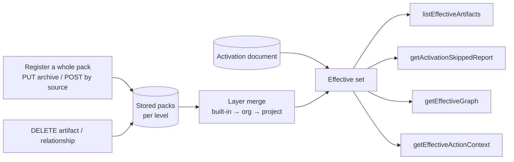

# Mission Specification: Layer merge, pack registration and effective reads

**Mission**: `layer-merge-and-effective-reads-01M6R0J6`
**Created**: 2026-11-06
**Status**: Draft
**Input**: ADR-0055 steps 3–4; issues #10, #11, #103, #357, #374. Operator rulings of 2026-11-06 (pack registration is a
full replacement; `enhances` is read only when active, from either end) and the six decisions recorded in this
mission's discovery.

## Context

The activation register (#398, #399) stores what a project activated and composes only the packs that activation
reaches. Core still cannot ask the service what is in force: the packs are listed unmerged, a pack can only be
edited one artifact at a time, nothing can be removed, and the four effective reads answer `501`.

This mission builds the rest of ADR-0055 steps 3–4:

- **Pack registration:** a whole pack can be registered, and doing so replaces the known version of that pack
  entirely, removals included. Per-artifact writes stay as helpers, and removal is by `DELETE`.
- **Layer merge:** packs at the three levels (built-in, org, project) merge in merge order, and the level that applies
  wins, as ADR-0048, ADR-0053 and ADR-0059 D3 already decide.
- **Effective reads:** `listEffectiveArtifacts`, `getActivationSkippedReport`, `getEffectiveGraph` and
  `getEffectiveActionContext` answer what is in force for an activation, and why anything else is not.

Vocabulary follows ADR-0048 d7: a pack has a **level**, levels merge in **merge order** (built-in, then org, then
project), and the winner is **the level that applies**. "Higher" and "lower" are not used for levels.

## User Scenarios & Testing *(mandatory)*

The primary actor is **core** (or an operator's client acting for a project). Every scenario runs against fixture
packs authored per rule (ADR-0055 D3), not against core's Python answers.

### User Story 1 - Register a whole pack, replacing what was known (Priority: P1)

Core registers a pack it authored as one unit, and the service then holds exactly that pack.

**Why this priority**: every other story reads packs; without whole-pack registration a removal can never reach the
service.

**Independent Test**: register a pack, register a new version without one of its artifacts, and read the pack back.

**Acceptance Scenarios**:

1. **Given** no pack `p` is known, **When** core sends `PUT /packs/p` with an archive of the pack directory, **Then**
   the service answers `201`, and every artifact, edge and preset of the archive is readable.
2. **Given** `p` 1.0.0 holds directives `A` and `B`, **When** core sends `PUT /packs/p` with 1.1.0 holding only `A`,
   **Then** the service answers `200`, `B` is no longer readable, and no edge from `B` remains.
3. **Given** `p` 1.0.0 is stored, **When** core sends 1.0.0 again with different content, **Then** the service answers
   `409` and the stored pack is unchanged.
4. **Given** `p` 1.0.0 is stored, **When** core sends the identical 1.0.0 archive, **Then** the service answers `200`
   and nothing changes.
5. **Given** an archive with a file the pack model does not know, a path that leaves the pack, or an invalid
   artifact, **When** core sends it, **Then** the service answers `422` with the violations, and nothing is stored.
6. **Given** a stale `If-Match` for `p`, **When** core sends `PUT /packs/p`, **Then** the service answers `412`.
7. **Given** a source the service can fetch, **When** core sends `POST /packs` naming it, **Then** the service fetches
   the pack, applies the same validation and full replacement, and answers `201` or `200` with the pack's location.

---

### User Story 2 - Remove one artifact or relationship from a pack (Priority: P1)

Core removes an artifact or an edge it no longer wants, without re-sending the whole pack.

**Why this priority**: the operator ruled that removal is by `DELETE` unless a whole pack is registered.

**Independent Test**: delete an artifact and read the pack, then try to delete one another pack still references.

**Acceptance Scenarios**:

1. **Given** `p` holds tactic `T` with an outgoing edge and a preset item naming `T`, **When** core sends
   `DELETE /packs/p/artifacts/tactic/T`, **Then** the service answers `204`, and `T`, its outgoing edges and that
   preset item are gone from `p`.
2. **Given** another pack `q` references `p::tactic:T`, **When** core deletes `T` from `p`, **Then** the service answers
   `409` naming the referencing pack, and nothing changes.
3. **Given** an edge `D requires T` in `p`, **When** core deletes that relationship, **Then** the service answers `204`
   and the edge is gone; the artifacts remain.
4. **Given** `T` is not held by `p`, **When** core deletes it, **Then** the service answers `404`.

---

### User Story 3 - Read what is in force for an activation (Priority: P1)

Core asks which artifacts an activation puts in force, after the layer merge.

**Why this priority**: this is the read core switches over to (#103).

**Independent Test**: one activation over built-in, org and project fixture packs; list its effective artifacts.

**Acceptance Scenarios**:

1. **Given** directive `D` exists at built-in and at project level, and the activation selects `D`, **When** core
   lists the effective artifacts, **Then** `D` appears once, with the project version's content and provenance
   (`packId`, `level: project`), and no field of the built-in version is inherited.
2. **Given** a governing preset in the closure lists `D` as must-have and the activation deactivates `D`, **When** core
   lists, **Then** `D` is in force with reason `required`, and the deny entry is reported as not applied.
3. **Given** the activation selects `X`, which no pack in the closure holds any longer, **When** core lists, **Then**
   `X` is absent and the skipped report lists it as stale.
4. **Given** `activatedKinds` omits `tactic`, **When** core lists, **Then** no tactic is in force except one the floor
   requires.
5. **Given** active `E enhances T` and `T` in force, **When** core lists, **Then** both are in force; **given** `E` is
   not active, **Then** `E` is absent (no pull).
6. **Given** active `E overrides T`, **When** core lists, **Then** `T` is absent with reason `overridden` in the skipped
   report.
7. **Given** a matching `If-None-Match`, **When** core lists again, **Then** the service answers `304`.

---

### User Story 4 - See why something is not in force (Priority: P2)

Core reads the skipped report of an activation.

**Independent Test**: an activation with stale ids, an unapplied deny entry, a kind not activated and an overridden
artifact; read its skipped report.

**Acceptance Scenarios**:

1. **Given** each case above, **When** core reads the skipped report, **Then** each artifact appears once, in the
   bucket that explains it, and the report carries the activation's revision.
2. **Given** an activation id that does not exist, **When** core reads it, **Then** the service answers
   `404 activation_not_found`.

---

### User Story 5 - Read the effective graph and an action's context (Priority: P2)

Core reads the edges among the artifacts in force, and the context one mission step receives.

**Independent Test**: the fixture from Story 3; read the graph and the context of one action.

**Acceptance Scenarios**:

1. **Given** an edge whose endpoint is not in force, **When** core reads the effective graph, **Then** the edge is
   absent.
2. **Given** a layer override of `D`, **When** core reads the graph, **Then** edges ending at `D` resolve to the
   winning version, edges starting at the overridden version are gone, and the graph lists the override (which
   artifact, which level won, which lost).
3. **Given** an active `E enhances T`, **When** core reads the graph from `T`'s side, **Then** the edge is present and
   `T` is enhanced by `E`.
4. **Given** a mission type the activation puts in force and one of its actions, **When** core reads the effective
   action context, **Then** it holds the artifacts in force that the action's step contract names, with enhancements
   that are active.
5. **Given** a mission type the activation does not put in force, **When** core reads an action's context, **Then** the
   context is empty and the skipped report says why; an unknown action is `404 action_not_found`.

---

### User Story 6 - Settle a sibling conflict (Priority: P3)

A distribution pack settles two packs at one level that define the same artifact.

**Acceptance Scenarios**:

1. **Given** packs `a` and `b` at org level both define `D`, and distribution pack `x` declares
   `overrides: [{artifact: D, member: b}]`, **When** core lists effective artifacts, **Then** `b`'s `D` is in force
   (#357) and no `pack_sibling_conflict` is raised.
2. **Given** the same conflict without the descriptor entry, **When** core reads, **Then** the read refuses with
   `500 pack_unreadable` naming `pack_sibling_conflict`, as today.

### Edge Cases

- A layer override the owner's mutability level does not allow (`locked`, or `extendable` replaced): the compose
  refuses as ADR-0063 D3 says; the read answers `500 pack_unreadable` with the policy violation.
- A whole-pack upload that removes an artifact a stored activation selects: the read lists the id as stale; the next
  activation write drops it (#399, R5).
- A whole-pack upload that changes `pack_level`: refused `422`; a pack's level is fixed for its id.
- Deleting the only member of a preset key: the key becomes empty, which the preset reads as not listed.
- A cycle of `overrides` relations (`E overrides T`, `T overrides E`), both active: refused at compose with
  `pack_unreadable`, never an arbitrary pick.
- A concurrent whole-pack upload and a read: the read sees the old or the new pack, never a mix.

## Requirements *(mandatory)*

### Functional Requirements

| ID | Title | User Story | Priority | Status | Delivery | No-op passable? |
|----|-------|------------|----------|--------|----------|-----------------|
| FR-001 | Whole-pack registration by archive | As core, I want `PUT /packs/{packId}` with an archive of the authored pack directory to create (`201`) or fully replace (`200`) the pack, removals included, validated as the whole-pack loader reads a pack, so the service holds exactly what I authored. | High | Open | [build] | no |
| FR-002 | Version rule on replace | As core, I want any `pack_version` to replace the known one, an identical re-send to be a `200` no-op, and the same version with different content refused `409`, so a version always means one content. | High | Open | [build] | no |
| FR-003 | Conditional and validated upload | As core, I want `If-Match` on the pack's revision honoured (`412` when stale), and an archive with an unknown file, a path leaving the pack, an invalid artifact or a changed `pack_level` refused `422` with violations, storing nothing. | High | Open | [build] | no |
| FR-004 | Registration by source | As core, I want `POST /packs` naming a fetchable source (ADR-0005, #374) to fetch the pack and apply FR-001..FR-003, answering with the pack's location. | Medium | Open | [build] | no |
| FR-005 | Delete an artifact | As core, I want `DELETE /packs/{packId}/artifacts/{kind}/{artifactId}` to remove the artifact, its outgoing edges and its preset items in that pack (`204`), `404` when not held, and `409` naming the referencing pack when another pack references it. | High | Open | [build] | no |
| FR-006 | Delete a relationship | As core, I want a `DELETE` of one relationship of a pack to remove that edge only (`204`), and `404` when the pack holds no such edge. | Medium | Open | [build] | no |
| FR-007 | Atomic replace | As core, I want a whole-pack replace and a delete to be all-or-nothing: a concurrent read sees the old or the new pack, never a mix, and a failed write leaves the old pack. | High | Open | [build] | no |
| FR-008 | Registration ADR | As the operator, I want a new ADR recording that registration fully replaces, per-artifact writes are helpers and removal is by `DELETE` (superseding ADR-0026 D2), distinct from ADR-0030's derived-pack removal. | High | Open | [build] | no |
| FR-009 | Layer merge | As core, I want the closure of an activation merged across levels in merge order (built-in, then org, then project), the level that applies winning, its artifact replacing the other whole with no field inherited (ADR-0059 D3). | High | Open | [build] | no |
| FR-010 | Edges under a layer override | As core, I want edges starting at an overridden artifact dropped and edges ending at it resolved to the winner. | High | Open | [build] | no |
| FR-011 | Override allowed by mutability | As core, I want a layer override the owner's mutability level forbids to refuse the compose (ADR-0063 D3), surfacing as `500 pack_unreadable` with the violation. | High | Open | [build] | no |
| FR-012 | Sibling conflict settled | As core, I want a descriptor `overrides` entry to put the named member's artifact in force (#357), and an unsettled sibling conflict to keep refusing. | Medium | Open | [build] | no |
| FR-013 | Effective artifacts | As core, I want `listEffectiveArtifacts` to answer the artifacts in force: `selected` within `activatedKinds`, the language filter and the closure, plus the required floor, minus `deactivated` (never the floor), each with `packId` and `level` provenance and its reason, paged, with `summary`. | High | Open | [build] | no |
| FR-014 | Required floor scope | As core, I want the floor to be the must-have items of every governing preset in the closure (ratifying DIV-205), never stored. | High | Open | [ratchet] | no |
| FR-015 | Enhancements at read | As core, I want an enhancement returned only when it is itself active, and `T is enhanced by E` to hold, so resolving `T` returns an active `E`; nothing is pulled in. | High | Open | [build] | no |
| FR-016 | CRG overrides at read | As core, I want an active `E overrides T` to leave `T` out with reason `overridden`, and a cycle of active overrides to refuse the compose. | Medium | Open | [build] | no |
| FR-017 | Skipped report | As core, I want `getActivationSkippedReport` to list each artifact not in force once, in a typed bucket: stale id, deny entry not applied (floor), kind not activated, language filtered, overridden, and mission type not in force. | High | Open | [build] | no |
| FR-018 | Effective graph | As core, I want `getEffectiveGraph` to answer the edges among artifacts in force (an edge is dropped with either endpoint), resolved through layer overrides, with a list of the layer overrides applied (artifact, winning level, losing level). | High | Open | [build] | no |
| FR-019 | Effective action context | As core, I want `getEffectiveActionContext` to answer the in-force artifacts an action's step contract names, with active enhancements; an empty context with a skipped-report reason for a mission type not in force; `404 mission_type_not_found` / `action_not_found` otherwise. | High | Open | [build] | no |
| FR-020 | Conditional reads | As core, I want every effective read to carry `ETag` covering the activation revision and the pack fingerprint and to answer `304` on a matching `If-None-Match` (ADR-0059 D5). | High | Open | [build] | no |
| FR-021 | Read refusals | As core, I want `404 activation_not_found` for an unknown activation and `500 pack_unreadable` for a closure that cannot compose, on all four reads. | High | Open | [build] | no |
| FR-022 | Reasons cleaned | As core, I want the moot `kind_default` reason removed from `EffectiveArtifactReason` (ADR-0053 d10 made it unreachable) and the new reasons (`overridden`, provenance) declared. | Medium | Open | [build] | no |
| FR-023 | Offering stays a catalog | As core, I want `GET /offering` and its reads unchanged: they list every configured pack unmerged. | Medium | Open | [ratchet] | no |

### Non-Functional Requirements

| ID | Title | Requirement | Category | Priority | Status |
|----|-------|-------------|----------|----------|--------|
| NFR-001 | Complexity limits | Every new or changed method stays within cyclomatic complexity ≤ 15, NPath ≤ 1000, ≤ 60 lines and nested-if depth ≤ 1; the suppression register does not grow. | Maintainability | High | Open |
| NFR-002 | Scenario coverage | Each operation built or unreserved here has at least one behavioural `@contract` scenario that fails before and passes after; a `@reserved` pin does not count (ADR-0059 D1). | Quality | High | Open |
| NFR-003 | Read latency | An effective read over a closure of 10 packs and 2,000 artifacts answers in under 300 ms CPU at p95 over 50 runs (report-only timing budget, like the activation budgets). | Performance | Medium | Open |
| NFR-004 | Upload bound | A whole-pack archive over 32 MiB, or with more than 10,000 entries, is refused `413` / `422` before any file is written. | Security | High | Open |
| NFR-005 | Archive safety | No archive entry may write outside the pack directory (no absolute paths, `..`, links or devices); 100% of a corpus of crafted archives is refused. | Security | High | Open |
| NFR-006 | Atomicity under concurrency | With 8 concurrent uploads of one pack and readers in parallel, every read in 100 runs sees exactly one complete version. | Reliability | High | Open |
| NFR-007 | One verified read | Each effective read composes the closure once from one verified read of the packs (as `ClosureQueries` does today). | Performance | High | Open |

### Constraints

| ID | Title | Constraint | Category | Priority | Status |
|----|-------|------------|----------|----------|--------|
| C-001 | Contract first | Every shape comes from `contracts/charter/openapi.yaml`; each contract change lands with a contract-changelog fragment before the code that serves it. | Technical | High | Open |
| C-002 | Hexagonal slices, no shadow logic | Merging and composition live in `packs`; `activations` asks `packs` through its port and never re-implements a walk or a merge; `HexagonalArchitectureTest` covers any new code. | Technical | High | Open |
| C-003 | No core changes | Nothing in spec-kitty core changes in this mission. | Business | High | Open |
| C-004 | Design is the oracle | Acceptance is against fixture packs authored per rule from the ADRs (ADR-0055 D3), not against core's Python answers. | Technical | High | Open |
| C-005 | Stacked delivery | The mission ships as three stacked PRs on top of #399: A (the ADR, whole-pack `PUT`/`POST`, `DELETE`s), B (layer merge, `listEffectiveArtifacts`, skipped report), C (effective graph, action context). | Technical | Medium | Open |
| C-006 | No disabled tests, no new suppressions | No test is disabled or quarantined to get green, and no static-analysis suppression is added. | Quality | High | Open |
| C-007 | Divergences recorded | Each behaviour that differs from core (the layer override replacing whole, the CRG `overrides` read, the typed skipped report) gets a divergence-register entry. | Technical | Medium | Open |

### Key Entities

- **Pack registration**: one whole pack as uploaded (archive or fetched source) with its `pack_id`, `pack_version`,
  `pack_level` and content digest; it replaces the stored pack of that id atomically.
- **Merged closure**: the activation's closure after the layer merge; per artifact id, the winning artifact, its
  `packId` and `level`, and the layer overrides applied.
- **Effective artifact**: an artifact in force, with its reason (`selected`, `required`, …) and provenance.
- **Skipped report**: every artifact not in force, each in one typed bucket with its reason.
- **Layer override record**: artifact id, winning level and pack, losing level and pack.

## Assumptions

- The archive format is a gzip-compressed tar or a zip of the pack directory as authored (the plan picks one and
  states it); `POST /packs` by source supports the source kinds ADR-0005 names, starting with the ones the service can
  already fetch.
- The pack revision used for `If-Match` is the content digest of the stored pack.
- `pack_level` of a stored pack cannot change by upload; moving a pack to another level means deleting and
  re-registering it under configuration.
- Language filtering follows the activation's `languages` as the contract already describes.

## Success Criteria *(mandatory)*

### Measurable Outcomes

- **SC-001**: All four effective reads and the new registration and `DELETE` operations answer per contract; no
  activation or pack operation answers `501`. — [build] · no-op passable: no
- **SC-002**: Every acceptance scenario of User Stories 1–6 is traced to a passing `@contract` scenario over fixture
  packs. — [build] · no-op passable: no
- **SC-003**: Re-registering a pack without one of its artifacts makes that artifact unreadable in 100% of the
  registration scenarios. — [build] · no-op passable: no
- **SC-004**: The offering and composition scenarios that pass today still pass unchanged. — [ratchet] · no-op
  passable: yes
