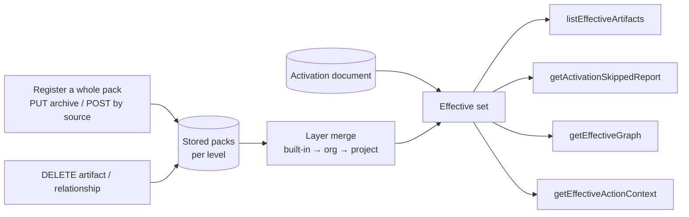

# Mission Specification: Layer merge, pack registration and effective reads

**Mission**: `layer-merge-and-effective-reads-01M6R0J6`
**Created**: 2026-11-06
**Status**: Draft
**Input**: ADR-0055 steps 3–4; issues #10, #11, #103, #357, #374. Operator rulings of 2026-11-06 (pack registration is a
full replacement; `enhances` is read only when active, from either end) and the six decisions recorded in this
mission's discovery. Operator rulings of 2026-11-07 on #408, #405 and #410 (see `research/rulings-2026-11-07.md`).

## Context

The activation register (#398, #399) stores what a project activated and composes only the packs that activation
reaches. Core still cannot ask the service what is in force: the packs are listed unmerged, a pack can only be
edited one artifact at a time, nothing can be removed, and the four effective reads answer `501`.

This mission builds the rest of ADR-0055 steps 3–4:

- **Pack registration:** a whole pack can be registered, and doing so replaces the known version of that pack
  entirely, removals included. Per-artifact writes stay as helpers, and removal is by `DELETE`.
- **Layer merge:** packs at the three levels (built-in, org, project) merge in merge order, and the level that applies
  wins, as ADR-0048, ADR-0053 and ADR-0059 D3 already decide.
- **Effective reads:** `listEffectiveArtifacts`, `getActivationSkippedReport`, `getEffectiveGraph` and
  `getEffectiveActionContext` answer what is in force for an activation, and why anything else is not.

Vocabulary follows ADR-0048 d7: a pack has a **level**, levels merge in **merge order** (built-in, then org, then
project), and the winner is **the level that applies**. "Higher" and "lower" are not used for levels.

## User Scenarios & Testing *(mandatory)*

The primary actor is **core** (or an operator's client acting for a project). Every scenario runs against fixture
packs authored per rule (ADR-0055 D3), not against core's Python answers.

### User Story 1 - Register a whole pack, replacing what was known (Priority: P1)

Core registers a pack it authored as one unit, and the service then holds exactly that pack.

**Why this priority**: every other story reads packs; without whole-pack registration a removal can never reach the
service.

**Independent Test**: register a pack, register a new version without one of its artifacts, and read the pack back.

**Acceptance Scenarios**:

1. **Given** no pack `p` is known, **When** core sends `PUT /packs/p` with an archive of the pack directory, **Then**
   the service answers `202` with a status URI; polling it ends `succeeded` with outcome `created`, and every
   artifact, edge and preset of the archive is then readable (A5: registration is asynchronous by design).
2. **Given** `p` 1.0.0 holds directives `A` and `B`, **When** core sends `PUT /packs/p` with 1.1.0 holding only `A`,
   **Then** the registration ends `succeeded` (`replaced`), `B` is no longer readable, and no edge from `B` remains.
3. **Given** `p` 1.0.0 was ever stored (the version→digest history, B1), **When** core sends 1.0.0 again with
   different content, **Then** the registration ends `refused` with `409 pack_version_conflict` and the stored pack
   is unchanged.
4. **Given** `p` 1.0.0 is stored, **When** core sends the identical 1.0.0 archive, **Then** the registration ends `succeeded`
   with outcome `unchanged` and nothing changes.
5. **Given** an archive with a file the pack model does not know, a path that leaves the pack, or an invalid
   artifact, **When** core sends it, **Then** the registration ends `refused` with
   `422` and the violations, and nothing is stored.
6. **Given** a stale `If-Match` for `p`, **When** core sends `PUT /packs/p`, **Then** the service answers `412`
   synchronously, before accepting; a revision that moves after acceptance ends the registration `refused` with
   `412`.
7. **Given** a source the service can fetch, **When** core sends `POST /packs` naming it, **Then** the service answers
   `202` with a status URI, fetches the pack, applies the same validation and full replacement, and the status names
   the pack's location when it ends `succeeded`.
8. **Given** a pack `q` that registers `directive:x`, which a built-in pack locks, **When** core registers `q`, **Then**
   the registration ends `refused` with the impact violation naming both packs, instead of every activation that
   composes both answering `500` later (A5).
9. **Given** a registration that adds a must-have item or a lock, **When** it succeeds, **Then** its status lists the
   floor and lock changes and the activations whose in-force set changes (B4).

---

### User Story 2 - Remove one artifact or relationship from a pack (Priority: P1)

Core removes an artifact or an edge it no longer wants, without re-sending the whole pack.

**Why this priority**: the operator ruled that removal is by `DELETE` unless a whole pack is registered.

**Independent Test**: delete an artifact and read the pack, then try to delete one another pack still references.

**Acceptance Scenarios**:

1. **Given** `p` holds tactic `T` with an outgoing edge and a preset item naming `T`, **When** core sends
   `DELETE /packs/p/artifacts/tactic/T`, **Then** the service answers `204`, and `T`, its outgoing edges and that
   preset item are gone from `p`.
2. **Given** another pack `q` references `p::tactic:T`, **When** core deletes `T` from `p`, **Then** the service answers
   `409` naming the referencing pack, and nothing changes.
3. **Given** an edge `D requires T` in `p`, **When** core deletes that relationship, **Then** the service answers `204`
   and the edge is gone; the artifacts remain.
4. **Given** `T` is not held by `p`, **When** core deletes it, **Then** the service answers `404`.

---

### User Story 3 - Read what is in force for an activation (Priority: P1)

Core asks which artifacts an activation puts in force, after the layer merge.

**Why this priority**: this is the read core switches over to (#103).

**Independent Test**: one activation over built-in, org and project fixture packs; list its effective artifacts.

**Acceptance Scenarios**:

1. **Given** directive `D` exists at built-in and at project level, and the activation selects `D`, **When** core
   lists the effective artifacts, **Then** `D` appears once, with the project version's content and provenance
   (`packId`, `level: project`), and no field of the built-in version is inherited.
2. **Given** a governing preset in the closure lists `D` as must-have and the activation deactivates `D`, **When** core
   lists, **Then** `D` is in force with reason `required`, and the deny entry is reported as not applied.
3. **Given** the activation selects `X`, which no pack in the closure holds any longer, **When** core lists, **Then**
   `X` is absent and the skipped report lists it as stale.
4. **Given** a mission type `M` selected and one of its steps' mission type denied, **When** core lists, **Then** `M`'s
   steps are in force only while `M` is, and `activatedKinds` no longer exists (FR-040, FR-041).
5. **Given** active `E enhances T` and `T` in force, **When** core lists, **Then** both are in force; **given** `E` is
   not active, **Then** `E` is absent (no pull).
6. **Given** active `E overrides T`, **When** core lists, **Then** `T` is absent with reason `overridden` in the skipped
   report.
7. **Given** a matching `If-None-Match`, **When** core lists again, **Then** the service answers `304`.

---

### User Story 4 - See why something is not in force (Priority: P2)

Core reads the skipped report of an activation.

**Independent Test**: an activation with stale ids, an unapplied deny entry, a kind not activated and an overridden
artifact; read its skipped report.

**Acceptance Scenarios**:

1. **Given** each case above, **When** core reads the skipped report, **Then** each artifact appears once, in the
   bucket that explains it, and the report carries the activation's revision.
2. **Given** an activation id that does not exist, **When** core reads it, **Then** the service answers
   `404 activation_not_found`.

---

### User Story 5 - Read the effective graph and an action's context (Priority: P2)

Core reads the edges among the artifacts in force, and the context one mission step receives.

**Independent Test**: the fixture from Story 3; read the graph and the context of one action.

**Acceptance Scenarios**:

1. **Given** an edge whose endpoint is not in force, **When** core reads the effective graph, **Then** the edge is
   absent.
2. **Given** a layer override of `D`, **When** core reads the graph, **Then** edges ending at `D` resolve to the
   winning version, edges starting at the overridden version are gone, and the graph lists the override (which
   artifact, which level won, which lost).
3. **Given** an active `E enhances T`, **When** core reads the graph from `T`'s side, **Then** the edge is present and
   `T` is enhanced by `E`.
4. **Given** a mission type the activation puts in force and one of its actions, **When** core reads the effective
   action context, **Then** it holds the artifacts in force that the action's step contract names, with enhancements
   that are active.
5. **Given** a mission type the activation does not put in force, **When** core reads an action's context, **Then** the
   context is empty and the skipped report says why; an unknown action is `404 action_not_found`.

---

### User Story 6 - Settle a sibling conflict (Priority: P3)

A distribution pack settles two packs at one level that define the same artifact.

**Acceptance Scenarios**:

1. **Given** packs `a` and `b` at org level both define `D`, and distribution pack `x` declares
   `overrides: [{artifact: D, member: b}]`, **When** core lists effective artifacts, **Then** `b`'s `D` is in force
   (#357) and no `pack_sibling_conflict` is raised.
2. **Given** the same conflict without the descriptor entry, **When** core reads, **Then** the read refuses with
   `500 pack_unreadable` naming `pack_sibling_conflict`, as today.

### Edge Cases

- A layer override the owner's mutability level does not allow (`locked`, or `extendable` replaced): the compose
  refuses as ADR-0063 D3 says; the read answers `500 pack_unreadable` with the policy violation.
- A whole-pack upload that removes an artifact a stored activation selects: the read lists the id as stale; the next
  activation write drops it (#399, R5).
- A whole-pack upload that changes `pack_level`: refused `422`; a pack's level is fixed for its id.
- Deleting the only member of a preset key: the key becomes empty, which the preset reads as not listed.
- A cycle of `overrides` relations (`E overrides T`, `T overrides E`), both active: refused at compose with
  `pack_unreadable`, never an arbitrary pick.
- A concurrent whole-pack upload and a read: the read sees the old or the new pack, never a mix.
- An `enhances` cycle, an artifact that both enhances and overrides one target, an `overrides` edge that resolves to
  its own source, or an `overrides` edge onto a target that is not `open`: refused at registration with `422` (A6,
  A8, A11, A12).
- A chain `F overrides E overrides T`, all selected: `F` is in force; `E` and `T` are hidden, and a requirement on `T`
  is satisfied by `F` (A3).
- An org preset and a project preset with the same id: the requirement is the union of the must-have items of every
  governing copy (A1). A must-have item no pack holds is dropped from the floor and reported (A10).
- A GET then PUT of an activation after packs changed: the replace drops ids the packs no longer hold and judges the
  floor only on deny entries it adds (A4).
- A registration queue that is full: `503` with `Retry-After`; nothing is accepted.

## Requirements *(mandatory)*

### Functional Requirements

| ID | Title | User Story | Priority | Status | Delivery | No-op passable? |
|----|-------|------------|----------|--------|----------|-----------------|
| FR-001 | Whole-pack registration by archive | As core, I want `PUT /packs/{packId}` with an archive of the authored pack directory to be accepted (`202`, A5) and then create or fully replace the pack, removals included, validated as the whole-pack loader reads a pack, so the service holds exactly what I authored. | High | Open | [build] | no |
| FR-002 | Version rule on replace | As core, I want any `pack_version` to replace the known one, an identical re-send to be a `200` no-op, and the same version with different content refused `409`, so a version always means one content. | High | Open | [build] | no |
| FR-003 | Conditional and validated upload | As core, I want `If-Match` on the pack's revision honoured (`412` when stale), and an archive with an unknown file, a path leaving the pack, an invalid artifact or a changed `pack_level` refused `422` with violations, storing nothing. | High | Open | [build] | no |
| FR-004 | Registration by source | As core, I want `POST /packs` naming a fetchable source (ADR-0005, #374) naming its target `packId` (and optionally a `sha256` or a git commit) to be accepted (`202`), fetch the pack and apply FR-001..FR-003, its status naming the pack's location. | Medium | Open | [build] | no |
| FR-005 | Delete an artifact | As core, I want `DELETE /packs/{packId}/artifacts/{kind}/{artifactId}` to remove the artifact, its outgoing edges and its preset items in that pack (`204`), `404` when not held, and `409` naming the referencing pack when another pack references it. | High | Open | [build] | no |
| FR-006 | Delete a relationship | As core, I want a `DELETE` of one relationship of a pack to remove that edge only (`204`), and `404` when the pack holds no such edge. | Medium | Open | [build] | no |
| FR-007 | Atomic replace | As core, I want a whole-pack replace and a delete to be all-or-nothing: a concurrent read sees the old or the new pack, never a mix, and a failed write leaves the old pack. | High | Open | [build] | no |
| FR-008 | Registration ADR | As the operator, I want a new ADR recording that registration fully replaces, per-artifact writes are helpers and removal is by `DELETE` (superseding ADR-0026 D2), distinct from ADR-0030's derived-pack removal. | High | Open | [build] | no |
| FR-009 | Layer merge | As core, I want the closure of an activation merged across levels in merge order (built-in, then org, then project), the level that applies winning, its artifact replacing the other whole with no field inherited (ADR-0059 D3). | High | Open | [build] | no |
| FR-010 | Edges under a layer override | As core, I want edges starting at an overridden artifact dropped and edges ending at it resolved to the winner. | High | Open | [build] | no |
| FR-011 | Override allowed by mutability | As core, I want a layer override the owner's mutability level forbids to refuse the compose (ADR-0063 D3), surfacing as `500 pack_unreadable` with the violation. | High | Open | [build] | no |
| FR-012 | Sibling conflict settled | As core, I want a descriptor `overrides` entry to put the named member's artifact in force (#357), and an unsettled sibling conflict to keep refusing. | Medium | Open | [build] | no |
| FR-013 | Effective artifacts | As core, I want `listEffectiveArtifacts` to answer the artifacts in force: `selected` (every kind, FR-040) within, the language filter and the closure, plus the required floor, minus `deactivated` (never the floor), each with `packId` and `level` provenance and its reason, paged, with `summary`. The language filter applies here, at read only: the activation document stays language-neutral, and a read with no activation applies no filtering. An artifact reached only through `suggests` is listed as a suggestion carrying the edge's `when` and `reason` (#408 rulings 2–3, 2026-11-07). | High | Open | [build] | no |
| FR-014 | Required floor scope | As core, I want the floor to be the must-have items of every governing preset in the closure (ratifying DIV-205), never stored. | High | Open | [ratchet] | no |
| FR-015 | Enhancements at read | As core, I want an enhancement returned only when it is itself active, and `T is enhanced by E` to hold, so resolving `T` returns an active `E`; nothing is pulled in. | High | Open | [build] | no |
| FR-016 | CRG overrides at read | As core, I want an active `E overrides T` to leave `T` out with reason `overridden`, and a cycle of active overrides to refuse the compose. | Medium | Open | [build] | no |
| FR-017 | Skipped report | As core, I want `getActivationSkippedReport` to list each artifact not in force once, in a typed bucket: stale id, deny entry not applied (floor), language filtered, overridden, mission type not in force, enhanced target not in force, override not applied, pin not held, required not held, and required not in force. The language-filtered bucket lists what the read-time language filter left out (#408 ruling 2). | High | Open | [build] | no |
| FR-018 | Effective graph | As core, I want `getEffectiveGraph` to answer the edges among artifacts in force (an edge is dropped with either endpoint), resolved through layer overrides, with a list of the layer overrides applied (artifact, winning level, losing level). | High | Open | [build] | no |
| FR-019 | Effective action context | As core, I want `getEffectiveActionContext` to answer the in-force artifacts an action's step contract names, with active enhancements; an empty context with a skipped-report reason for a mission type not in force; `404 mission_type_not_found` / `action_not_found` otherwise. An artifact the action reaches only through `suggests` is listed as conditional, with the edge's `when` and `reason`, so the agent decides when it applies; artifacts reached through `requires` and the other hard relations stay plain entries (#408 ruling 3). | High | Open | [build] | no |
| FR-020 | Conditional reads | As core, I want every effective read to carry `ETag` covering the activation revision and the pack fingerprint and to answer `304` on a matching `If-None-Match` (ADR-0059 D5). | High | Open | [build] | no |
| FR-021 | Read refusals | As core, I want `404 activation_not_found` for an unknown activation and `500 pack_unreadable` for a closure that cannot compose, on all four reads. | High | Open | [build] | no |
| FR-022 | Reasons cleaned | As core, I want the moot `kind_default` reason removed from `EffectiveArtifactReason` (ADR-0053 d10 made it unreachable) and the new reasons (`overridden`, provenance) declared. | Medium | Open | [build] | no |
| FR-023 | Offering stays a catalog | As core, I want `GET /offering` and its reads unchanged: they list every configured pack unmerged. | Medium | Open | [ratchet] | no |
| FR-024 | Asynchronous registration | As core, I want `PUT /packs/{packId}` and `POST /packs` to accept a registration with `202` and a status URI after the synchronous checks (size, media type, `If-Match`, access), and `GET` on that URI to answer `pending`, `running`, `succeeded` (with the `PackRegistration`) or `refused` (with the `Problem`), so a slow fetch or impact check never holds my connection (IC-14; PR A; DM-01M6RA8225EXG6GAT1MM2R9T6C). | High | Open | [build] | no |
| FR-025 | Registration impact check | As core, I want a registration refused (`422`, naming the packs) when any closure the pack joins would fail to compose, break a lock or mutability rule, hold an `enhances` cycle, an artifact that both enhances and overrides one target, an `overrides` edge onto itself or onto a target that is not `open`, so no activation turns into a `500` after the fact (IC-15; PR A; DM-01M6RA8225EXG6GAT1MM2R9T6C, DM-01M6RA86QPBM1VE5QZTB9AZ195, DM-01M6RA8G0RGRWSFW4DERH8W319, DM-01M6RA8S9G57W4BW55SNVHBQ10). | High | Open | [build] | no |
| FR-026 | Version history and pins | As core, I want every `(pack_version, revision)` a pack ever held remembered, so a version is never reused with other content, and a pin no pack holds dropped by a write (reported in `dropped`) and reported by a read (`pinNotHeld`), never a `422` that blocks every write (IC-16, IC-19; PR A; DM-01M6RA9BKJY7X9BFV93QW1KM1T). | High | Open | [build] | no |
| FR-027 | Floor and lock notices | As core, I want a successful registration's status to list the must-have items and locks it added or removed and the activations whose in-force set changes, and `GET /activations/{id}` to list its deny entries that are not applied, so no change of force is silent (IC-15, IC-17; PR A and B; DM-01M6RA9SAKCBSKGX165JM3CAGS). | Medium | Open | [build] | no |
| FR-028 | Requirement union, held ids only | As core, I want the requirement of a preset id to be the union of the must-have items of every governing copy across levels, and a must-have item no pack holds dropped from the floor and reported, so a requirement only tightens and never names an unheld id (IC-09, IC-19; PR B, slice A0; DM-01M6RA7FHRC5K8QPX7KN5FZ4S8, DM-01M6RA8MG55V8C2V9PXWDTRNQS). | High | Open | [build] | no |
| FR-029 | Transitive overrides, floor to a fixed point | As core, I want overrides to compose top to bottom (`F` over `E` over `T` leaves `F`, which satisfies a requirement on `T`), and the requirement judged on the final set by iterating to a fixed point, so a required artifact is in force or satisfied in every answer (IC-09; PR B; DM-01M6RA7RPNZS810FTFC98Z13GH, DM-01M6RA7M56M1409EV9JX1EW83K). | High | Open | [build] | no |
| FR-030 | Enhancers grounded | As core, I want an enhancer in force only when its support reaches a non-enhancer in force (least fixed point), so no ring of enhancers holds itself up (IC-09; PR B; DM-01M6RA8G0RGRWSFW4DERH8W319, DM-01M6R4W3ZMSESETMQ0ZQTCZCFJ). | High | Open | [build] | no |
| FR-031 | Replace round trip | As core, I want `PUT /activations/{id}` to judge the floor only on the deny entries it adds and to drop ids the packs no longer hold (reported in `dropped`), so a GET then PUT of the same body never fails without a pack change (IC-19; slice A0; DM-01M6RA7XC5HC8915GZT2R3H83W). | High | Open | [build] | no |
| FR-032 | Write warnings | As core, I want `ActivationChange.warnings` to name each artifact a write applied that the read will not put in force (`enhanced_target_not_in_force`, `overridden`), so a write predicts the read (IC-17; PR B; DM-01M6RAA2B2G9PNXN2F9SJ7B1CR). | Medium | Open | [build] | no |
| FR-033 | Lock scope and own policy | As core, I want a pack's policy to lock and enforce only artifacts of the pack and of the packs it builds on (`depends_on` and lineage), and never to bind the pack itself, so an enterprise pack can enforce over the packs it builds on without reaching unrelated packs (IC-19; slice A0; DM-01M6RA97220XBR7RR447FE2JXD, DM-01M6RAA6Y7NVVGKVKQV05GZYES). | High | Open | [build] | no |
| FR-034 | `includeDeactivated` clears what it reaches | As core, I want a select with `includeDeactivated` to clear deny entries only on artifacts its walk reaches and selects, not on lineage ancestors it passes through (IC-19; slice A0; DM-01M6RA9XQSH3E07C7VCPCVD6R4). | Medium | Open | [build] | no |
| FR-035 | Sibling settlement | As core, I want `enhances` not to count as a sibling conflict, and a settlement to name exactly one winner (IC-19; slice A0; DM-01M6RA92BS6GGCYTRCFQDYYY5S). | Medium | Open | [build] | no |
| FR-036 | Removal against the new tree | As core, I want the inbound-reference check of a `DELETE` or a replace to judge references against the tree as it will be after the change (referrers the same request removes do not block), to count other packs' preset items as references, and every `409 artifact_referenced` to list the referring artifacts and packs (IC-06; PR A; DM-01M6RA9MQ6YAP048KD43DNFS4F, DM-01M6RA8MG55V8C2V9PXWDTRNQS). | High | Open | [build] | no |
| FR-037 | Registration access and audit | As the operator, I want registration refused without an authenticated principal, off unless `charter.registration.enabled` and the source kind's own flag are on (the git allowlist empty by default), and every attempt written to an audit log (IC-18; PR A; post-plan security squad 7–8). | High | Open | [build] | no |
| FR-038 | Cascade over merged edges | As core, I want the write cascade to walk the merged edges once the merge exists, so it never follows an edge of an overridden artifact (IC-07; PR B; DM-01M6R4W1H9P3451V89KHP97XKM). | Medium | Open | [build] | no |
| FR-039 | Pack read | As core, I want `GET /packs/{packId}` to answer the stored pack's summary (`PackRegistration` shape, with a `self` link), so `Location` and `_links` point at a declared read (IC-02; PR A; post-plan contract squad). | Medium | Open | [build] | no |
| FR-040 | One kind model | As core, I want mission types selected and denied like any kind (`selected.mission_type`, `deactivated.mission_type`, except when required or locked), selecting a mission type to cascade to its steps, and its steps and bound artifacts in force only while it is, so one rule set covers every kind (IC-20; slice A0; DM-01M6RA8BJ0FZV9BHFJ1MV4SVJY, DM-01M6RCXTS0SMDNTWZ8G7GJ2P5S, DM-01M6RCXZ9HSHT4K3443YYZ8ZFC). | High | Open | [build] | no |
| FR-041 | Remnant members refused, storage v2 | As core, I want `activatedKinds` and `missionTypes` on any activation write refused `422` now, a stored v1 document upgraded on read to `schemaVersion: 2` with the same in-force set, one kernel kind registry, and presets free to name any kind (IC-20; slice A0; DM-01M6RCY40CQQTHC130RWF43W0D, DM-01M6RCY8MYNGNPJ247M2Y4880N). | High | Open | [build] | no |
| FR-042 | Client round trip | As core, I want a GET then PUT of an activation through the generated client to leave its revision unchanged, pinned by a test (the client turns an absent list into `[]` today) (IC-19; slice A0; A7 squad side finding). | Medium | Open | [build] | no |
| FR-043 | Cascade depth | As core, I want a cascading select and a cascading deactivate to take an optional `depth`, the number of `suggests` hops the walk may cross (ADR-0018 D4's meaning; the hard relations, `enhances` and the lineage are walked in full), so I can deepen a cascade step by step; absent means unlimited, as today (core parity) (#408 ruling 1; slice A0; DM-01M6TDH0SY5Q224GX709DXWG8K). | Medium | Open | [build] | no |

### Non-Functional Requirements

| ID | Title | Requirement | Category | Priority | Status |
|----|-------|-------------|----------|----------|--------|
| NFR-001 | Complexity limits | Every new or changed method stays within cyclomatic complexity ≤ 15, NPath ≤ 1000, ≤ 60 lines and nested-if depth ≤ 1; the suppression register does not grow. | Maintainability | High | Open |
| NFR-002 | Scenario coverage | Each operation built or unreserved here has at least one behavioural `@contract` scenario that fails before and passes after; a `@reserved` pin does not count (ADR-0059 D1). | Quality | High | Open |
| NFR-003 | Read latency | An effective read over a closure of 10 packs and 2,000 artifacts, measured end to end through the HTTP layer (MockMvc, warm JVM, 10 warm-up runs), answers in under 300 ms wall time at p95 over 50 runs, reported at 1× and 3× (report-only, ADR-0057: runner speed varies about 2×). The build-failing guard is deterministic: a read does one compose, one in-force resolution, and at most 3 × the closure's node count walk visits, cold and warm cache (decision `DM-01M6RN5SG19KXAHH4VGT9QBYA1`). | Performance | Medium | Open |
| NFR-004 | Upload bound | A whole-pack archive over 32 MiB is refused `413` before the body is read; one with more than 10,000 entries (zip: counted from the end-of-central-directory record before any entry is read) or over 32 MiB expanded is refused `422`, having read at most 32 MiB + 64 KiB of decompressed bytes, and having written nothing outside staging. | Security | High | Open |
| NFR-005 | Archive safety | No archive entry may write outside the pack directory (no absolute paths, `..`, links or devices; names ASCII `[A-Za-z0-9._-]` per segment; files `0600`, directories `0700`); 100% of a corpus of at least 20 crafted archives (tar, zip and git trees) is refused, each with its expected violation. | Security | High | Open |
| NFR-006 | Atomicity under concurrency | With 8 concurrent uploads of one pack and readers in parallel, every read in 100 runs sees exactly one complete version. | Reliability | High | Open |
| NFR-007 | One verified read | Each effective read composes the closure once from one verified read of the packs (as `ClosureQueries` does today). | Performance | High | Open |
| NFR-008 | Registration acceptance | `202` is answered within 1 s of the last body byte at p95 over 50 runs of a 32 MiB archive (reported, report-only per ADR-0057); a registration reaches `succeeded` or `refused` within the source deadline (60 s) plus 30 s, or ends `refused` with `registration_timed_out`, pinned by a deterministic fake-clock test. | Performance | High | Open |
| NFR-009 | Bounded ingest | At most 2 registrations run at once and at most 8 wait; the next answers `503` with `Retry-After`. The registry lock is taken with a 5 s `tryLock` (else the registration ends `refused` `503`), and no download, extraction or fetch runs under it. A staging sweep leaves no staging directory older than 15 minutes, and a registration is refused before writing when the pack volume has less than 2× the archive bound free. | Reliability | High | Open |
| NFR-010 | Audit completeness | 100% of registration and `DELETE` attempts, accepted or refused, write one audit record (principal, `packId`, source kind and locator with the query cut, outcome, revision before and after). | Security | High | Open |
| NFR-011 | git floor | The git source is usable only with `git` ≥ 2.50.1, checked at startup; below it, or without the binary, 100% of git-source requests are refused `503 pack_source_unavailable` and the other source kinds work. | Security | High | Open |
| NFR-012 | Escaped errors | Every refusal body built from untrusted input (archive names, URLs, git stderr) escapes control characters and truncates each value to 256 bytes; git failures map to a fixed set of reasons, never raw stderr. | Security | Medium | Open |

### Constraints

| ID | Title | Constraint | Category | Priority | Status |
|----|-------|------------|----------|----------|--------|
| C-001 | Contract first | Every shape comes from `contracts/charter/openapi.yaml`; each contract change lands with a contract-changelog fragment before the code that serves it. | Technical | High | Open |
| C-002 | Hexagonal slices, no shadow logic | Merging and composition live in `packs`; `activations` asks `packs` through its port and never re-implements a walk or a merge; `HexagonalArchitectureTest` covers any new code. | Technical | High | Open |
| C-003 | No core changes | Nothing in spec-kitty core changes in this mission. | Business | High | Open |
| C-004 | Design is the oracle | Acceptance is against fixture packs authored per rule from the ADRs (ADR-0055 D3), not against core's Python answers. | Technical | High | Open |
| C-005 | Stacked delivery | The mission ships as four stacked PRs on top of #399: A0 (the ruling changes to #399's built behaviour, the A7 kind model and the cascade depth of #408), A (the ADR, asynchronous whole-pack `PUT`/`POST`, the impact check, `DELETE`s, the write generation), B (layer merge, the effective set, `listEffectiveArtifacts`, skipped report, write warnings), C (effective graph, action context, the deny-satisfied-by-override write rule). | Technical | Medium | Open |
| C-006 | No disabled tests, no new suppressions | No test is disabled or quarantined to get green, and no static-analysis suppression is added. | Quality | High | Open |
| C-008 | git is a host binary | The git source uses the system `git` binary, ≥ 2.50.1, never JGit; it never checks out a work tree (objects are read with `ls-tree` and `cat-file --batch`). README.md and `docs/guides/run-in-a-container.md` state the requirement. | Technical | High | Open |
| C-007 | Divergences recorded | Each behaviour that differs from core (the layer override replacing whole, the CRG `overrides` read, the typed skipped report) gets a divergence-register entry. | Technical | Medium | Open |

### Key Entities

- **Pack registration**: one whole pack as uploaded (archive or fetched source) with its `pack_id`, `pack_version`,
  `pack_level` and content digest; it replaces the stored pack of that id atomically.
- **Merged closure**: the activation's closure after the layer merge; per artifact id, the winning artifact, its
  `packId` and `level`, and the layer overrides applied.
- **Effective artifact**: an artifact in force, with its reason (`selected`, `required`, …) and provenance.
- **Skipped report**: every artifact not in force, each in one typed bucket with its reason.
- **Layer override record**: artifact id, winning level and pack, losing level and pack.

## Assumptions

- The archive format is a gzip-compressed tar or a zip of the pack directory as authored (the plan picks one and
  states it); `POST /packs` by source supports the source kinds ADR-0005 names, starting with the ones the service can
  already fetch.
- The pack revision used for `If-Match` is the content digest of the stored pack.
- Registration status is held in memory on the one replica (ADR-0061), bounded and kept 1 hour after it ends; a
  restart forgets pending registrations, and their status URI answers `404`. The client learns completion by polling
  the status URI; no outbound webhook is called (a push callback would be a new SSRF surface).
- `pack_level` of a stored pack cannot change by upload; moving a pack to another level means deleting and
  re-registering it under configuration.
- Language filtering follows the activation's `languages` as the contract already describes.

## Success Criteria *(mandatory)*

### Measurable Outcomes

- **SC-001**: All four effective reads and the new registration and `DELETE` operations answer per contract; no
  activation or pack operation answers `501`. — [build] · no-op passable: no
- **SC-002**: Every acceptance scenario of User Stories 1–6 is traced to a passing `@contract` scenario over fixture
  packs. — [build] · no-op passable: no
- **SC-003**: Re-registering a pack without one of its artifacts makes that artifact unreadable in 100% of the
  registration scenarios. — [build] · no-op passable: no
- **SC-004**: The offering and composition scenarios that pass today still pass unchanged. — [ratchet] · no-op
  passable: yes
- **SC-005**: Every counter-example of the ruleset review (A1–A15, B1–B8) has a scenario pinning its ruled answer. —
  [build] · no-op passable: no
