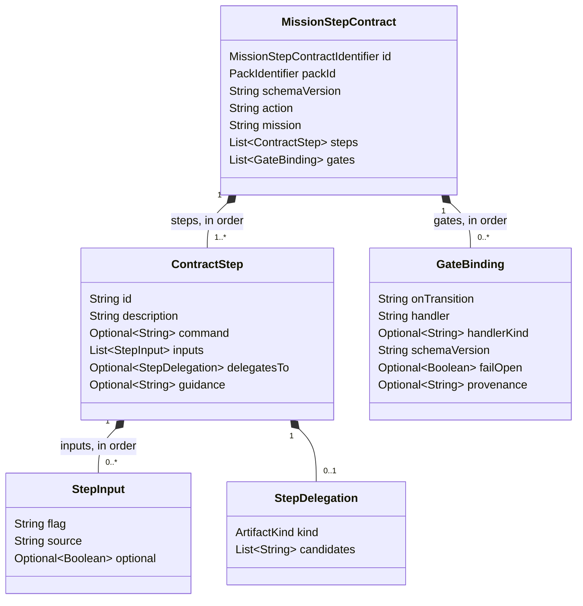

# Data model: Mission step contract round trip

## Field map

| YAML (`*.step-contract.yaml`) | Domain | Rule |
|---|---|---|
| `id` | `MissionStepContractIdentifier` | Required; the local id; the URN is `mission_step_contract:<id>` |
| `schema_version` | `schemaVersion` | Required; not blank |
| `action`, `mission` | `action`, `mission` | Required; not blank; `action` is the label |
| `steps[]` | `steps` | At least one; order and repetition kept |
| `steps[].id`, `.description` | `ContractStep.id`, `.description` | Required; the id is not blank |
| `steps[].command`, `.guidance` | `Optional<String>` | Absent and `null` are the same |
| `steps[].inputs[]` | `List<StepInput>` | `flag` and `source` are required; `optional` is kept as written |
| `steps[].delegates_to` | `Optional<StepDelegation>` | `kind` is an artifact kind; `candidates` is non-empty and kept in order |
| `gates[]` | `List<GateBinding>` | Inert data (#155); every field is kept as written |

## Invariants

- The entity is equal to another entity with the same identifier.
- It has no relationships.
- Duplicate step ids are validate mode's to report, not the entity's.
- Unknown keys never reach the domain: the closed schema refuses them in storage.
