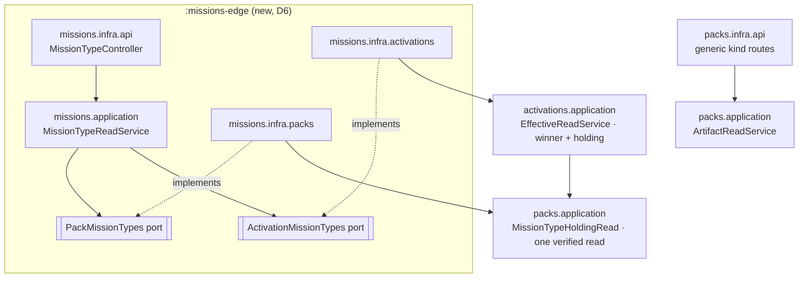

# Implementation Plan: Mission type, step, step contract and skeleton reads

**Branch**: `issue-99-mission-type-reads` | **Date**: 2026-11-09 | **Spec**: [spec.md](spec.md)
**Input**: `spec.md`, `research/code-grounding.md`, `research/operator-decisions.md` (D6–D8), the seam map below.

## Summary

Serve the mission tier, which is already stored and validated, through the read contract. `mission_step_contract`
becomes a served kind of the generic packs read. `mission_type` is served by literal routes in a new missions edge
module (`:missions-edge`), with steps and skeletons as sub-resources, pack-scoped and under an activation. The effective
reads link their items to these reads.

## Technical Context

**Language/Version**: Java 25, Spring Boot 4, Gradle 9 (build-logic convention plugins).
**Primary Dependencies**: openapi-generator `spring` (interfaceOnly, useTags), cucumber-jvm, ArchUnit, JUnit Jupiter.
**Storage**: the pack store (filesystem), unchanged.
**Testing**: contract scenarios in `contracts/charter/scenarios/` (suite `CharterContractSuite`, glue
`ai.speckitty.charter.deployable.bdd`, packs written inline with `the <level> pack "
" with the file "<path>":`),
unit tests per ring, ArchUnit (`HexagonalArchitectureTest`), `OperationCoverageTest` (each 2xx exercised).
**Scale/Scope**: about 6 new operations, 4 new schemas, 3 new refusal codes, 1 new Gradle module.

## Charter Check

| Gate | How this plan meets it |
|---|---|
| PROJECT_002 (1), no divergence | Reads serve stored content verbatim; round trip untouched. |
| PROJECT_002 (2), contract | 0.x change per ADR-0022: `### Breaking` and `### Added` `changes/` fragments (ADR-0047), no `CHANGELOG.md` edit. |
| DIRECTIVE_034 test first | Each WP opens with red scenarios and unit tests. |
| DIRECTIVE_001 architecture | New edge ring with ArchUnit rules; no rule weakened (decision 1, D6). |
| DIRECTIVE_003 decisions | D6 is recorded in the ADR-0006/0037 amendment the profiles PR lands; D7/D8 go in the contract docs. |
| DIRECTIVE_037 living docs | `docs/api/service-contract.md`, `hypermedia-hateoas.md` relation table, examples. |
| NO_FULL_HEAVY_SUITES_IN_MISSION | In-mission runs are per-module tests and named gate tests; `verifyAll` runs at the pre-PR gate and in CI. |
| Adversarial squad | At this plan point (below) and pre-PR. |

## Seam map (verified 2026-11-09)

- Codegen: `:charter-api` generates `ai.speckitty.charter.api.<Tag>Api` from `openapi.yaml`; abstract methods
  (`skipDefaultInterface`) force a controller per operation.
- Links: `Relation` is public in packs, `Hypermedia` is package-private, and other slices may not name
  `packs.infra.api`. The activations slice builds `_links` with string relations and `new Link(...)`.
- Removal: `ArtifactRemovalService.requireHeld` is kind-agnostic over `SERVED`; companions are removed by
  `KindBinding.companions`. `DELETE` lives on `RegistrationApi` (`deletePackArtifact`).
- Step text: loaded eagerly, so `MissionType.step(id)` carries `StepDocument` prompt and guidelines. Template
  `Payload` is bytes only.
- Under an activation, `MergedClosure.winners()` names only the holding pack. The profiles mission adds the winner
  read (its answer of 2026-11-09): `ClosureView.effectiveArtifact(kind, id, states)` in packs.application, exposed as
  `EffectiveReadService.artifact(ActivationId, ArtifactKind, String, int depth)` in activations.application. It returns
  the winner `CharterArtifact`, its pack and level, and its state, inside one verified read. The generic
  `GET /activations/{id}/artifacts/{kind}/{artifactId}` accepts the kinds in `ArtifactReadService.SERVED`.
- Effective items: the profiles mission adds `_links.effective-artifact` (the activation-scoped read) beside
  `_links.artifact` (the winner's pack-scoped read) on effective list, graph and action-context items of served kinds.
  Mission types and step contracts get them by joining `SERVED`. Action nodes (`action:<type>/<step>`) are this
  mission's.
- Pins: `WireTokenParityTest` pairs `SERVED` with `ArtifactKindToken` enum; `ArtifactReadServiceTest` pins `SERVED`'s
  order. Both are sibling-owned and extended additively.

## Architecture

- **Two ports, not one** (squad A2): `PackMissionTypes` (key: pack id) and `ActivationMissionTypes` (key: activation
  id), both in `missions.application`, named neither `*Repository` nor `*Gateway`. Each adapter is the only bean of its
  port.
- **One composite verified read per request** (squad A3): `packs.application.MissionTypeHoldingRead.holding(pack,
  typeId)` judges the descriptor, then reads inside one `ConsistentRead`: the `CharterArtifact` type, its `Template`s,
  the `MissionStepContract`s whose `mission` is the type, and the stored bytes of every step's `prompt.md` and
  `guidelines.md`. These are packs.domain and kernel types only (`APPLICATION_IS_EDGE`). The missions port returns
  missions-owned views and the fingerprint as a string; it never names `ConsistentRead.Verified`.
- **Stored prompt bytes** (squad A4, C7): step prompt and guidelines are the stored companion files byte for byte,
  read through a packs.domain port that the pack store implements (`PackCompanionFiles.bytes(pack, path)`), inside the
  composite read. No re-render and no new Markdown port. `spdd` slot markers survive.
- **Under an activation** (squad A6): `activations.application.EffectiveReadService` gains `missionTypeHolding(
  ActivationId, typeId)`, built on the profiles mission's winner read. It returns the winning type, and from the pack
  that holds that winner its skeletons, companion bytes and the step contracts of the merged closure whose `mission`
  is the type (each a layer-merge winner). It is coordinated with the profiles mission (same file; rebased on its
  branch). Skeletons are not merged on their own: they come from the winner's holding pack.
- **The `mission_type` envelope** (squad A1, C4): the literal `getPackMissionType` answers the `Artifact` envelope
  with a `missionType` member. `Artifact.oneOf` gains `missionType` and `missionStepContract`. `ArtifactReadService`
  separates `LISTED` (the five, `mission_type`, `mission_step_contract`; the list, `?kind=`, `/references`, removal and
  the activation generic route) from the item kinds of the generic item route (the five and `mission_step_contract`).
  The generic item route never holds a throwing branch: a `mission_type` request that reached it would be
  `kind_not_found`, and the deployed service always routes it to the literal mapping. A test pins that.
- **Step-contract binding** (squad C10): the step links the contract in scope whose `mission` and `action` equal the
  type and step; with several, the lowest id.
- **Links** (squad C5): string relations through a missions-local `MissionRelation` enum, checked against
  `hypermedia-hateoas.md` by a parity test like `RelationSetParityTest`, and added to `link-relations-are-known` in
  `contracts/lint/ruleset.yaml`. Relations: `self`, `collection`, `mission-type` (step, skeleton, step contract to their
  type), `step-contract`, `skeleton`, `artifact` (a delegation candidate's pack-scoped read), and the profiles
  mission's `effective-artifact`. Each step and skeleton entry of the mission type body has its own `_links.self`. No
  link points at an operation that is not built.
- **ArchUnit** (squad A7): on top of the profiles rule shapes, `MISSIONS_NAME_PACKS_ONLY_FROM_ADAPTER` (only
  `missions.infra.packs`, only packs.application and packs.domain) and `MISSIONS_NAME_ACTIVATIONS_ONLY_FROM_ADAPTER`
  (only `missions.infra.activations`, only activations.application and activations.domain), each with a known-bad
  fixture.
- **Wiring** (squad A9): `settings.gradle.kts`, `charter-reports` `serviceModules` (shared package root),
  `:deployable` dependency, and the four `missions.*.config` packages in `DeployableConfiguration`'s scan.

## Contract

New operations, tag `MissionTypes` (declared under `tags:`):

| Operation | Path |
|---|---|
| `getPackMissionType` | `GET /packs/{packId}/artifacts/mission_type/{missionTypeId}` |
| `getPackMissionStep` | `GET /packs/{packId}/artifacts/mission_type/{missionTypeId}/steps/{stepId}` |
| `getPackMissionSkeleton` | `GET /packs/{packId}/artifacts/mission_type/{missionTypeId}/skeletons/{skeletonName}` |
| `getActivationMissionType`, `getActivationMissionStep`, `getActivationMissionSkeleton` | the same under `/activations/{activationId}/artifacts/mission_type/...` |

As built: WP05 named the activation operations `getEffectiveMissionType`, `getEffectiveMissionStep` and
`getEffectiveMissionSkeleton` (tag `EffectiveMissionTypes`), and D11 added `getEffectiveMissionStepContract`.

- `{skeletonName}` is one segment (D9: RFC 6901 escaping of the path under the type's `templates/`).
- The three activation operations are declared `x-reserved {contractSet: activation, issue: '#99'}` with a `501`
  until WP05 builds them (squad C8). No link points at them before then.
- Schemas: `MissionType.yaml` (stored fields; `steps[]` with `id`, `title`, `onDemand`, `_links.self`;
  `skeletons[]` with `name`, `path`, `_links.self`), `MissionStep.yaml` (`id`, `title`, `description`, optional
  `role`, `onDemand`, optional `prompt` and `guidelines` (stored bytes as text), optional `expectedInputArtifacts` and
  `expectedOutputArtifacts`), `MissionStepContract.yaml`, `MissionSkeleton.yaml` (`name`, `path`, `missionTypeId`,
  `encoding: text|base64`, `content`, `sha256`, `size`; every property cited by `x-source` or `x-derived`).
- Refusals: new `mission_step_contract_not_found` and `skeleton_not_found`; reused `mission_type_not_found` and
  `action_not_found` (an unknown step), with their raised-by texts extended. The new operations get their own 404
  response listing their codes. The `bare` pack `pack_unreadable` rows are repeated for the new routes. This is a
  minimal hunk in `CharterRefusalCode.yaml`, rebased after #437.
- Neither new kind has a write, so neither answers an ETag. `DELETE` takes `If-Match: *`, as for a tactic.
- `getPackArtifact`, `ArtifactKind` and `ArtifactKindToken`: `mission_step_contract` joins; `mission_type` joins the
  list filter, and its item is answered by `getPackMissionType`, which says so.
- `/references` answers for both kinds through `LISTED`, covered by scenarios.
- Change fragments: `### Breaking` (the two refusal codes, the two `Artifact` members, the two kind tokens, the
  `encoding` enum; core regenerates its DTOs) and `### Added` (the operations).
- 200 scenarios the coverage gate needs: the pack mission type, step (sequence and on-demand), flat and nested
  skeleton, the `mission_step_contract` item, `?kind=` list for both kinds, `/references` for both kinds, and the three
  activation reads (WP05).

## Work packages (outline; `tasks.md` finalises)

| WP | Scope | Depends |
|---|---|---|
| WP01 | `:missions-edge` module, wiring, ArchUnit rules and fixtures (on the profiles shape) | profiles amendment |
| WP02 | Contract: schemas, paths (activation ones reserved), refusal codes, relations, examples, fragments; scenarios red | — |
| WP03 | `LISTED` split, `mission_step_contract` item, list, `/references` green | WP02 |
| WP04 | Composite read, pack-scoped mission type, step and skeleton reads green | WP01, WP02 |
| WP05 | Activation-scoped reads (un-reserve) green | WP04, profiles PR |
| WP06 | Step links on `action:` graph nodes and the action context (#450 part) | WP05 |
| WP07 | `DELETE` for both kinds with the mission-type cascade (D10), docs, usability script | WP03, WP04 |

## Risks

- **Sibling coupling**: `SERVED`, `ArtifactDtos`, `Artifact.yaml`, `ArtifactKindToken` and `EffectiveReadService` are
  shared with the profiles mission; additive hunks only, rebased on its branch.
- **Cascade removal**: the store's `Removal` gains the type's owned templates; the impact check runs over all of them.

## Plan-point squad (run 2026-11-09, folded)

Two lenses: architecture (A) and contract/spec fidelity (C). The blockers were folded above:

- A1/C4: two representations at one URL. Fixed by the envelope and the `LISTED` split.
- C1: multi-segment path. Operator ruling D9: a single-segment name.
- C2: the `utf-8` enum value fails `enum-snake-case`. Fixed: `text|base64`.

Every major was folded: A2 (ports), A3 (one verified read), A4/C7 (stored bytes), A5 (operator ruling D10), A6
(activation source), C3 (`### Breaking`), C5 (relations), C6 (SC-001 restated in the spec), C8 (reserved activation
operations), C9 (refusal order, reuse of `action_not_found`). Every minor was folded: A7–A10 and C10.

Decided without the operator and logged here as review items: the reuse of `action_not_found` for an unknown step
(one vocabulary with the action context), the lowest-id tie-break for step-contract binding, `If-Match: *` for the
two kinds' `DELETE`, and RFC 6901 as the spelling of D9.
