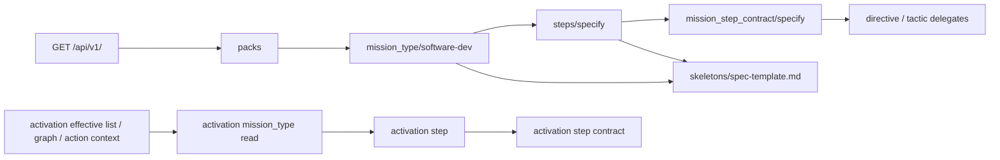

# Mission Specification: Mission type, step, step contract and skeleton reads

**Mission**: `mission-type-reads-01M70ZN5`
**Created**: 2026-11-09
**Status**: Draft
**Input**: issues #99, #148, #96 (for `mission_type`, `mission_step_contract` and mission-type templates), #100 and
#450 (item links for these kinds). Five operator decisions from the dispatch brief, plus D6–D8 from grounding
(`research/operator-decisions.md`); D9–D10 from the plan-point squad. Code grounding: `research/code-grounding.md`.

## Context

The service serves five artifact kinds (tactic, directive, styleguide, paradigm, toolguide) through one generic read,
`GET /packs/{packId}/artifacts/{kind}/{artifactId}`. Mission types, their steps, the steps' contracts and the
mission's document skeletons are stored and validated, but no client can read them. The effective reads of an
activation name mission types and actions, but nothing links to their content.

This mission makes them readable and linked, both pack-scoped and under an activation, so a client that starts at
`GET /api/v1/` can follow links from `software-dev` to its steps, their step contracts and their skeletons.

Vocabulary:

- **mission type**: a stored `*.mission-type.yaml` (`mission_type:<type>`).
- **step**: one entry of a mission type's `steps` or `on_demand_steps`; its graph node is `action:<type>/<step>`.
- **step contract**: a stored `*.step-contract.yaml` (`mission_step_contract:<id>`), bound to one step by its
  `mission` and `action`.
- **skeleton**: a file under `missions/<type>/templates/`, the starting shape of a document a step produces. Stored
  as kind `template` (URN `template:<type>/<path>`); called a skeleton on the wire (D7). Pack-level `templates/` files
  are generic asset templates and are out of scope.

## User Scenarios & Testing *(mandatory)*

The primary actor is a client of the service (core, or an operator's client acting for a project). Scenarios run
against fixture packs and, for acceptance, against open-packs at `a2a9379`.

### User Story 1 - Read a pack's mission type and its steps (Priority: P1)

**Independent Test**: list a pack's artifacts, follow the `mission_type` item, then follow one step link.

**Acceptance Scenarios**:

1. **Given** a pack that holds mission type `software-dev`, **When** the client reads
   `GET /packs/{packId}/artifacts/mission_type/software-dev`, **Then** it gets `200` with the mission type's stored
   fields (title, description, content, path conventions, expected output artifacts), its steps in stored order, then
   its on-demand steps, each with a link to the step, and its skeletons, each with a link.
2. **Given** the same pack, **When** the client lists `GET /packs/{packId}/artifacts?kind=mission_type`, **Then** the
   page names `software-dev` with a `self` link to the read in scenario 1.
3. **Given** step `specify` of `software-dev`, **When** the client reads
   `.../artifacts/mission_type/software-dev/steps/specify`, **Then** it gets the step's id, title, description, role,
   the stored `prompt.md` and `guidelines.md` text verbatim, its expected input and output artifacts, a link to its
   mission type, a link to its step contract when one exists, and a link to the skeleton of each expected output
   artifact that names one.
4. **Given** an unknown mission type, step, or a pack that does not exist, **When** the client reads it, **Then** the
   service refuses with `pack_not_found` (or `pack_unreadable`), then `mission_type_not_found`, then
   `action_not_found` for an unknown step: a step is the action `action:<type>/<step>`.
5. **Given** on-demand step `retrospect`, **When** the client reads `.../steps/retrospect`, **Then** it is served like
   any step, marked on-demand.

### User Story 2 - Read a step contract (Priority: P1)

1. **Given** step contract `specify` (`mission: software-dev`, `action: specify`), **When** the client reads
   `GET /packs/{packId}/artifacts/mission_step_contract/specify`, **Then** it gets its action, mission, steps (id,
   description, command, inputs, delegation with kind and candidates, guidance) and gates, with a link to its step and
   mission type, and a link to each delegation candidate of a served kind.
2. **Given** an unknown step contract id, **Then** the service refuses with `mission_step_contract_not_found`.
3. **Given** `?kind=mission_step_contract` on the list, **Then** the page names the pack's step contracts.

### User Story 3 - Read a skeleton (Priority: P1)

1. **Given** skeleton `spec-template.md` of `software-dev`, **When** the client reads
   `.../artifacts/mission_type/software-dev/skeletons/spec-template.md`, **Then** it gets the stored bytes (as text
   when they are valid UTF-8, else base64), its name, its path, its mission type, and a link back to the mission type.
2. **Given** a nested skeleton `divio/howto-template.md` of `documentation`, **When** the client reads
   `.../mission_type/documentation/skeletons/divio~1howto-template.md`, **Then** it gets that skeleton (D9).
3. **Given** a name naming no skeleton of the mission type, **Then** the service refuses with `skeleton_not_found`.

### User Story 4 - The same reads under an activation (Priority: P1)

1. **Given** an activation built from this repository's `charter.yaml`, **When** the client reads
   `GET /activations/{id}/artifacts/mission_type/software-dev` (the activation's artifact URL for the kind, the shape
   the profiles mission builds), **Then** it gets the layer-merge winner of that mission type with step and skeleton links under the
   activation.
2. **Given** the same activation, **When** the client follows a step link and then its step contract link, **Then**
   each answer is the layer-merge winner and its links stay under the activation.
3. **Given** a mission type no pack of the activation's closure holds, **Then** the service refuses with
   `mission_type_not_found`; an unknown activation is `activation_not_found`. A type that a closure pack holds but the
   activation does not select is answered, whatever its state, as the generic activation read does (operator,
   2026-11-10).

### User Story 5 - Effective reads link to these reads (Priority: P2, part of #450)

1. **Given** an activation, **When** the client reads the effective list, graph or action context, **Then** every
   item of kind `mission_type` or `mission_step_contract`, and every action node `action:<type>/<step>`, carries a link
   to its read under the activation.

### User Story 6 - Remove a mission type or step contract (Priority: P3, decision 4)

1. **Given** a writable pack that holds mission type `x` or step contract `y`, **When** the client sends `DELETE` on
   its pack-scoped item path, **Then** the removal follows the same rules as the five served kinds (preconditions,
   impact refusal, audit). A mission type is removed with its step companions and its skeletons as one removal, and
   is refused `409` while a step contract binds it or a graph edge names it or its action nodes (D10).

### Edge Cases

- A step without a `guidelines.md` answers no guidelines member, never an empty string.
- A step prompt that holds bare `spdd:reasons-block` slot markers (open-packs `a2a9379`) is served as stored, byte
  for byte; the composed prompt is #438's.
- A step's `template_path` `templates/spec-template.md` binds skeleton `spec-template.md` (the `templates/` prefix is
  stripped). A `template_path` with no stored skeleton gives the step no link to it, never a broken link.
- When two step contracts in scope bind the same step, the step links the one with the lowest id.
- A step contract whose `mission` names a mission type its scope does not hold (the pack, or the activation's merged
  closure) still reads, without a mission-type link.
- A skeleton name that does not decode (RFC 6901 escaping, D9) to a skeleton of the type is `skeleton_not_found`;
  nothing is resolved outside the mission type.

## Requirements *(mandatory)*

### Functional Requirements

- **FR-001**: `mission_type` and `mission_step_contract` join the listed kinds after the five already served: the
  generic list, its `?kind=` filter, `/references` and removal. `mission_step_contract` also joins the generic item
  read. The item of a `mission_type` is answered by its literal route (`getPackMissionType`) in the `Artifact`
  envelope. `template` joins neither (D7).
- **FR-002**: The mission type read carries its stored fields, its steps then on-demand steps (each marked), and its
  skeletons, with a link to each step and each skeleton.
- **FR-003**: `GET /packs/{packId}/artifacts/mission_type/{type}/steps/{step}` serves one step: stored fields,
  the stored prompt and guidelines files byte for byte, expected input and output artifacts, and links to its mission type, its step
  contract (the contract whose `mission` and `action` equal the type and step) and its bound skeletons.
- **FR-004**: The step contract read carries action, mission, steps, delegations and gates, with links to its step,
  its mission type and each delegation candidate of a served kind.
- **FR-005**: `GET /packs/{packId}/artifacts/mission_type/{type}/skeletons/{name}` serves one skeleton; `{name}` is
  one segment (D9); the stored bytes are served as text when valid UTF-8, else base64, never altered.
- **FR-006**: The routes of FR-002 to FR-005 are literal routes in the missions slice (decision 1), which Spring
  prefers over the generic `{kind}` route.
- **FR-007**: Under an activation, the same reads answer the layer-merge winner through the generic activation path
  of the profiles mission, with the steps and skeletons sub-resources hung off it; no second activation path.
- **FR-008**: Effective list, effective graph and action context items of these kinds, and action nodes, link to
  their activation reads.
- **FR-009**: New refusal codes `mission_step_contract_not_found` and `skeleton_not_found`; `mission_type_not_found`
  and `action_not_found` (an unknown step) are reused. Order: pack (`pack_not_found`, `pack_unreadable`), then mission
  type, then step or skeleton.
- **FR-010**: `DELETE` on a mission type or step contract follows the rules of the five served kinds; a mission type
  cascades its skeletons (D10).
- **FR-011**: Governance walks for these kinds reuse the existing walker rules (decision 5); no new walk.
- **FR-012**: Every read is a `ConsistentRead` with a fingerprint header, like the existing reads.

### Non-Functional Requirements

- **NFR-001**: Contract change on the 0.x line follows ADR-0022: new refusal codes, new `Artifact` members and new
  closed enums are listed under `### Breaking` (as the 2026-11-08 prompt-fragment fragment did), the new paths under
  `### Added`, in `changes/` fragments (ADR-0047), with scenarios and examples.
- **NFR-002**: No ArchUnit rule is weakened; rules are added for the new missions rings (decision 1).
- **NFR-003**: What is served equals what is stored (PROJECT_002, ADR-0036).
- **NFR-004**: `verifyAll` and `:packs:wholePackRoundTrip` pass on Java 25, plus the docs checks.

### Key Entities

- **MissionType**, **MissionStep**, **StepDocument** (missions.domain); **MissionStepContract** and **Template**
  (packs.domain); the wire **Skeleton** view of a mission-type `Template`.

## Success Criteria *(mandatory)*

- **SC-001**: Against open-packs `a2a9379`, a client starting at `GET /api/v1/` reaches `software-dev`, all 13 of
  its steps (8 in sequence, 5 on demand), the 5 step contracts bound to them (specify, plan, tasks, implement,
  review), the 2 skeletons steps bind (specify, plan) and all 4 skeletons the mission type lists, pack-scoped and
  under an activation built from this repository's `charter.yaml`, proven by the shared usability script.
- **SC-002**: Every new route has a contract scenario that was red before it went green.

## Out of scope

- Pack-level generic asset templates (D7).
- The effective (composed) step prompt with ADR-0066 fragments (#438).
- Moving `NodeRef` to the kernel (#438 phase 2).
- The action-context scoping of required directives (#450's first half).
