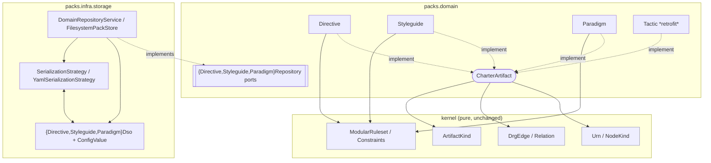

# Data model — pack doctrine artefacts

Entities, value objects, DSOs, invariants, and the DRG edge contract for the three
new kinds and the `CharterArtifact` family. Field sets are authoritative from the
canonical schemas in `contracts/packs/schemas/{directive,styleguide,paradigm}.schema.json`
(source of truth, ADR-0017). All new types live in the `packs` slice.

## Family interface — `CharterArtifact` (`packs.domain`)

The thin common spine; reuses the kernel `DrgEdge`/`Urn`/`NodeKind`/`ArtifactKind`.

| Member | Type | Notes |
|--------|------|-------|
| `kind()` | `ArtifactKind` | the kernel kind constant |
| `packId()` | `PackIdentifier` | owning pack — a packs type, hence the interface is in `packs.domain` (M1) |
| `localId()` | `String` | the schema `id` |
| `schemaVersion()` | `String` | the `schema_version` |
| `label()` | `String` | normalizes `title` (directive/styleguide) \| `name` (paradigm/tactic) |
| `description()` | `Optional<String>` | `intent` (directive) \| `summary` (paradigm) \| `purpose` (tactic) \| empty (styleguide) |
| `edges()` | `List<DrgEdge>` | per-kind derivation (below); empty for styleguide |
| `urn()` | `Urn` (default) | `new Urn(NodeKind.of(kind()), localId())` |

Implemented by `Directive`, `Styleguide`, `Paradigm`, and (retrofit) `Tactic`.

## Directive (`packs.domain`) — US1

A binding governance rule. Identity: **`DirectiveIdentifier`** (`record(String value)`;
invariants: matches `^[A-Z][A-Z0-9_-]*$`).

| Field | Type | Required | Notes |
|-------|------|----------|-------|
| `id` | `DirectiveIdentifier` | ✔ | |
| `packId` | `PackIdentifier` | ✔ | |
| `schemaVersion` | `String` | ✔ | matches `^1\.0$` |
| `title` | `String` | ✔ | → `label()` |
| `intent` | `String` | ✔ | → `description()` |
| `enforcement` | `Enforcement` | ✔ | enum value (FR-017) |
| `scope` | `Optional<String>` | — | free text (distinct from styleguide scope — n13) |
| `procedures` | `List<String>` | — | bare refs → edges (target kind `procedure`) |
| `integrityRules` | `List<String>` | — | `integrity_rules` |
| `validationCriteria` | `List<String>` | — | `validation_criteria` |
| `explicitAllowances` | `List<String>` | — | `explicit_allowances` |
| `references` | `List<DirectiveReference>` | — | `DirectiveReference{type, id, when?, reason?}` |

**Invariants (`ModularRuleset<Directive>`):** required scalars non-blank; `enforcement`
a valid `Enforcement`; **conditional** `enforcement == LENIENT_ADHERENCE ⇒ explicitAllowances` non-empty (M3).

## Styleguide (`packs.domain`) — US2

Conventions for the shape of a work product. Identity: **`StyleguideIdentifier`**
(matches `^[a-z][a-z0-9-]*$`).

| Field | Type | Required | Notes |
|-------|------|----------|-------|
| `id` | `StyleguideIdentifier` | ✔ | |
| `packId` | `PackIdentifier` | ✔ | |
| `schemaVersion` | `String` | ✔ | `^1\.0$` |
| `title` | `String` | ✔ | → `label()` |
| `scope` | `StyleguideScope` (enum) | ✔ | `code\|docs\|architecture\|testing\|operations\|glossary` |
| `principles` | `List<String>` | ✔ | non-empty |
| `patterns` | `List<Pattern>` | — | `Pattern{name, description, badExample?, goodExample?}`; non-empty when present |
| `antiPatterns` | `List<AntiPattern>` | — | `AntiPattern{name, description, badExample, goodExample}` (all required); non-empty when present |
| `tooling` | `Optional<Map<String,String>>` | — | nullable scalar-map (R1) |
| `qualityTest` | `Optional<String>` | — | `quality_test` |
| `structuralLintConfig` | `Optional<ConfigValue>` | — | arbitrary nested tree (R1/FR-018) |
| `appliesToLanguages` | `List<String>` | — | |
| `references` | `List<String>` | — | bare citations — **body, not edges** (M4) |

**Invariants:** required scalars non-blank; `scope` a member of `StyleguideScope`;
`principles` non-empty; `patterns`/`antiPatterns` non-empty when present.
`description()` = empty; `edges()` = empty.

## Paradigm (`packs.domain`) — US3

A way of working. Identity: **`ParadigmIdentifier`** (matches `^[a-z][a-z0-9-]*$`).

| Field | Type | Required | Notes |
|-------|------|----------|-------|
| `id` | `ParadigmIdentifier` | ✔ | |
| `packId` | `PackIdentifier` | ✔ | |
| `schemaVersion` | `String` | ✔ | `^1\.0$` |
| `name` | `String` | ✔ | → `label()` |
| `summary` | `String` | ✔ | → `description()` |
| `directiveRefs` | `List<String>` | — | `directive_refs`, bare → edges (target kind `directive`) |
| `references` | `List<ParadigmReference>` | — | `ParadigmReference{type, id}` |

**Invariants:** required scalars non-blank.

## Pack aggregate membership (m-1 — decided: extend)

`Pack` today holds `List<Tactic>` with two invariants (every tactic belongs to the
pack; no two tactics share an id), and `DomainRepositoryService.assemble()` wires
only tactics. **Decision: extend the aggregate** so the new kinds are genuinely
first-class child entities "like Tactic" (the mission's stated intent and US4's
"the aggregate … binds to the family"). `Pack` gains `List<Directive>`,
`List<Styleguide>`, `List<Paradigm>` with the analogous per-kind invariants
(belongs-to-pack; no-duplicate-id), the `Pack.Builder` gains the three adder
methods, `DomainRepositoryService.assemble()`/`FilesystemPackStore` read all kinds,
and `PackRoundTripTest` covers them. The per-type repository ports (SC-002) remain
the single-entity load/save boundary; the aggregate is the whole-pack read. The
no-duplicate-id guard matters because a `locate…`-style store lookup returns the
first match.

## Enforcement (`packs.domain`) — FR-017

`enum Enforcement { REQUIRED, LENIENT_ADHERENCE, ADVISORY }` with `token()` /
`fromToken()` round-trip mirroring `ArtifactKind.token()`
(`LENIENT_ADHERENCE ↔ "lenient-adherence"`).

## DSOs (`packs.infra.storage`)

One flat record per kind (`DirectiveDso`, `StyleguideDso`, `ParadigmDso`) mirroring
its YAML; **record equality is the round-trip fidelity assertion** (NFR-001). Each
has its own nested records — the per-kind reference shapes differ, so none reuses
`TacticDso.Reference`:

- `DirectiveDso.Reference(String type, String id, Optional<String> when, Optional<String> reason)`
- `ParadigmDso.Reference(String type, String id)`
- `StyleguideDso.Pattern(String name, String description, Optional<String> badExample, Optional<String> goodExample)`
- `StyleguideDso.AntiPattern(String name, String description, String badExample, String goodExample)`
- `ConfigValue` sealed tree (Scalar/Seq/Mapping) for `structural_lint_config`; `tooling` as `Map<String,String>` (R1).

Nullable-scalar fields are `Optional<…>` at the DSO level (absent ≠ present-empty);
non-nullable lists normalize absent→empty (absence-vs-empty edge case).

## DRG edge contract (`edges()`, FR-019)

Each `DrgEdge` is `(source = this.urn(), target = Urn(targetKind, refId), relation, impacts=empty, when, reason)`.
`impacts` is empty (no `IMPACTS` edges minted here). Target kind by field:

| Kind | Edge-bearing field | Target kind | Relation (interim) | when/reason |
|------|--------------------|-------------|--------------------|-------------|
| directive | `references[]` (typed) | from `type` via `NodeKind.of(ArtifactKind.fromToken(type).orElseThrow())` | `SUGGESTS` | `when`/`reason` carried |
| directive | `procedures[]` (bare) | `procedure` | `REQUIRES` | empty |
| paradigm | `directive_refs[]` (bare) | `directive` | `REQUIRES` | empty |
| paradigm | `references[]` (typed) | from `type` token | `SUGGESTS` | empty |
| tactic | `references[]` (typed) | from `type` token | `SUGGESTS` | `when` carried (`""`→empty) |
| styleguide | — | — | — | no edges |

`impacts = empty` on every edge (no `IMPACTS` relations). Target-kind resolution is
total for schema-valid input (the `type` enum == the `ArtifactKind` set). The
**Relation column is the justified interim mapping** — the authoritative per-field
mapping is core's DRG extractor (cross-repo), confirmed during IC-01; `APPLIES` is
rejected for carries-out fields (source is not an action). Empty bare-ref items are
rejected by a domain invariant (below), so `Urn` never throws. Single source:
[research.md](./research.md) R2.

## Additional domain invariant — empty bare-refs (R4, m-3)

Beyond schema parity (NFR-002): the directive and paradigm `ModularRuleset`s reject
any blank `procedures[]` / `directive_refs[]` item (the schema types them as `string`
with no `minLength`, but `Urn` rejects an empty id). Recorded as an *additional*
invariant so the validation-parity audit does not expect it from the schema.

## C4 — component view (packs slice, after this mission)

