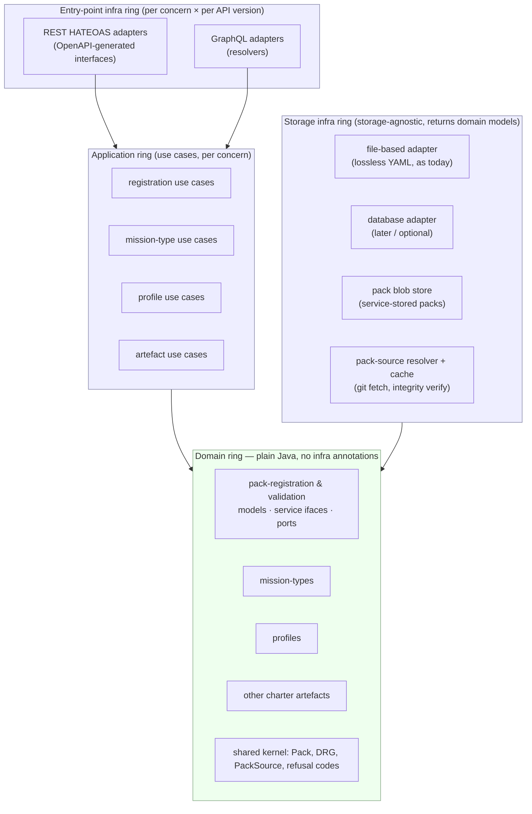
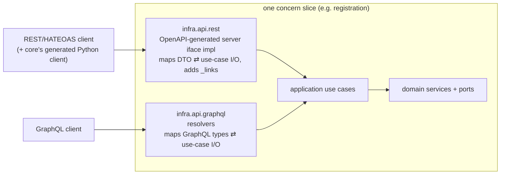
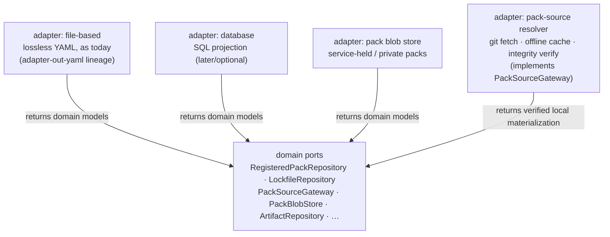
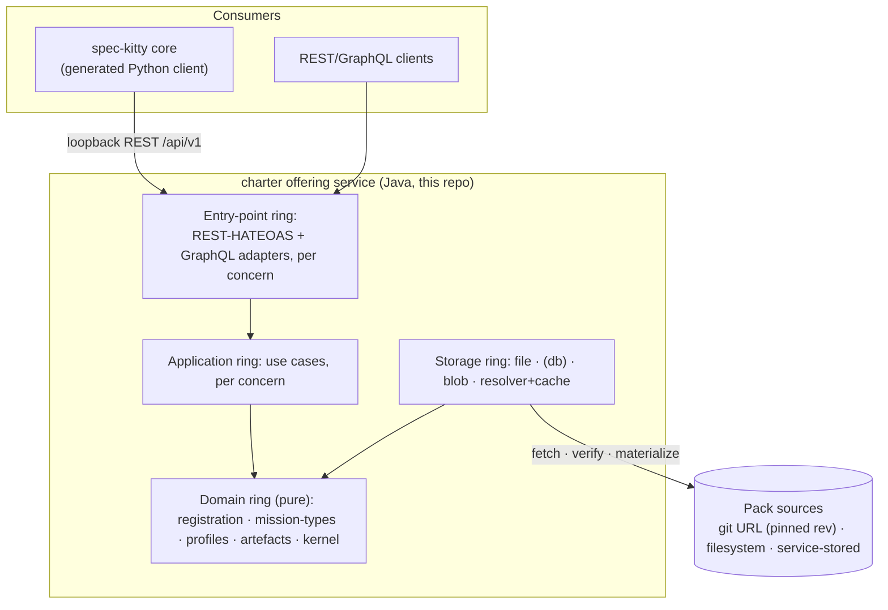

# Architecture Design — Pack Registration & Distribution

**Mission**: `pack-registration-distribution-01M56M49`
**Author**: architect-alphonso (design only — no Java implementation)
**Date**: 2026-10-18
**Status**: Draft for operator review
**Scope**: Architecture of the charter offering service's pack **registration, storage, verification and distribution** capability, designed *to* the operator's architecture brief. It is implementation-independent: it names structure, boundaries, and enforceable invariants, and surfaces decision points rather than settling material trade-offs.

**Authoritative inputs** (this design conforms to them, does not re-litigate them):
- Operator architecture brief (`design-mission-architecture-brief.md`) — the *shape* (onion + vertical slices, two API versions, storage-agnostic, ArchUnit).
- Mission spec (`spec.md`).
- Draft ADR-0005 (pack sourcing & distribution model; built-in as first catfooding consumer).
- Charter ADR-0001 (Java service + OpenAPI contract), ADR-0004 (public API returns generated DTOs), ADR-0002 (contract source of record — Proposed).
- `docs/architecture/*` (hexagonal-service, logical-model, resolution-model, contract-and-dtos, behavior-and-scenarios).

> Where this design meets an existing architecture doc or ADR with a different shape, the tension is **flagged, not silently resolved** — see §9 and the Decision Points in the hand-back.

---

## 1. The two structural axes

The architecture is organized on two orthogonal axes, exactly as the brief sets them:

- **Onion layers (dependency direction, inward only).** `entry-point infra → application → domain ← storage infra`. The domain is the innermost ring and depends on nothing outward; both infra rings depend inward on the domain.
- **Vertical concern slices (subdomain partition).** Each slice owns a cohesive piece of the charter offering and cuts through every layer. The brief names the slices: **pack registration & validation**, **mission types**, **profiles**, and **other charter artefacts**. A fifth, cross-cutting **shared kernel** slice carries the pack-and-DRG primitives every slice reads.



Dependency rule, in one line: **arrows only point toward the domain.** The entry-point ring knows the application ring; the application ring and the storage ring know the domain ring; the domain ring knows only itself and the JDK.

---

## 2. Package / module structure

Naming convention (logical, authoritative on the axes): `be.sddevelopment.charter.<concern>.<layer>`.

```
be.sddevelopment.charter
├── kernel                         # shared domain kernel (cross-slice primitives)
│   ├── domain                     #   Pack, PackId, PackLevel, PackVersion, DrgNode, DrgEdge,
│   │                              #   Urn, ArtifactKind, RefusalCode, PackSource (value type)
│   └── (no infra — kernel is pure)
│
├── registration                   # concern slice: pack registration & validation
│   ├── domain                     #   models, repository ports, service interfaces (plain Java)
│   ├── application                #   use-case orchestration (register / verify / resolve / distribute)
│   └── infra
│       ├── api.rest               #   REST HATEOAS controllers over registration use cases
│       ├── api.graphql            #   GraphQL resolvers over the *same* registration use cases
│       └── storage                #   file + db + blob + resolver adapters implementing ports
│
├── missiontypes                   # concern slice: mission types
│   ├── domain · application
│   └── infra { api.rest · api.graphql · storage }
│
├── profiles                       # concern slice: agent profiles
│   ├── domain · application
│   └── infra { api.rest · api.graphql · storage }
│
├── artefacts                      # concern slice: other charter artefacts (directives, tactics,
│   ├── domain · application        #   styleguides, toolguides, paradigms, procedures, step contracts,
│   └── infra { api.rest · api.graphql · storage }   # glossary packs, skills, assets, templates)
│
└── bootstrap                      # Spring Boot wiring, config, loopback binding, credential checks
                                   # (the only module that knows every slice; composition root)
```

- **No infra annotations in any `*.domain` package** — hard rule, ArchUnit-enforced (§6).
- `kernel.domain` holds the shared vocabulary of the logical model (`Pack`, `DrgNode/Edge`, `Urn`, `ArtifactKind`, refusal codes) so slices agree on one `Pack`/`DRG` shape rather than each minting their own.
- `*.infra.api.rest` and `*.infra.api.graphql` are **two adapters over one application**, per concern (§4).
- `*.infra.storage` is where the storage port implementations live (§5). The **pack-source resolver** (git fetch, cache, integrity verify) is a storage-ring concern: the domain never sees a URL, only a `PackSource` value and a verified local materialization.

**Gradle module granularity is a Decision Point** (DP-3): the logical package tree above can map onto one Gradle module per `(slice × layer)` (maximal ArchUnit leverage, many modules), onto one module per layer with slices as packages (matches today's `charter-domain / read-app / adapter-*`), or onto one module per slice with layers as packages. This design fixes the *package* axes; the module packaging is the operator's call.

---

## 3. Domain model sketch per concern

Plain-Java POJOs (records / sealed types), repository **ports** (interfaces), and **service interfaces**. No implementation, no annotations. Names and responsibilities only.

### 3.0 Shared kernel (`kernel.domain`)
- `Pack` — a registered pack: `PackId` (ULID), `PackVersion`, `PackLevel {built_in, org, project}`, `parentPack`, declared `PackSource`, `PackManifest`.
- `PackSource` — sealed: `GitSource {url, ref, rev(pinned sha), subdir?}`, `FilesystemSource {path}`, `StoredSource {storedRef}` (uploaded/service-held). `rev` is the trust anchor, never a floating ref.
- `PackManifest` — generated manifest: per-constituent `{id, kind, path, contentHash, provenancePath}`; the integrity/lockfile primitive (reuse open-packs `snapshot_sha256` / `content_hash`, do not reinvent).
- `DrgNode`, `DrgEdge`, `Urn (<kind>:<id>)`, `ArtifactKind`, `NodeKind`, `Relation`.
- `RefusalCode` — canonical diagnostics as domain values (`PACK_LEVEL_MISMATCH`, `PACK_LEVEL_MISSING`, `UNRESOLVED_EDGE_ENDPOINT`, `SOURCE_CONFLICT`, `INTEGRITY_FAILURE`, `ENGINE_INCOMPATIBLE`, `SOURCE_UNREACHABLE`, …). Part of the contract (ADR per contract-and-dtos §"What the contract carries"), surfaced as `Problem`.

### 3.1 Pack registration & validation (`registration.domain`) — the heart of this mission
Entities / value objects:
- `RegisteredPack` (aggregate root) — a `Pack` + its `RegistrationStatus`, `TrustTier {built_in_high, open_high, consumer, private}`, `ConsentState`, `Lockfile` entry.
- `Lockfile` / `LockfileEntry` — `{packId, PackSource(with rev), integrityDigest}`; the committed pin that *is* the fact (ADR-0005 §3).
- `IntegrityReport`, `CompatRange` (`requires_core`), `SourceConflict`.

Service interfaces (domain-owned, plain Java):
- `PackRegistrationService` — `register(PackSource, TrustContext) : RegisteredPack`; validates descriptor, assigns/honors `PackId`, fails closed on id/slug collision (`SOURCE_CONFLICT`).
- `PackResolver` — `resolve(PackId|PackSource) : ResolvedPack` (materialized local dir + manifest); **fetch → materialize → verify → hand downstream**. Verifies against `Lockfile`; gates `requires_core` at resolve time (`ENGINE_INCOMPATIBLE`); fails closed & legible when uncached + unreachable (`SOURCE_UNREACHABLE`).
- `PackDistributionService` — `distribute(PackId, requesterTier) : DistributionResponse` (the read/pull surface every tier shares; the one canonical path of ADR-0005 §2).
- `IntegrityVerifier`, `TrustPolicy` (allowlist / operator-consent gate for consumer/private git), `SupplyChainPolicy`.

Repository ports (domain-owned, impl in storage ring):
- `RegisteredPackRepository` — `save/find/list` RegisteredPacks (returns domain models).
- `LockfileRepository` — read/write the committed lockfile.
- `PackSourceGateway` (port) — "give me a verified local materialization of this `PackSource`"; the **only** seam that knows git/network/cache. Domain depends on the port; the resolver adapter in the storage ring implements it.
- `PackBlobStore` (port) — store/retrieve service-held (`StoredSource`) pack bytes.

> **Resolver / merge boundary** (ADR-0005 §7, DIRECTIVE_001/031): resolver (fetch/materialize/verify/store) is a *different concern* from merge/activation. This slice ends at "verified local materialization + manifest"; merge/activation is the artefacts/kernel read side.

### 3.2 Mission types (`missiontypes.domain`)
- `MissionType {id}`, `Action (action:<missionType>/<action>)`, `MissionStepContract {step → delegated kind + candidates}`.
- `MissionTypeService` — list/describe; `ActionSequenceService` (from `requires` edges).
- Ports: `MissionTypeRepository`.

### 3.3 Profiles (`profiles.domain`)
- `AgentProfile {id, specialization, collaboration, references}`, `ResolvedProfile`, `ProfileLineage (specializes_from)`, overlay semantics (`enhances` field-merge / `overrides` replace).
- `ProfileResolutionService` — `resolve(profileId, action) : ResolvedProfile` (lineage + overlays + compact context); unresolved = error; `skipped_profiles` reported.
- Ports: `AgentProfileRepository` (exposes `skippedProfiles`).

### 3.4 Other charter artefacts (`artefacts.domain`)
- `Artifact {id, kind : ArtifactKind}` across the kinds table (directive, tactic, styleguide, toolguide, paradigm, procedure, glossary_pack, skill, anti_pattern, asset, template, mission_step_contract).
- `ActiveGraph`, `LayerMerge`, `Activation {activated_<kind>, activated_kinds, mission_type_activations}`, `OrgCharterPolicy {required_<kind>}`.
- `ArtifactService`, `GraphQueryService`, `ActivationService` (plan → commit).
- Ports: `ArtifactRepository`, `ActiveGraphRepository`.

> This slice reproduces the `resolution-model.md` pipeline (load → merge → activate → answer) and inherits its fail-loud rules. It is adjacent to, not part of, registration: registration *delivers verified packs*; artefacts *merge and answer from them*.

---

## 4. The two API versions as entry-point adapters

Both API versions are **entry-point infra adapters over the same application use cases** — never a second implementation of domain logic (the overview.md invariant: "REST and MCP may never implement charter resolution independently"; extended here to GraphQL).



- **OpenAPI-based HATEOAS REST** is the primary, contract-of-record surface. It conforms to ADR-0001 (contract-first), ADR-0004 (returns generated DTOs), ADR-0002 (contract authored here), and `contract-and-dtos.md` (one `openapi.yaml` under `contracts/charter/`, split files, closed response schemas, `Problem`/`PageInfo` vocabulary, `servers: /api/v1`). Controllers *implement generated server interfaces* so a contract/code divergence fails the build. **HATEOAS adds hypermedia `_links`** (e.g. a `RegisteredPack` links to its `distribute`, `verify`, `source` relations) — how those links sit inside *closed* generated DTOs is **DP-6**.
- **GraphQL** is the second entry-point version over the identical use cases. Its schema (SDL) exposes the same domain operations as a graph-shaped surface. **Its source-of-record relationship to the OpenAPI contract (ADR-0002) and whether it is generated-from or authored-beside is DP-4; REST↔GraphQL surface parity is DP-5.**
- **The application use cases are the shared contract-neutral seam.** DTO/GraphQL-type ↔ use-case-I/O mapping lives *only* in the adapters. A transport DTO never crosses into the application or domain ring (three-models-kept-apart rule, hexagonal-service.md).
- **MCP**: existing docs plan an `adapter-in-mcp`. The brief names only REST + GraphQL. Whether MCP is dropped, deferred, or added as a third sibling adapter is **DP-7** — it changes nothing structural (it would be one more entry-point adapter over the same use cases).

---

## 5. Storage port abstraction

The storage ring is **storage-solution-agnostic**: the domain declares ports; implementations plug in behind them and **return plain domain models** (BDD entity/value-object approach), never storage-shaped DTOs (brief; hexagonal-service.md "three models kept apart"; ADR-0005 §4).



- **File-based (as today)** is the shipped default: lossless YAML document models + source fingerprints, reading the `packs/`, `.kittify/config.yaml`, `charter.yaml` inputs. "Reads only configured inputs, never directory presence" (resolution-model.md) is preserved — a git source resolves to a local dir *before* any repository sees it.
- **Database** is a drop-in sibling implementing the same ports; selecting file-vs-DB is composition-root configuration, not a domain concern (**DP-8**: one storage port set shared vs per-slice; selection mechanism).
- **Service-stored packs** (`StoredSource`, for consumer/private/uploaded packs) land in `PackBlobStore` — filesystem, object store, or DB blob, with privacy & retention policy (**DP-9**).
- **Pack-source resolver + offline cache** implements `PackSourceGateway`: the *only* component that knows git, network and cache. It materializes → verifies against the lockfile → hands a local dir + manifest inward. An offline/populated cache resolves with no network; fail closed when uncached + unreachable.

---

## 6. ArchUnit rule set (enforceable invariants)

Named, testable rules that make the two axes a gate, not a habit. These are the invariants; the test module (`bootstrap` or a dedicated `architecture-tests`) owns them.

| Rule | Statement | Fails when |
|---|---|---|
| `DOMAIN_IS_PURE` | classes in `..domain..` depend only on `java..`, `..kernel.domain..`, and their own slice's `..domain..` | a domain class imports Spring, Jakarta, Jackson/YAML, HTTP, GraphQL, JDBC, or any `..infra..`/`..application..` |
| `NO_INFRA_ANNOTATIONS_IN_DOMAIN` | no class/field/method in `..domain..` is annotated with an infra annotation (`org.springframework..`, `jakarta..`, `com.fasterxml.jackson..`, `jakarta.persistence..`, GraphQL annotations) | an annotation from those packages appears in a domain package (the brief's hard rule) |
| `ONION_DEPENDS_INWARD` | `..infra..` → `{..application.., ..domain..}`; `..application..` → `..domain..`; `..domain..` → nothing outward | any outward or skip-forward dependency (e.g. domain → infra, application → infra) |
| `ENTRYPOINT_OVER_APPLICATION` | `..infra.api.rest..` and `..infra.api.graphql..` may depend on `..application..` (+ generated API types / GraphQL runtime) but **not** on `..infra.storage..` | a REST/GraphQL adapter reaches a storage adapter directly |
| `STORAGE_RETURNS_DOMAIN` | public methods of storage-adapter port implementations return only `..domain..`/`..kernel.domain..` types (or JDK) | a storage adapter returns a transport DTO or a persistence/document entity |
| `PORTS_LIVE_IN_DOMAIN` | repository/gateway interfaces reside in `..domain..`; their implementations in `..infra.storage..` | a port interface is declared in an infra package |
| `SLICES_DO_NOT_CROSS` | a slice's `..domain..` depends on no *other* slice's packages except `..kernel..` | `registration.domain` imports `profiles.domain` directly (must go through kernel) |
| `TRANSPORT_STAYS_IN_ADAPTER` | generated OpenAPI DTOs / GraphQL types are referenced only in `..infra.api..` | a DTO/GraphQL type leaks into application or domain |
| `RESOLVER_OWNS_NETWORK` | only `..infra.storage..` (resolver adapter) references git/HTTP/cache client libraries | domain or application imports a git/network client |
| `GENERATED_API_NOT_IN_DOMAIN` | `..domain..` imports nothing from the generated `charter-api` package | domain references a generated server interface/DTO (resolution-model.md: domain's kind type is conformance-checked, not imported) |

---

## 7. Where this sits against ADR-0005 (the decision this architecture realizes)

ADR-0005's seven decisions map cleanly onto the structure:

| ADR-0005 decision | Home in this architecture |
|---|---|
| 1. Service owns registration/distribution via OpenAPI | `registration` slice; REST adapter implements the OpenAPI contract |
| 2. One canonical path for every tier; built-in is first catfooding consumer | `PackDistributionService` + `PackResolver` — tier is a parameter, not a branch |
| 3. The pin (lockfile), not content, is committed | `Lockfile` / `LockfileRepository` (DP-11 granularity) |
| 4. Test determinism via `src/test/resources` | fixtures feed file-based storage adapter in tests; no vendored trees |
| 5. Core is a generated client | REST adapter + generated Python client (ADR-0004); no second resolver in core |
| 6. Supply-chain controls (pin, integrity, trust tiers, consent, offline cache) | `SupplyChainPolicy`, `TrustPolicy`, `IntegrityVerifier`, resolver cache in storage ring |
| 7. Resolver / merge boundary | `registration` (resolve) vs `artefacts` (merge/activate); `PackSourceGateway` is the single translation layer |

---

## 8. Smallest-useful C4-ish container view



---

## 9. Tensions with existing architecture (flagged, not resolved)

1. **Vertical slices vs. the existing horizontal read/write (CQRS) split.** `hexagonal-service.md` and `overview.md` organize modules by *use-case side* (`charter-read-app`, `charter-write-app`, `adapter-in-rest`, `adapter-in-write`). The brief organizes by *vertical concern*. These are orthogonal and can co-exist (read/write becomes a sub-split inside each slice's application ring), but the two docs currently describe a different top-level shape. → **DP-1**.
2. **MCP adapter.** Existing docs plan `adapter-in-mcp`; the brief names only REST + GraphQL. → **DP-7**.
3. **GraphQL vs. the single-contract-of-record principle.** ADR-0002 / contract-and-dtos.md make *one* OpenAPI document the source of record for all DTOs. GraphQL introduces a second schema language; its relationship to that principle is unsettled. → **DP-4**.
4. **HATEOAS vs. closed generated DTOs.** ADR-0004 + contract-and-dtos.md fix closed response schemas (`additionalProperties:false`) generated from OpenAPI; HATEOAS needs hypermedia `_links` modeled *inside* those closed schemas. Compatible, but needs an explicit modeling decision. → **DP-6**.
5. **Service layering location.** The brief puts *service interfaces* in the domain; the existing hexagonal docs put use cases in a separate application layer (`read-app`/`write-app`). Whether domain-service *implementations* live in the pure domain or in an application ring is a genuine onion-vs-hexagonal styling choice. → **DP-2**.

None of these is resolved here; each is a Decision Moment for the operator.

---

## 10. Entry criteria for the eventual implementation mission

- Decision Points DP-1…DP-11 resolved (ADRs / Decision Moments recorded).
- OpenAPI contract skeleton for the `registration` concern authored under `contracts/charter/` (paths, closed schemas incl. `_links`, `Problem` reuse) — per the chosen DP-6/DP-4 outcomes.
- BDD scenarios for registration/distribution outcomes authored to the behavior-and-scenarios.md bar, with `src/test/resources` fixtures provisioned.
- ArchUnit rule set (§6) agreed as the acceptance gate for the implementation mission.
```
