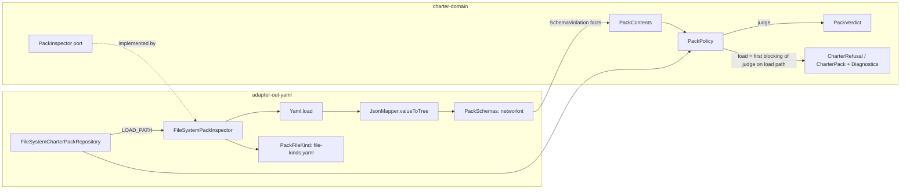

# Implementation Plan: Pack schemas and pack-level policy in the domain

**Branch**: `feat/pack-schemas-and-level-policy` | **Date**: 2026-10-19 | **Spec**: [spec.md](spec.md)
**Input**: Mission specification from `kitty-specs/pack-schemas-and-level-policy-01M5AFMA/spec.md` (rulings R1-R16)

## Summary

This plan does four things:

1. **Imports the pack schemas.** Core's 14 pydantic pack and artifact models come in as this
   repository's canonical JSON Schemas under `contracts/packs/schemas/`. They are produced by a
   reproducible export-and-transform script, which applies every change the rulings require.
2. **Validates the load path.** The YAML adapter validates the three load-path file kinds
   against those schemas with networknt `json-schema-validator` 3.0.8, on the Jackson 3 version
   Boot manages.
3. **Moves the pack rules into the domain.** The pack-level policy (#48), and every rule a schema
   cannot express, become one pure domain service. That service emits **pack findings**.
4. **Adds the validate mode.** It collects every finding of a pack root. The load path is its
   fail-fast projection over the load-path files.

Open-packs is migrated upstream to URN-only endpoints, with no fragment header fields. The
charter catches up to open-packs `main`'s layout and re-pins to that migration. A non-vacuous
acceptance check then classifies and validates every open-packs YAML file at the pinned commit.

## Technical Context

**Language/Version**: Java 25 (toolchain `/opt/jdk-25` locally, Temurin 25 in CI); Gradle 9.8.1 Kotlin DSL; Python 3.13 for the one-off schema export from core's venv (not part of the build)
**Primary Dependencies**:
- snakeyaml-engine 3.2 (existing; parses YAML to plain maps and lists).
- **New:** `com.networknt:json-schema-validator:3.0.8`, in `adapter-out-yaml` only. Its `tools.jackson.core:*` and `tools.jackson.dataformat:jackson-dataformat-yaml` transitives are excluded, and Jackson 3 `jackson-databind` is taken from the Spring Boot 4.1.1 BOM (3.1.5), so the service's Jackson version does not move. `org.slf4j:slf4j-api` is also excluded and declared BOM-versioned, so networknt's 2.0.19 does not silently override Boot's 2.0.18.
- Spring Boot 4.1.1 (existing, service only); ArchUnit, JUnit 5, AssertJ, Cucumber (existing tests); PIT (existing, nightly).

**Storage**: Files only. Pack roots on disk (YAML), and schemas bundled as classpath resources of `adapter-out-yaml`.
**Testing**:
- JUnit 5 and AssertJ unit tests per module, test first.
- Cucumber contract scenarios (`contracts/charter/scenarios/packs.feature`, run by `:charter-service:test`).
- ArchUnit (`HexagonalArchitectureTest`).
- The `@Tag("open-packs")` round-trip, plus the new open-packs acceptance check (`:adapter-out-yaml:openPacksRoundTrip`, part of `check`).
- PIT on the new domain classes, run by the mission.

**Target Platform**: The JVM service (loopback daemon per ADR-0011), on Linux and macOS developer machines and in the GitHub Actions CI.
**Project Type**: A single Gradle multi-module project (`service/*`, `contracts`, `build-logic`).
**Performance Goals**:
- Validate mode over all 409 mapped open-packs files completes in under 15 s.
- The open-packs load gets no more than 2 s slower (NFR-002).
- Schemas are compiled once per process and cached.

**Constraints**:
- No network during validation (NFR-005).
- Strict SHA-256 dependency verification.
- The domain stays plain Java, with no annotations (ADR-0006).
- No generated records (ADR-0017 D5).
- No OpenAPI change beyond C-001.
- Runner A owns the REST, read-app and action-context layers (C-005).

**Scale/Scope**:
- 14 schemas, 13 exercised by open-packs.
- 516 open-packs YAML files: 409 mapped, 107 excluded.
- About 10 new domain types, about 6 adapter types.
- 5 contract-scenario changes.
- 1 open-packs PR.

## Charter Check

*GATE: passes before Phase 0 research; re-checked after Phase 1 design.*

| Charter rule (`.kittify/charter/charter.md`) | How this plan complies |
|---|---|
| Never diverge from the oracle (line 22) | Every deliberate difference from core is an operator ruling (R4-R16), listed in `VENDORED.md` and the divergence register. The corpus acceptance re-checks core's verdict on every planted file (FR-012). |
| Never break the OpenAPI contract (line 25) | The contract changes are only those C-001 lists. The contract is `1.0.0-SNAPSHOT` with no `contract-charter-v*` tag, so the release gate compares nothing. oasdiff would classify the `DiagnosticCode` value as breaking (`response-property-enum-value-added`) once a 1.x baseline exists, so this mission must land before the first 1.x tag (risk K3). |
| Open-packs round-trips exactly, and no unverified dependency (line 29) | The round-trip stays and moves to the new layout. networknt and `itu` get Gradle-generated SHA-256 entries. The DIRECTIVE_051 evidence is in [research.md](research.md#r2-dependency-and-supply-chain). |
| Adversarial squad at the plan point and before merge (line 37) | The plan-point squad runs after this plan. The pre-PR squad runs at closeout. |
| A call made without review is logged (line 39) | Spec "Open review items". The plan adds its own calls under [Calls made in this plan](#calls-made-in-this-plan). |
| `verifyAll` on Java 25, style gates (lines 43-49) | The new code follows Palantir, Checkstyle, Error Prone, NullAway and doclint. Every new public type has Javadoc. |
| Docs checks (line 50) | NFR-004. The new docs (register, ADR amendment, PlantUML) go through `check_docs.py all` plus `plantuml`. |
| Scenarios first (line 54) | FR-013: each wire change starts as a red scenario. |
| Test first, no fake green (line 56) | C-007. The red runs are kept in the mission's evidence (`tracer`). The acceptance checks assert exact counts and the pinned HEAD. |
| DDD in core's vocabulary (line 57) | The glossary rows and the canonical node-kind names (R14). `PackFinding` is defined in `docs/context/domain.md`. |
| C4 (line 58) | The write-model class diagram is a C4 code-level (level 4) view of the authored pack files. |

**Result**: pass. There are no violations, so Complexity Tracking is empty.

## Project Structure

### Documentation (this mission)

```text
kitty-specs/pack-schemas-and-level-policy-01M5AFMA/
├── spec.md
├── plan.md              # this file
├── research.md          # Phase 0: decisions with evidence
├── data-model.md        # Phase 1: domain types, findings, codes
├── quickstart.md        # Phase 1: how to run, regenerate, verify
├── contracts/           # Phase 1: finding-code catalogue and contract deltas
│   ├── pack-finding-codes.md
│   └── contract-deltas.md
└── tasks.md             # /spec-kitty.tasks (not created here)
```

### Source Code (repository root)

```text
contracts/packs/
├── schemas/*.schema.json     # NEW: 14 canonical schemas (Draft 2020-12); every $id and $ref ends in .json
├── file-kinds.yaml           # NEW: single authority: file-name rule -> kind -> schema; node kinds and
│                             #      fragment plurals; reviewed exclusion classes with reasons
├── VENDORED.md               # NEW: origin, export command, every change (C1..Cn) with its ruling
└── README.md                 # NEW
contracts/charter/schemas/{DiagnosticCode,CharterRefusalCode}.yaml   # FR-013 D1, D2
contracts/charter/scenarios/packs.feature                            # FR-013 D3-D7
contracts/charter/CHANGELOG.md                                       # 1.0.0-SNAPSHOT lines
scripts/packs/sync_schemas.py # NEW: export from core's venv + apply the listed changes (one script)

service/charter-domain/src/main/java/ai/speckitty/charter/domain/
├── PackDescriptor.java       # facts: declaredLevel Optional, requiresCore, undeclaredKeys
├── CharterPack.java          # IllegalArgumentException guard on declared != configured (programming error)
├── Diagnostic.java           # + Code.PACK_UNKNOWN_KEY
├── NodeKind.java             # + fromPlural(String): the one Java owner of fragment plurals (R14)
├── PackRoot.java             # NEW: name, Optional<PackLevel> configuredLevel, opaque locator
├── PackContents.java         # NEW: facts read from one root; nested FileRead<T>, SchemaViolation,
│                             #      RawGraph/RawNode/RawEdge, StepContractFacts, ArtifactFacts, AssetFacts,
│                             #      ClassifiedFile
├── PackFinding.java          # NEW: code, file, place (pointer segments), detail; severity from the code
├── PackFindingCode.java      # NEW: catalogue; severity, wire projection (throws when unmapped)
├── PackPolicy.java           # NEW: pure; the ONLY place codes are chosen and texts are formatted
├── PackVerdict.java          # NEW: files + findings
├── PackInspector.java        # NEW port: inspect(PackRoot, Scope) -> PackContents; Scope = LOAD_PATH | FULL
└── Pep440.java               # NEW: static boolean isValidSpecifierSet(String)

service/adapter-out-yaml/src/main/java/ai/speckitty/charter/yaml/
├── PackSchemas.java          # NEW: strict 2020-12 registry, bundled-only IRIs, metaschema check, cache
├── PackFileKind.java         # NEW: reads the bundled file-kinds.yaml (classification without validation)
├── FileSystemPackInspector.java # NEW: implements PackInspector for both scopes; never throws on content
├── PackDescriptorReader.java # parse + schema -> FileRead<PackDescriptor> facts; no texts, no codes
├── GraphDocumentReader.java  # parse + schema -> FileRead<RawGraph> facts; no texts, no codes
└── FileSystemCharterPackRepository.java  # load = PackPolicy.load(inspector.inspect(root, LOAD_PATH))

service/adapter-out-yaml/src/test/...           # PackSchemasTest (FR-006), mapper and vocabulary tests,
                                                # planted/** + planted/core-verdicts.json, OpenPacksRoundTripTest
service/charter-service/src/test/...            # ArchUnit rules + fixtures; contract scenarios
build-logic/ or service/adapter-out-yaml/build.gradle.kts   # networknt + exclusions + BOM platform
gradle/{libs.versions.toml,verification-metadata.xml}, gradle.properties (openPacksRef)
.github/workflows/service.yml                   # pin read from gradle.properties, fails on blank
docs/conformance/{divergence-register.md,divergences.yaml}, docs/adr/0017-…, docs/architecture/**,
docs/architecture/diagrams/pack-write-model.puml, docs/context/{domain,system-context}.md,
docs/guides/service-build.md
packs/internal, packs/qa                        # re-vendored from the pinned open-packs commit
```

**Structure Decision**:
- **No new modules, and no read-app change.** C-005 applies, and ADR-0006's slices are still
  Proposed.
- **The validate-mode seam is the `PackInspector` port plus the pure `PackPolicy`.** Both live in
  the domain (ADR-0006 D2/D3). #115 adds the application-ring use case that composes them, and
  will move the composition `FileSystemCharterPackRepository` does today into the application
  ring. That interim placement is recorded in the repository port's Javadoc.

## Architecture



### One owner of every decision and every text

- **The adapter reports facts only.** It never builds a `PackFinding`, chooses a code or formats
  a text. It hands `PackContents` to the domain:
  - each file as a `FileRead<T>`: `Absent`, `Unreadable(ParseFailure | List<SchemaViolation>)`
    or `Read(T)`;
  - networknt errors reduced to `SchemaViolation(file, pointer segments, keyword, property, value, args)`;
  - raw graph documents as strings and numbers (`RawGraph`, `RawNode`, `RawEdge`);
  - the facts the rules need.
- **`PackPolicy` is the single owner.**
  - It chooses every `PackFindingCode` and formats every detail with today's vocabulary (table
    below).
  - It builds `DoctrineGraph` from `RawGraph`, so the URN binding, the legacy `in_tension_with`
    mapping and the `impacts` strength rule (NaN and infinity included) become collected domain
    rules, not adapter exceptions.
  - `DrgEdge` keeps its constructor check as a programming-error guard only.
- **Absent and unreadable are different.** A rule fires only on `Absent` or `Read`, never on
  `Unreadable`. A schema-invalid `pack.yaml` therefore never also yields "has no pack.yaml", and
  a schema-invalid fragment never yields `org_fragment_missing`.
- **The configured level is optional.** On a bare path (#115 parity with core's
  `validate_pack(path)` without `expected_level`):
  - the mismatch rule is skipped, as core does;
  - `org_fragment_missing` keys on the declared level.

### Load is a projection of judge (I2, by construction)

- **`load(contents)` is `firstBlocking(judge(contents) restricted to loadPath(contents))`.**
  During the chain, WP01 ships a transitional `load(contents, graph)`, WP05 adds `load(contents)`
  beside it, and WP07 switches the adapter and deletes the transitional overload, so every commit
  compiles and stays green. The
  load then either refuses with that finding or builds the `CharterPack` with the warnings as
  `Diagnostic`s. There is no second rule list.
- **`loadPath` is one shared function.** It covers `pack.yaml`, the root `*.graph.yaml` shards and
  `drg/fragment.yaml`, plus the pack-level findings attached to `pack.yaml`.
- **The inspector has one reader path for both scopes.** `LOAD_PATH` only skips reading the other
  files.
- **A parametrized adapter test over every planted pack and every open-packs pack** asserts that
  `repository.load` refuses if and only if the restricted `judge` is blocking. When it refuses,
  the code and text match. When it does not, the diagnostics equal the restricted warnings.

### Precedence (pinned; it preserves today's behavior)

Findings are ordered first by file group, then within a file.

1. `pack.yaml` (parse, schema, `requires_core`, unknown keys).
2. The root shards in name order.
3. `drg/fragment.yaml`.
4. The pack-level and pack-wide rules (`pack_level_mismatch`, `org_fragment_missing`), attached
   to `pack.yaml` with an empty place.
5. In validate mode only, the remaining files in path order.

Within a file, findings are ordered by pointer segments:
- object keys follow the schema's `properties` declaration order (so `nodes` comes before
  `edges`, as the reader does today);
- array indices compare numerically.

Today a level mismatch loses to a bad shard, because the mismatch is thrown at construction after
the graph is read. Group 4 keeps that. A two-fault test pins it.

### The detail vocabulary (`PackPolicy`, keyed on keyword plus place, never on networknt's message)

| Keyword | Place | Text (`<o>` is the origin) |
|---|---|---|
| parse failure | file | `<o> is not valid YAML: <first line>`; pack descriptor: `pack.yaml of <n> is not valid YAML` |
| `type` object | root | `<o>: expected a mapping`; pack descriptor: `pack.yaml of <n> is not a mapping` |
| `type` object | node or edge item | `<o> node: expected a mapping` / `<o> edge: expected a mapping` |
| `type` array | — | `<o> <key>: expected a list` |
| `type` string | — | `<o>: '<k>' must be a string`; pack descriptor: `pack.yaml of <n>: <k> must be a string` |
| `type` number, integer, boolean | — | `<o>: '<k>' must be a number`, `… an integer`, `… a boolean` |
| `additionalProperties` | — | `<o>: unknown key '<k>'`; at a node or edge: `<o> node: unknown key '<k>'` |
| `required` | — | `<o>: missing '<k>'`; pack descriptor: `pack.yaml of <n> has no <k>` |
| `minLength` | fragment node `id` | `<o>: a node of kind '<kind>' has an empty id` |
| `pattern` | fragment node `id` | `<o>: node id '<v>' is not <kind>:<id>-safe` |
| `pattern` | shard node `urn` | `<o>: node urn '<v>' is not <kind>:<id>` |
| `pattern` | per-kind `if/then` on a shard node | `<o>: node <urn> declares kind '<kind>'` |
| `pattern` | edge `source` or `target` | `<o>: edge endpoint '<v>' is not a URN` (R6) |
| `pattern` | other | `<o>: '<k>' does not match its pattern` |
| `enum` | relation, kind, `pack_level` | `<o>: unknown relation '<v>'`; `<o>: node <id> has unknown kind '<v>'`; `pack.yaml of <n> declares an unknown pack_level '<v>'` |
| `enum`, `const` | other | `<o>: '<k>' has an unsupported value '<v>'` |
| `minItems` | — | `<o>: '<k>' needs at least <n> item(s)` |
| `minimum`, `maximum`, `exclusiveMinimum` | — | `<o>: '<k>' <v> is out of range` |
| `anyOf` over a nullable `[T, null]` | — | Collapsed to the non-null branch's error. Other `anyOf`/`oneOf` use the fixed fallback |
| any other keyword | — | Fixed and locale-free: `<o>: '<pointer>' breaks schema keyword '<keyword>'` |

The `impacts` texts ("an impacts edge is missing 'impacts'", "a <rel> edge has no 'impacts'" and
"'impacts' <v> is outside [-1, 1]") are `PackPolicy` rules over `RawEdge`. The schema declares
`impacts` as an optional number only.

Two tests protect the table:
- one walks every bundled schema and fails on any keyword the table has no row for;
- one per FR-003 literal, red first against today's reader.

### Pack-level codes confined (FR-002)

ArchUnit enforces the following.
- **Only `PackPolicy`** (and each enum itself) accesses:
  - `Diagnostic.Code.PACK_LEVEL_MISSING`;
  - `PackFindingCode.PACK_LEVEL_MISSING`;
  - `PackFindingCode.PACK_LEVEL_MISMATCH`.
- `RefusalCode.PACK_LEVEL_MISMATCH` is accessed only by `PackPolicy`, `PackFindingCode` and
  `..rest..` (`RefusalHandler$1`, the title switch).
- **Each route has a negative fixture**, following the self-exemption pattern at
  `HexagonalArchitectureTest.java:95-103`.
- **`CharterPack` keeps an `IllegalArgumentException` guard** for a declared level that differs
  from the configured one. `CharterOfferingTest`'s mismatch assertion moves to `PackPolicyTest`:
  the behavior moves, not just a test shape.

### Vocabulary kept in sync (one authority, checked)

- **`contracts/packs/file-kinds.yaml` is the single data authority.** It holds the 15 node kinds,
  the fragment plurals (R14), the file-name rules and the exclusions.
- **`sync_schemas.py` reads its kind lists from that file** to generate the URN alternation and
  the 15 per-kind `if/then` branches.
- **On the Java side,** `NodeKind` (with the new `fromPlural`) and `ArtifactKind` remain the
  hand-written domain owners (ADR-0017 D5).
- **A vocabulary test in `adapter-out-yaml` asserts four equalities:**
  - the schema's URN alternation and the `NodeKind` tokens;
  - the fragment `kind` enum, `NodeKind.fromPlural`'s domain and `file-kinds.yaml`;
  - the `file-kinds.yaml` artifact kinds and the `ArtifactKind` tokens;
  - the `PackFindingCode` projections and the contract's `DiagnosticCode`/`CharterRefusalCode` enums.

### Schema loading (NFR-005)

- **Bundled only.** `PackSchemas` maps the `$id` prefix
  `https://schemas.spec-kitty.ai/charter/packs/` to `classpath:packs/schemas/`. Its loader allows
  that prefix plus the bundled 2020-12 metaschema IRIs, and blocks every other IRI.
  - A negative test shows a remote `$ref` is refused.
  - A positive test shows a bundled `$ref` resolves.
- **Strict keywords.** The dialect uses `DisallowUnknownKeywordFactory`.
- **`.json` only.** A test asserts every `$id` and `$ref` ends in `.json`. A `.yaml` IRI would
  route to the excluded YAML mapper and throw `NoClassDefFoundError`.
- **JDK regex.** The optional regex engines (joni, GraalJS) are absent, so networknt uses JDK
  regex. The generated patterns use only constructs that are portable between ECMA-262 and Java.
  This is stated in `VENDORED.md`.
- **FR-006 lives in `PackSchemasTest`** (`adapter-out-yaml`, run by `check`). It checks the
  metaschema, unique `$id`s, local refs, strict keywords, that `VENDORED.md` lists every file, and
  a planted broken schema. There is no separate contracts-module checker: the adapter is the
  schemas' only consumer, and a second validator is out of bounds under C-002.

### Open-packs pin (FR-011, P6)

- **`gradle.properties`** holds `openPacksRef=<40 hex>`.
- **CI step.** A `service.yml` step reads it into `$GITHUB_OUTPUT`, fails on an empty value or one
  that is not 40-hex, and passes it to `actions/checkout`.
- **Gradle.** It passes the pin to the test as a `systemProperty`, which is a task input.
- **The test asserts three things:**
  - the pin is 40-hex;
  - `git -C <dir> rev-parse HEAD` equals the pin;
  - `git status --porcelain --untracked-files=all` is empty.

  The failure message prints the exact `git checkout` command.

## Calls made in this plan

These are logged because the charter records every call made without review. The plan squad has
reviewed them; see the dispositions in research.md R9.

- **P1.** The new diagnostic code is named `pack_unknown_key`.
- **P2.** The `extends` relation alias is refused in fragments: R14's one-name rule, applied to
  relations. Java refuses it today. Recorded in the register.
- **P3.** The validate-mode-only codes never reach the wire in this mission:
  `artifact_schema_error`, `duplicate_step_id`, `duplicate_artifact_id`, `asset_path_escape`,
  `asset_mime_invalid` and `org_charter_schema_error`.
- **P4.** `org_fragment_missing` and `requires_core_invalid` project to the `pack_unreadable`
  refusal.
- **P5.** The schema `$id` base is `https://schemas.spec-kitty.ai/charter/packs/<file>.json`. It
  is never fetched.
- **P6.** The open-packs pin moves into `gradle.properties` (`openPacksRef`).
- **P7.** The `charter.yaml` schema is validated by planted fixtures. Whether this repository's own
  `.kittify/charter/charter.yaml` validates is measured and recorded, not enforced.
- **P8.** The asset MIME check uses a fixed extension table from Python's built-in
  `mimetypes.types_map`, without system `mime.types` files. Recorded as a possible divergence.
- **P10.** Edge `provenance` (core's merge-time marker, `drg/models.py:409-412`) is not part of the
  authored edge schema, so it is refused. This applies R7's principle that runtime provenance is not
  authored. No open-packs DRG edge carries it. Recorded as DIV-019.
- **P11.** The `impacts` relation and edge strength are added to the imported schemas (WP02 C7 and
  C12), because core has neither. This is not a new call: ADR-0009 D1 and ADR-0014 D-2 already
  rule that the contract leads. Recorded as DIV-018.
- **P12.** FR-010's production entry point is a pure domain service, `PackValidation(PackInspector)`.
  It is not an application-ring use case, because the read-app belongs to runner A (C-005). #115
  composes it.
- **P9.** A pattern-invalid fragment node id gets a new text (`node id '<v>' is not
  <kind>:<id>-safe`). No test pins one today.

## Implementation Concern Map

> **Note**: Implementation concerns are NOT work packages and are NOT executable units.
> `/spec-kitty.tasks` translates these into executable WPs — one concern may become
> multiple WPs; multiple small concerns may merge into one WP. Do not label concerns
> with WP-style IDs or sequencing language.

### IC-01 — Finding model and the pack-level policy in the domain (#48)

- **Purpose**: Establish the domain's finding model and make the domain the sole owner of the
  pack-level outcomes, with architecture rules that keep it so.
- **Owns the types other concerns build on**: `PackFinding`, `PackFindingCode`, `PackPolicy`,
  `PackRoot`, `PackContents` (with `FileRead`), `PackVerdict`.
- **Relevant requirements**: FR-001, FR-002, FR-003 (pack-level texts); SC-003, SC-004.
- **Affected surfaces**:
  - `charter-domain`;
  - `PackDescriptorReader` and `FileSystemCharterPackRepository` (pack-level facts only);
  - `HexagonalArchitectureTest` and its fixtures;
  - `CharterOfferingTest` (the behavior move);
  - `GovernanceFingerprintTest`;
  - read-app `PackListingQueryTest` and `ActionContextQueryTest` (shape only, C-005).
- **Sequencing/depends-on**: none.
- **Risks**: Runner A edits the read-app tests too, so expect a rebase. Pin the unknown-`pack_level`
  text before it moves.

### IC-02 — Open-packs migration, layout catch-up and re-pin

- **Purpose**: Make the pinned corpus satisfy URN-only endpoints and header-free fragments, and
  make the charter read open-packs `main`'s layout.
- **Relevant requirements**: FR-017, FR-011 (pin mechanics), R11; NFR-001.
- **Affected surfaces**:
  - open-packs PR #52 (opened 2026-10-19; head `0b19a83`);
  - `OpenPacksRoundTripTest` (layout and the `internal` diagnostics row);
  - `gradle.properties` and `.github/workflows/service.yml`;
  - `packs/internal` and `packs/qa`, re-vendored with an updated `PROVENANCE.md`.
- **Acceptance**: after the re-vendor, the installed `spec-kitty` (4.0.0rc8) reports clean on both
  `charter context --action plan` and `doctor charter-packs`.
- **Sequencing/depends-on**: none. The pin points at #52's head until the operator merges it.
- **Risks**: K1 (merge timing).

### IC-03 — Canonical schemas and provenance

- **Purpose**: Produce 14 canonical schemas in `contracts/packs/` that are reproducible from core,
  with every change listed and one data authority for the kinds.
- **Relevant requirements**: FR-004, FR-005, FR-014 (schema side); R1-R2, R4-R9, R13-R15.
- **Affected surfaces**: `contracts/packs/**` and `scripts/packs/sync_schemas.py`.
- **Sequencing/depends-on**: none.
- **Risks**: K8. The probe is re-run on the transformed schemas against the pinned corpus before
  the commit.

### IC-04 — Validator dependency and schema loading

- **Purpose**: Add networknt under the supply-chain rules, confined to the adapter, with schemas
  loaded strictly, offline and once.
- **Relevant requirements**: FR-006, FR-007; NFR-005; C-002, C-006.
- **Affected surfaces**:
  - `gradle/libs.versions.toml` and `gradle/verification-metadata.xml`;
  - `service/adapter-out-yaml/build.gradle.kts`, with exclusions for `tools.jackson.core`,
    `tools.jackson.dataformat:jackson-dataformat-yaml` and `org.slf4j:slf4j-api`, and
    BOM-versioned direct `jackson-databind` and `slf4j-api`;
  - `PackSchemas`, `PackFileKind` and `PackSchemasTest`;
  - the ArchUnit networknt confinement and its fixture;
  - `docs/guides/service-build.md` (a BOM platform in a non-Spring module).
- **Sequencing/depends-on**: IC-03.
- **Risks**: K5 and K6. The `dependencyInsight` evidence for `jackson-*` and `slf4j-api` is
  recorded.

### IC-05 — Load path on the schemas; the wire changes scenarios-first

- **Purpose**: The three load-path kinds are read as facts and judged by `PackPolicy`. The
  hand-coded duplicates go. The five wire changes land scenario-first. Every unchanged pinned text
  holds.
- **Relevant requirements**: FR-003, FR-008, FR-013; R3, R5-R8, R13, R16 (fragment required);
  C-001.
- **Affected surfaces**:
  - the readers, the inspector (`LOAD_PATH`) and the repository;
  - the `PackPolicy` vocabulary and graph building;
  - `Diagnostic.Code`, the contract enums, `packs.feature` and the contract CHANGELOG;
  - any scenario fixture with an org pack that has no fragment.
- **Sequencing/depends-on**: IC-01, IC-04.
- **Risks**: K2 and K4. The I2 parametrized test, and the precedence two-fault test.

### IC-06 — Validate-mode rules (#115 preparation)

- **Purpose**: Turn the single-pack rules that need the full scope into pure `PackPolicy` rules,
  and fill the inspector's `FULL` scope.
- **Relevant requirements**: FR-009, FR-010, FR-016; R3 (grammar), R16; NFR-003; SC-005.
- **Affected surfaces**: `Pep440`, the `PackPolicy` rules (step ids, artifact ids, assets, org
  fragment) and `FileSystemPackInspector` (`FULL`).
- **Sequencing/depends-on**: IC-01, and IC-04 for the adapter half.
- **Risks**: K7. The PEP 440 corpus is generated with core's pinned `packaging` version plus an
  adversarial list. PIT runs with a committed init script and DEFAULTS mutators, and every
  surviving mutant gets an equivalence rationale.

### IC-07 — Non-vacuous open-packs acceptance and planted files

- **Purpose**: Prove the schemas and rules on the real corpus, at the pinned HEAD with exact
  counts, and plant one invalid file per change and rule, cross-checked against core in a
  machine-readable record.
- **Relevant requirements**: FR-011, FR-012; SC-001, SC-002; NFR-002.
- **Affected surfaces**:
  - `OpenPacksAcceptanceTest`, which holds the classification, validation and timing checks and
    shares the pin, the walk and the DIAGNOSTICS table with `OpenPacksRoundTripTest` through
    `OpenPacksCorpus`;
  - `src/test/resources/planted/**`;
  - `planted/core-verdicts.json` (core SHA, command, raw JSON, and agree or divergence with a
    register id) plus a bijection test;
  - a non-gating `scripts/packs/core_verdicts.py`.
- **Sequencing/depends-on**: IC-02, IC-03, IC-04, IC-06.
- **Risks**: Counts drift when the pin changes, and they move with it. NFR-002 is measured in the
  same job: baseline commit against the change, cold and warm, median of 5 runs. A loose
  `assertTimeout` (2× the budget) guards it.

### IC-08 — Docs, decision records, glossary and the write-model diagram

- **Purpose**: One authority per concept in the docs: the ADR-0017 amendment, the divergence
  register, the canonical vocabulary and the PlantUML write model.
- **Relevant requirements**: FR-014, FR-015; R10, R14; NFR-004.
- **Affected surfaces**:
  - `docs/adr/0017-*.md` and `docs/conformance/*`;
  - `docs/architecture/{descriptors,descriptor-schemas,logical-model}.md` and
    `docs/architecture/diagrams/pack-write-model.puml`;
  - `docs/context/{domain,system-context}.md`, the full glossary page, and
    `docs/plans/open-questions.md` (the Q13 link).
- **Sequencing/depends-on**: IC-03, IC-05.
- **Risks**: The PlantUML pin check, and the terms guard and cspell wordlist.

## #115 doctor parity test design (FR-016; designed, not implemented)

1. **Inputs.**
   - Every pack root of open-packs at the pinned commit.
   - The planted packs under `planted/`.
   - A scratch git project per run, with `.kittify/config.yaml` registering the pack, because
     `doctor charter-packs` needs a project.
2. **Oracle.**
   - Core's `spec-kitty charter pack validate --json <pack>` through the CLI path
     (`validate_pack_with_org_charter`).
   - Shape: `{ok, errors[], advisories[]}`, each item `{severity, artifact_type, artifact_id, file, message, category?}`.
   - It is run through the ADR-0016 harness, which this repository builds under #72.
3. **Subject.** `PackPolicy.judge(PackInspector.inspect(PackRoot(name, Optional.empty(), path), FULL))`
   returns the `PackVerdict`. The configured level is left empty on purpose, to match core's
   bare-path `validate_pack`.
4. **Normalisation.**
   - Core's findings are de-duplicated by `(file, category)`, because core reports an unknown
     `pack.yaml` key twice: as `drg` and as `pack`.
   - Absolute paths become pack-relative.
   - Severities map as error → blocking and advisory → warning.
   - Core findings with no category are classified by `artifact_type`.
5. **Mapping.** The table in [contracts/pack-finding-codes.md](contracts/pack-finding-codes.md#core-mapping).
   It covers the rows core can produce for one pack. Rows that need the built-in layer
   (`drg_kind_drift`, intent rules, `profile_skipped`) are excluded with reasons.
6. **Comparison.**
   - Both sides become a multiset of `(file, code, severity)`. Message texts are never compared,
     and neither is place, because core has no place-in-file field.
   - A difference fails the test unless the divergence register lists it with status `open` for
     that surface.
   - Known listed differences:
     - core is fail-fast on an invalid `pack.yaml` (P14), while the service collects every finding;
     - the unknown-key severity (R5);
     - retired fields (R13);
     - URN-only endpoints, where core accepts a bare local id (R6);
     - the fragment kinds `actions` and `anti_patterns` (R14).
7. **Seam left by this mission.**
   - The `PackInspector` port and the `PackPolicy.judge` and `PackVerdict` types.
   - The stable `PackFindingCode` catalogue.
   - The register's machine-readable `divergences.yaml`, which the comparison reads.

## Risks

| # | Risk | Mitigation |
|---|------|------------|
| K1 | The open-packs PR is not merged while the charter PR waits | The pin points at the PR head and the charter PR is marked blocked. If upstream squash-merges, the pin moves to the merge commit in one change with any count updates. |
| K2 | The parallel runner A conflicts on `packs.feature`, the CHANGELOG and `PackListingQueryTest` | Minimal hunks. Rebase onto A at closeout, union-resolving the CHANGELOG. |
| K3 | A `contract-charter-v1.*` tag lands before this mission | The `DiagnosticCode` addition would then be breaking. Check the tags at closeout and ask the operator if one exists. |
| K4 | Error-text drift from the schema mapper | FR-003 lists every pinned text. The mapper is table-driven with one test per row, run red first against today's reader. |
| K5 | Maven Central 429 | Bounded retries, `--max-workers=2`. Never hand-edit the verification metadata. |
| K6 | The service's Jackson version moves | The exclusions plus the BOM platform, verified with `dependencyInsight` in the dependency change. |
| K7 | PEP 440 grammar mismatch | A corpus from `packaging`, committed with provenance and run in both directions. |
| K8 | Closing nested sections refuses real files | The corpus probe re-runs on the transformed schemas before they are committed. |
