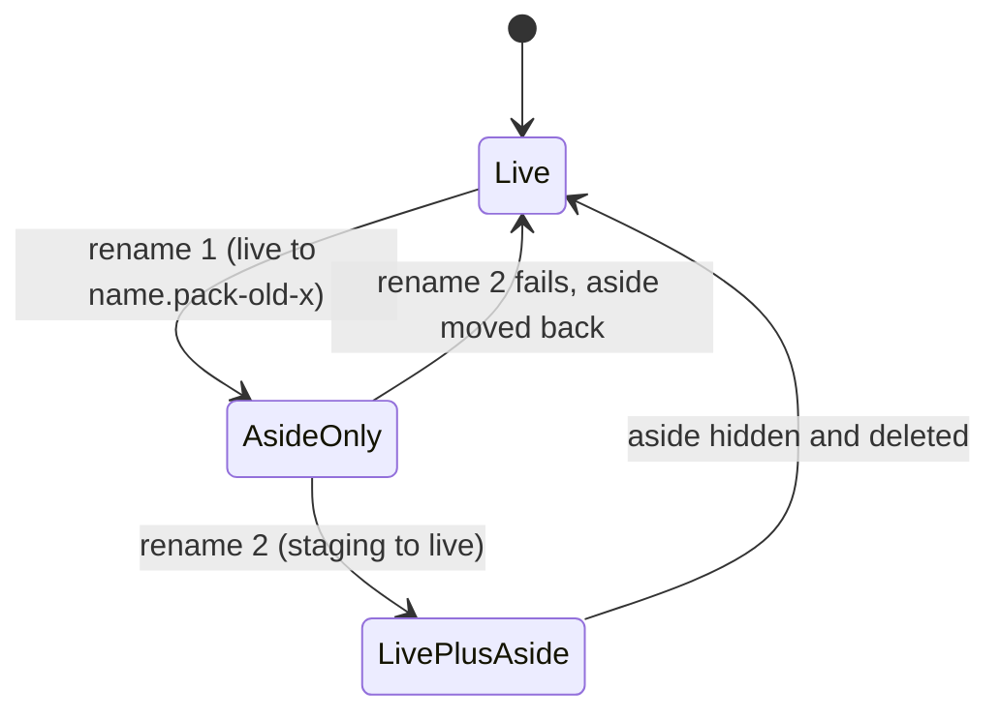

# Data model: Slice B

## Pack file classification (file-kinds.yaml)

| Result | Source | Load | Registration | Validate mode | Digest | Gate census |
|---|---|---|---|---|---|---|
| Mapped | `files` rule | held by its kind | held | read and checked | yes | `<kind>` |
| Excluded | `exclusions` rule | not held | **not refused** (was: `unmodelled`); stripped before the commit, reported as diagnostic `file_not_held` | listed with its reason | no | `other:<segment>` (gate status `EXCLUDED`) |
| Retired | `retired` rule | violation `retired` + reason | `422`, code `retired` | `artifact_schema_error`, "is retired: <reason>" | yes, tail | `retired:<match>` |
| Payload | `payloads` rule | held as asset or template | held | listed | yes | `<kind>` |
| Companion | a kind's descriptor | held with its owner | held | read | yes | its owner's kind |
| **Ignored** (new) | `ignored` rule, after all of the above | classified as Excluded with the rule's reason (as built in WP03; no separate result) | as Excluded | as Excluded | no | as Excluded |
| Unclassified | nothing | — | `422`, code `unmodelled` | skipped | no | `other:<segment>` |

Invariants:
- No file matches a `files` and an `exclusions` rule, nor a `retired` rule and either (unchanged).
- An `ignored` rule never applies to a file another rule or a companion claim takes.
- `ignored` rules have `match` and `reason`, both required; any other key fails the table.

### Rule changes

| Section | Removed | Added |
|---|---|---|
| `files` | `*/pack.md`, `*/org-charter.yaml` | `*/README.md` → `pack-document`, markdown |
| `retired` | — | `*/pack.md`, `*/PROVENANCE.md`, `*/org-charter.yaml` |
| `ignored` (new) | — | `**/*.md` |

## Pack document

`PackDocument` (domain, unchanged shape): `frontmatter?`, `title?` (H1), `preamble`, `sections[{title, content}]`.
Read from and written to `README.md` at the pack root. Digested in the pack-level tail: presets (path order),
`README.md`, `pack-manifest.yaml`, `policy.yaml`.

`PackDocumentText` (domain, new, read model): `markdown` (the held file's text), `title?`, `body` (canonical Markdown of
preamble and sections). Port `PackDocumentRepository.document(PackIdentifier) → Optional<PackDocumentText>`.

## Pack descriptor

`pack.yaml` loses `active_charter`. `PackPaths` = `{packDrg?, mutabilityPolicy?}`.

## Refusal codes

| Code | Status | Raised by |
|---|---|---|
| `pack_document_not_found` (new) | 404 | `getPackDocument` when the pack has no document |
| `pack_not_found` | 404 | unknown pack (also built-in packs, as `getPack`) |
| (Problem, no code) | 406 | an `Accept` the read cannot produce |

Removed validate-only finding: `org_charter_schema_error`.

## Link relation

`doc`: on the pack resource (and a registration's stored answer) when the pack has a document; targets
`/packs/{packId}/doc`.

## Pack directory during a replace

States of `packs/<name>` during `MOVE_ASIDE`:

Reader rule: `Live` or `LivePlusAside` reads the live directory; `AsideOnly` with exactly one aside reads the aside; no
live directory and zero or several asides refuse as today; a plain empty entry (a create's reservation) reads as
absent. A read whose directory identity (path, file key, creation time) changes under it runs again, only on such
progress, up to 8 moves (one replace moves it twice), then refuses `stale_input` (as built in WP06).
