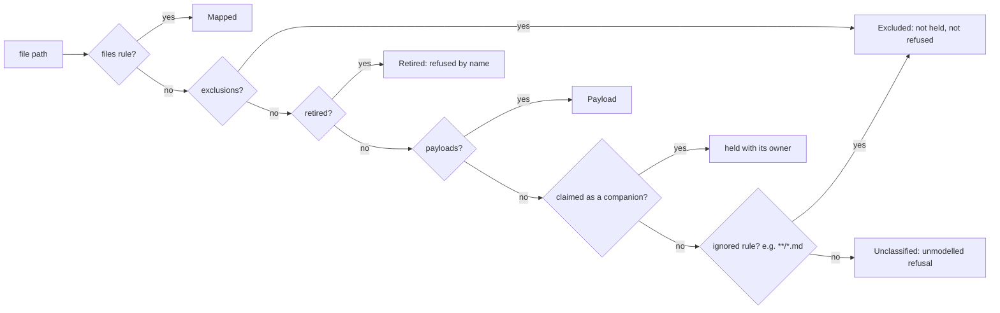

# Implementation Plan: Slice B: real packs register as they are

**Branch**: `kitty/mission-slice-b-real-packs-register-01M7649C` | **Date**: 2026-11-11 | **Spec**: [spec.md](spec.md)
**Input**: Mission specification from `kitty-specs/slice-b-real-packs-register-01M7649C/spec.md`

## Summary

Four rulings, one model change. The pack document moves from `pack.md` to `README.md`; `pack.md`, `PROVENANCE.md` and
`org-charter.yaml` become `retired` rules; unmodelled Markdown becomes a last-resort exclusion; registration stops
refusing excluded files. A new read, `GET /packs/{packId}/doc`, serves the document by content negotiation, and the pack
resource links it as `doc`. Lock-free readers resolve a pack's directory through one resolver that falls back to the
`.pack-old-*` aside during a replace. The `text` comment is reworded. ADR-0042 gets a dated amendment, the contract a
minor with a `### Breaking` note, and open-packs two drafted issues.

The brownfield map behind this plan, with file:line evidence from four scouts, is in [research.md](research.md).

## Technical Context

**Language/Version**: Java 25 (Temurin, `/usr/lib/jvm/temurin-25`); Gradle Kotlin DSL build; Python 3 for docs checks.
**Primary Dependencies**: Spring Boot (web, the generated OpenAPI interfaces), Jackson/SnakeYAML through the existing
codecs, the in-repo Markdown codec (`infra/storage/markdown`), Cucumber for contract scenarios, ArchUnit. No dependency is
added, upgraded or removed (DIRECTIVE_051: nothing to check; strict SHA-256 verification untouched).
**Storage**: the file-system pack store (`PackCommitStore`, `WholePackStore`, `FilesystemPackStore`).
**Testing**: JUnit 5 unit and store tests in `service/packs`; contract scenarios (`contracts/charter/scenarios`, run by
`CharterContractSuite`); the whole-pack round trip over charter's example packs (`:packs:wholePackRoundTrip`, ADR-0070);
contract lint, closed-object, refusal-example and changelog-fragment checks in `contracts/build.gradle.kts`; docs checks.
**Target Platform**: Linux server (container), the charter offering service.
**Project Type**: single Gradle multi-module service plus its contract.
**Performance Goals**: no added latency or lock on hot reads (NFR-001); the doc read is one pack load, as `getPack` is.
**Constraints**: canonical model only (C-001, C-002); Gradle in the foreground, one run at a time, `--max-workers=1`.
**Scale/Scope**: about 60 source and test files for the retirements, one new operation, one new refusal code, one link
relation, one resolver; docs across ADRs, architecture pages, guides and glossary sources.

## Charter Check

| Charter rule | How this plan meets it |
|---|---|
| The charter's model is canonical; no legacy reader | `pack.md`, `PROVENANCE.md`, `org-charter.yaml` move to `retired` rules; `active_charter` leaves the closed descriptor; nothing reads them. |
| Tests and examples carry only the canonical shape | Example packs get `README.md` with `## Provenance`; old shapes only in refusal tests. |
| Contract versioning (ADR-0022) | 0.x minor: one added operation, code and relation; the retirements under `### Breaking`. |
| Round trip is equality of meaning (ADR-0036) | `README.md` keeps `pack.md`'s Markdown model and comparison; no field leaves a check; `expected-red.yaml` gains nothing. |
| Adversarial squad at plan point and before merge | Plan-point squad over spec, plan and research before tasks; pre-merge squad over the integrated diff. |
| Gates before merge | `verifyAll` on Java 25, the whole-pack round trip, docs checks (NFR-003). |
| Issue rules (`docs/development/issue-tracker.md`) | Minors folded or dropped; `Closes` #451, #431, #490, #432 in the PR; #466 ticked; #381 closed not planned. |
| Calls made without review are logged | "Calls made by the mission" in spec.md, decisions D1 to D9 in research.md. |

No violations; Complexity Tracking is empty.

## Project Structure

### Documentation (this mission)

```
kitty-specs/slice-b-real-packs-register-01M7649C/
├── spec.md, plan.md, research.md, data-model.md, quickstart.md
├── contracts/pack-doc.openapi.yaml      # the new operation, as it lands in contracts/charter
├── research/
│   ├── open-packs-TBD-readme-doc.md
│   ├── open-packs-TBD-org-charter-preset.md
│   └── squad-plan-point.md, squad-pre-merge.md
└── tasks/
```

### Source Code (repository root)

```
contracts/packs/file-kinds.yaml, schemas/            # rules, retired, ignored, schemas
contracts/charter/openapi.yaml, paths/, schemas/, examples/, scenarios/, changes/, lint/ruleset.yaml
service/kernel/…/domain/                              # RefusalCode, PackPaths
service/packs/…/domain/                               # PackDocument, PackPolicy, PackFindingCode, new port
service/packs/…/application/                          # PackDocumentQuery, PackSummaryQuery
service/packs/…/infra/storage/                        # PackFileKind, WholePackStore, PackFileSet, inspector, resolver
service/packs/…/infra/api/                            # controller + mapper (doc link)
service/web-transport/…/RefusalHandler.java           # status of the new code
service/packs/src/testFixtures/resources/example-packs/
docs/adr/, docs/architecture/, docs/guides/, docs/development/, site/.contextive/, scripts/usability/
```

**Structure Decision**: the existing onion slices (ADR-0006). The doc read is an application query over a new domain
port whose implementation lives in `infra.storage`; the controller lives in `infra.api`.

## Design

### Classification (FR-001 to FR-005, FR-009, FR-016)



- `files`: `*/pack.md` becomes `*/README.md` (schema `pack-document`, `content_form: markdown`); `*/org-charter.yaml`
  is removed.
- `retired`: `*/pack.md` (reason: the pack document is `README.md`), `*/PROVENANCE.md` (reason: folded into
  `README.md` as a provenance section), `*/org-charter.yaml` (reason: an activation preset with must-have items plus
  `policy.yaml`). Root-anchored, like the existing rules.
- New top-level `ignored` section: `match: "**/*.md"` with a reason. It is consulted only after `payloads`, and a
  companion claim wins over it: classification returns Excluded with the rule's reason (as built in WP03: no distinct
  `Ignored` result), and companion resolution treats it as unclaimed, so skill bodies are still claimed. Load,
  registration, validate mode and the gate census treat it as excluded (decision D2).
- The load's `unmodelled` list drops every file classified as excluded or ignored, so registration refuses neither
  (decision D1). The gate census keeps excluded files in their buckets.
- The `text` comment is rewritten (FR-016).

### Pack document (FR-001, FR-017)

`PackDocumentMarkdown.FILE` becomes `README.md`; the read, the canonical write, validate mode, the digest tail position
and the gate's `pack-document` model follow the constant. The structure schema is unchanged except its description. No
alias, no fallback read of `pack.md`.

### The doc read (FR-006 to FR-008)

- Contract: `GET /packs/{packId}/doc`, tag `Registration`, operationId `getPackDocument`. `200` has two contents,
  `text/markdown` (string) and `application/json` (`PackDocument` schema: `title` optional, `body` required, `_links`
  required, closed), headers `ETag`, `Charter-Source-Fingerprint` (required) and the shared ones as `getPack`. `404`
  covers `pack_not_found` and `pack_document_not_found`; `406` is a Problem with no code. Examples for both 200 forms.
- Domain port `PackDocumentRepository` (in `packs.domain`): `Optional<PackDocumentText> document(PackIdentifier)`,
  where `PackDocumentText` is `{String markdown, Optional<String> title, String body}`. Implementation in
  `infra.storage` reads the held file, parses it with the existing codec for title and body, and renders the body
  canonically (preamble and sections, no frontmatter, no H1).
- Application `PackDocumentQuery`: resolves the pack like `PackSummaryQuery` (built-in packs answer `pack_not_found`),
  and reads document and revision in one consistent read (`ConsistentRead`, as `ProcedureReadService`).
- Controller: negotiates on `Accept`. `text/markdown` returns the Markdown with `Content-Type: text/markdown;
  charset=UTF-8`; `application/json`, `application/*`, `*/*` or no `Accept` return the JSON; anything else `406`.
- `doc` link: `Relation.DOC`, the hypermedia table, the lint enum. `PackSummaryQuery` reports whether the pack has a
  document, and the mapper adds `doc` only then.

### org-charter.yaml (FR-009 to FR-012)

Delete the rule, the schema and its docs page, `PackFindingCode.ORG_CHARTER_SCHEMA_ERROR` and the `codeFor` branch.
Remove `active_charter` from the descriptor schema, `PackPaths`, `PackDescriptorReader`, `PackDescriptorDso`,
`YamlSerializationStrategy` and `PackPolicy.DESCRIPTOR_KEYS`. Drop the key from every fixture and from the eleven
scenario Backgrounds. One agreement test runs classification, validate mode, load and registration on a pack that ships
`org-charter.yaml`. A how-to, `docs/guides/enforce-org-presets.md`, gives the recipe. The planted case
`c10-org-charter-schema-version-quoted`, its core verdict and its map entry go together.

### Swap window (FR-013 to FR-015)

- `PackDirectories.liveOrAside(Path entry)` (package-private, `infra.storage`): the entry's real path if it exists;
  otherwise the missing live directory (`PackCommitStore.missingLiveDirectory`, which follows a dangling link) and its
  asides; exactly one aside is read, zero or several refuse as today.
- An identity-checked re-read around each lock-free read that walks a directory: a reader whose directory identity
  (path, file key, creation time) changed under it resolves again and finds the new live directory; it retries only on
  such progress, up to 8 moves, then refuses `stale_input` (superseded the planned three attempts; as built in WP06).
- Callers: `CommitStorePackWriteStore.currentRevision`, `digestOf`, `registeredRelationships`, `authored`;
  `PackFileSet.regularFiles`; `FileSystemPackSources.addPack`; `WholePackStore.unmodelled`.
- `StorageRootLocations`: a half-swapped entry whose write lock is held is listed (its directory resolves through the
  aside) instead of waiting up to 10 s; the crash repair runs only when the lock is free (`tryLock`).
- Tests: a deterministic test with `SlowSwapCommitStores.pausingMidSwap` (latch in, latch out) reads revision and
  content mid-swap and gets the old revision; `InterruptedCommitRepairTest.aReadThatMeetsASwapInFlightWaitsForItAndServesTheNewState`
  is rewritten to the ruling (served the old state, no wait). `RegistrationConcurrencyTest` is run 20 times.

### Example packs, fixtures, gate (FR-019, NFR-004)

`built-in` and `org-base`: `pack.md` becomes `README.md` with a `## Provenance` section. `project`: drop
`active_charter`. Add one unmodelled note (for example `org-base/docs/authoring-notes.md`) so the round trip proves the
ignored rule. The digest fixture renames `pack.md`; its pinned fingerprint is recomputed once and the reason recorded in
the test. `WholePackRoundTripTest` keeps `pack-document` GREEN. `expected-red.yaml` is unchanged.

### Docs (FR-012, FR-017, FR-018, FR-020)

ADR-0042 amendment (2026-11-11); ADR-0036 table row and ADR-0031 note; architecture pages (logical model, descriptors,
pack schemas, diagrams), `contracts/packs/README.md`, the hypermedia table, `docs/api/service-contract.md`, the
glossary sources in `site/.contextive/definitions.yaml`, the divergence register (core still reads `pack.md` and
`org-charter.yaml`), the usability script and README, the contract changes fragment and the open-packs drafts.

## Plan-point squad folds (2026-11-11)

The squad's verdict is PROCEED-WITH-FOLDS (3/3); every disposition is in
[research/squad-plan-point.md](research/squad-plan-point.md). These change the design above:

- **Excluded means reported and stripped (FR-005, FR-021).** `loadStaged` lists excluded files (table exclusions and
  the `ignored` fallback) instead of refusing them; registration removes them from the staged tree before computing the
  revision and committing, and answers one warning diagnostic per file (`file_not_held`, with the rule's reason).
  ADR-0065 D1 and the contract's "holds exactly the staged tree" texts are amended.
- **The gate judges excluded files (squad A2, R2).** `WholePackCensus` takes Excluded from `PackFileKind` and gives a
  checked EXCLUDED status (absent from the written tree); a `.txt` control stays red. No entry is added to
  `expected-red.yaml` or the gate's own `exclusions.yaml`.
- **Case variants are refused by name (FR-022).** Exact first; when the exact class is the fallback or unclassified and
  the case-folded class is a `files` or `retired` rule, the file is refused naming that rule. The fallback's extension
  matches case-insensitively. `ignored` stays out of `matchingRules` and the overlap check.
- **The doc read (FR-024).** A spike first proves how one operation with `text/markdown` and `application/json` 200s
  generates and is served under ADR-0004 (named component `PackDocumentRead`). `Vary: Accept`, `If-None-Match` and a
  declared `304`, as the activation reads do; RFC 9110 negotiation; `406` with the shared headers.
- **Swap window (FR-013, FR-023).** (1) A phase hook inside the real `MOVE_ASIDE` (`afterAside`, `afterLive`,
  `afterHide`) replaces `SlowSwapCommitStores`' reimplementation. (2) One resolver, `PackDirectories`, at the
  location-to-directory step of all three `over()`/`resolve()` copies, `declaredLevel`, `addPack`, and the listing.
  (3) Reads run inside an identity-checked re-read: record the resolved directory's `fileKey` before, check it after;
  retry only when it changed (progress), cap 8, at the cap refuse `stale_input`, never `pack_unreadable`. (4) The
  listing uses `tryLock` for half-swapped and stale entries and lists a held half-swapped pack through the aside. (5) An
  empty reserved create directory with no aside reads as absent. (6) `ConsistentRead` accepts a read that started and
  ended in one odd generation with equal digests (separate commit, flagged to the operator).
- **The record (squad A5, A6, A8).** A new ADR (number chosen at write time against `main` and open PRs) records the
  calls beyond the rulings; dated notes on ADR-0042, 0036, 0031, 0065, 0019 and 0040; the how-to maps every
  `org-charter.yaml` field; the fragment's `### Breaking` names core's seam change and that stored packs with retired
  shapes read as `pack_unreadable` until re-registered.

## Implementation Concern Map

### IC-01 — The doc read's contract shape (spike)

- **Purpose**: prove how a two-media-type 200 generates, is implemented under ADR-0004, negotiates, and answers 304/406.
- **Relevant requirements**: FR-006, FR-007, FR-024
- **Affected surfaces**: `contracts/charter/` (path, schema, responses), `build-logic/.../charter.contract-api.gradle.kts`
  (read only), a throwaway controller in a scratch branch; output is a decision note in `research/`
- **Sequencing/depends-on**: none
- **Risks**: an unchecked cast or a hand-written mapping outside the generated interface needs the operator.

### IC-02 — The pack document is README.md

- **Purpose**: `README.md` as `pack-document`; `pack.md` and `PROVENANCE.md` retired; case variants refused; example
  packs and fixtures; the fingerprint recapture; a codec dry run over open-packs `main` READMEs.
- **Relevant requirements**: FR-001 to FR-003, FR-016, FR-019, FR-022
- **Affected surfaces**: research.md §A; `RetiredFileFixture`; `PackDigestFixtureTest`; `GeneratedPackTree`
- **Sequencing/depends-on**: none
- **Risks**: tests whose meaning flips (squad R4).

### IC-03 — Excluded files are reported, stripped and judged

- **Purpose**: the `ignored` fallback; excluded files not refused, stripped before commit, reported as diagnostics; the
  gate's EXCLUDED status; the companion-claim agreement test; registration scenarios.
- **Relevant requirements**: FR-004, FR-005, FR-021
- **Affected surfaces**: `file-kinds.yaml`, `PackFileKind`, `Companions`, `WholePackStore`, `PackRegistrationService`,
  `WholePackCensus`, `WholePackExpectation`, `DiagnosticCode.yaml`, `whole-pack-registration.feature`
- **Sequencing/depends-on**: IC-02
- **Risks**: the fallback capturing a claimed file; ADR-0065's contract text.

### IC-04 — org-charter.yaml and active_charter are retired

- **Purpose**: remove the rule, schema, validation, finding code and key; the agreement test; scenarios; docs pages.
- **Relevant requirements**: FR-009 to FR-011
- **Affected surfaces**: research.md §B
- **Sequencing/depends-on**: IC-03
- **Risks**: the closed descriptor makes every leftover `active_charter` a 500; shared lines with #496 (PackPolicy,
  PackFindingCode, kernel PackPaths).

### IC-05 — The doc read and the doc link

- **Purpose**: the operation, `PackDocumentRead`, the refusal code, the relation, the port, query, controller, link,
  scenarios.
- **Relevant requirements**: FR-006 to FR-008, FR-024
- **Affected surfaces**: research.md §C
- **Sequencing/depends-on**: IC-01, IC-02
- **Risks**: shared `CharterRefusalCode.yaml` with #496.

### IC-06 — Readers ride out the swap window

- **Purpose**: phase hook, resolver, identity-checked re-read, listing, create, `ConsistentRead`; deterministic tests T1
  to T7 of the squad; the concurrency test 20 times.
- **Relevant requirements**: FR-013 to FR-015, FR-023, NFR-001, NFR-002
- **Affected surfaces**: research.md §D plus `DomainRepositoryService.over`, `FilesystemPackStore.existingDirectory`,
  `StorageRootLocations.declaredLevel`, `CompositionFactsCache`, `ConsistentRead`
- **Sequencing/depends-on**: IC-03 (shares `WholePackStore`)
- **Risks**: shares `resolve()` neighbourhoods with #495 (#184); whoever merges second rebases.

### IC-07 — The record and the open-packs drafts

- **Purpose**: the new ADR and dated notes; the how-to with a field mapping; architecture pages, diagrams, glossary
  sources; divergence register; the contract fragment; the usability script; the drafts updated with the codec dry run.
- **Relevant requirements**: FR-012, FR-017, FR-018, FR-020
- **Affected surfaces**: research.md §B (docs), §E
- **Sequencing/depends-on**: IC-02 to IC-06
- **Risks**: generated glossary pages; the docs-site schema-page check; cspell.
