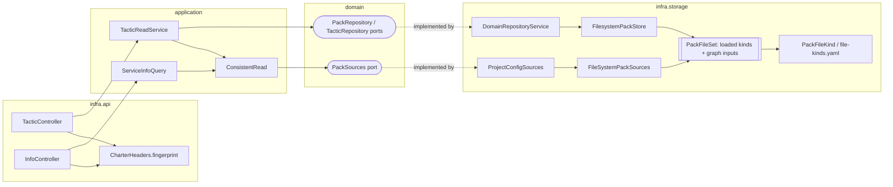

# Implementation Plan: Verified source fingerprint on every read

**Branch**: `fix/verified-source-fingerprint` | **Date**: 2026-10-24 | **Spec**: [spec.md](spec.md)
**Input**: Mission specification from `kitty-specs/verified-source-fingerprint-01M5PG7Q/spec.md`

## Summary

Make the source fingerprint honest and send it on every artifact read. Three moves, one per ring:

1. **Storage (`infra.storage`)**: one package-private authority, `PackFileSet`, declares the
   **loaded kinds** (an enum: tactic, directive, styleguide, paradigm) and the **graph inputs**
   (root `*.graph.yaml` shards and `drg/fragment.yaml`). It walks a pack once, classifies with
   `PackFileKind`, and orders once. `FilesystemPackStore` can enumerate files only for a declared
   loaded kind; `FileSystemPackSources.fingerprint()` digests `pack.yaml`, every file of every
   loaded kind, then the graph inputs, all from that one walk. A new kind added to the enum is
   digested by construction.
2. **Application (`application`)**: `ConsistentRead`, restored in the role `ConsistentLoad` had
   before PR #139, wraps a load between two digests of the `PackSources` port and returns the
   value with the digest it verified, or refuses with `stale_input`. A load that fails is
   re-digested, and a changed or unreadable second digest turns the failure into `stale_input`.
   `ServiceInfoQuery` and `TacticReadService` both go through it.
3. **Inbound (`infra.api`)**: `TacticController` sets `Charter-Source-Fingerprint` once on each
   200, from the verified value, as `InfoController` does. Refusals stay without it.

Scenarios first: tactic 200s (list and get) asserting the header equals `/info`'s, tactic
`stale_input` scenarios that change a **tactic file** mid-read, and a stale-beats-404 scenario.
They are red on `main`.



## Technical Context

**Language/Version**: Java 25 (Temurin), Gradle 9.8.1 wrapper, strict SHA-256 dependency verification
**Primary Dependencies**: Spring Boot (web, MockMvc), SnakeYAML Engine, Jackson; no new dependency
**Storage**: Pack directories on the file system (`FilesystemPackStore`, `PackFileKind` over `contracts/packs/file-kinds.yaml`)
**Testing**: JUnit 6 + AssertJ unit tests; Cucumber 8 contract scenarios in `contracts/charter/scenarios/` bound in `service/deployable` (per-exchange contract and fingerprint check in `ScenarioHttp`); ArchUnit `HexagonalArchitectureTest`; plain-JUnit seeded generator for the generated-tree test (no jqwik, C-003)
**Target Platform**: The charter service (Spring Boot, loopback daemon today, hosted-first per ADR-0020)
**Project Type**: single (Gradle multi-module: `kernel`, `packs`, `deployable`, `charter-api`)
**Performance Goals**: Each read digests its inputs exactly twice (NFR-002); the generated-tree test finishes in under 10 s (NFR-001)
**Constraints**: No contract shape change (C-001); config inputs stay (C-002, #127); ADR-0006 rings (C-004)
**Scale/Scope**: About 8 production classes touched, 1 new production class in each of `application` and `infra.storage`, 2 feature files, 5 docs pages

**Supply chain (DIRECTIVE_051)**: No dependency is added, upgraded or removed. Nothing to verify;
`gradle/verification-metadata.xml` is untouched.

## Charter Check

| Charter rule | How this plan meets it |
|---|---|
| Never break the OpenAPI contract | No schema, operation or declaration changes. The header is already declared on both tactic 200s; behavior now matches its description. Contract CHANGELOG records a Fixed entry and the new scenarios. |
| Divergence from the oracle | Core's Python charter has no fingerprint; this is a service-only freshness behavior. Divergence register unaffected. |
| Adversarial squad at the plan point and before merge | Plan-point squad on this design (Phase 2); pre-PR squad at closeout. |
| BDD, scenarios first | WP02 adds the tactic scenarios red before any production change. |
| Test first, no fake green | Expected sets come from the generator, not from `PackFileKind`; the stale scenarios mutate a file the read loads; each new scenario has a negative control. |
| `verifyAll` on Java 25 + style + docs checks | Run per WP and at closeout. |
| Decision documentation | ADR-0018 gains a dated amendment (D8, D11) naming the file-set authority and the shared verified read; ADR-0025 is not needed (no new decision beyond D8/D11's own text). |

Re-check after design: no violation. The one judgement call (graph inputs stay digested though
no read loads them) is recorded in spec Open decisions and research R2.

## Project Structure

### Documentation (this mission)

```
kitty-specs/verified-source-fingerprint-01M5PG7Q/
├── spec.md
├── plan.md
├── research.md
├── data-model.md
├── quickstart.md
├── checklists/requirements.md
└── tasks/
```

### Source Code (repository root)

```
service/packs/src/main/java/ai/speckitty/charter/packs/
├── application/
│   ├── ConsistentRead.java          (new)  the verified-read rule, returns Verified<T>
│   ├── ServiceInfoQuery.java        (edit) answers through ConsistentRead
│   └── TacticReadService.java       (edit) both reads through ConsistentRead
├── infra/storage/
│   ├── PackFileSet.java             (new)  loaded kinds + graph inputs, one walk, one order
│   ├── FilesystemPackStore.java     (edit) kindFiles -> PackFileSet, kinds typed
│   ├── FileSystemPackSources.java   (edit) digests PackFileSet.digested(...)
│   └── FileSystemPackInspector.java (edit) graphShards shared via PackFileSet (no behavior change)
└── infra/api/
    └── TacticController.java        (edit) header on 200
service/deployable/src/main/java/.../CharterWiring.java          (edit) ConsistentRead bean over ProjectConfigSources
service/deployable/src/test/java/.../bdd/
├── CucumberSpringConfiguration.java (edit) @Primary ConsistentRead over DriftingSources
├── ReadConsistencySteps.java        (edit) "a tactic file changes while the next read is answered"
└── DriftingSources.java             (edit) javadoc names every reader of the seam
contracts/charter/scenarios/
├── service.feature                  (edit) "The source fingerprint follows a tactic file" (WP02)
└── tactics.feature                  (new)  tactic list/get 200 with the verified header, tactic stale_input (list, get),
                                            stale beats 404, negative control, missing own and sibling pack directory (WP03)
contracts/charter/CHANGELOG.md, headers/CharterSourceFingerprint.yaml (prose), schemas/CharterRefusal*.yaml (prose)
docs/architecture/service-lifecycle.md, docs/api/service-contract.md, docs/adr/0018-...md
```

**Structure Decision**: Existing `packs` slice; no new module. `PackFileSet` stays in
`infra.storage` because `PackFileKind` and the glob table are a storage concern; moving it to
`domain` would break `DOMAIN_IS_PURE`. `ConsistentRead` sits in `application` because the
refusal rule ("stale beats a load refusal") is a use-case rule and must span every port call a
use case makes; pushing it into the storage adapter would thread a fingerprint through domain
port return types (`STORAGE_RETURNS_DOMAIN`) and cover one port call only.

## Design details

### PackFileSet (infra.storage, package-private)

- `enum LoadedKind { TACTIC("tactic"), DIRECTIVE("directive"), STYLEGUIDE("styleguide"), PARADIGM("paradigm") }`, with `token()`.
- Every entry point normalizes its directory (`toAbsolutePath().normalize()`) before classifying, so
  a configured root like `packs/foo/.` classifies exactly as the store's normalized directory.
- `PACK_YAML` lives here and the store uses it.
- `static List<String> files(Path packDir, LoadedKind kind)`: the relative, `/`-separated paths of the pack's files of that kind, from one recursive walk (`Files.walk`, no directory-link following, `Files.isRegularFile` following file links, names ending `.yaml`), classified by `PackFileKind.bundled().classify(<dirname>/<rel>)`, sorted by `String` order. This is exactly today's `kindFiles`, moved.
- `static List<String> digested(Path packDir)`: `pack.yaml` when it is a regular file; then for each `LoadedKind` in declaration order its `files(...)`; then the graph inputs: root `*.graph.yaml` regular files sorted by name (today's `FileSystemPackInspector.graphShards`), then `drg/fragment.yaml` when present. The walk runs once per call (one `Files.walk` result reused for all kinds).
- Order note: for a pack with no loaded-kind files the digest order and labels are identical to today's, so `/info`'s value for such inputs does not change.
- `FilesystemPackStore` keeps its typed per-kind readers but asks only `PackFileSet.files(dir, LoadedKind.X)`; its four `*_KIND` string constants go, so a read of an undeclared kind does not compile.

### ConsistentRead (application)

```java
public final class ConsistentRead {
    public ConsistentRead(PackSources sources)
    public <T> Verified<T> read(String staleDetail, Supplier<T> load)
    public record Verified<T>(T value, String fingerprint) {}
}
```

- `first = sources.fingerprint()`: a refusal propagates (`pack_unreadable`, 500).
- `value = load.get()`; on a `RuntimeException`, `second = digestOrNull()`; if it differs from
  `first` (or is null) throw `stale_input`, else rethrow the original failure.
- On success, `second = digestOrNull()`; differ or null -> `stale_input`; else `Verified(value, first)`.
- `staleDetail` is the whole `stale_input` detail sentence, supplied by the caller: `/info`
  keeps `"The inputs changed while the service info was read; read it again."` (its pinned body
  is unchanged); the list passes `"The inputs changed while the tactics were read; read them
  again."` and the single read `"The inputs changed while the tactic was read; read it again."`.
- `ConsistentRead` carries **no** stereotype annotation and is never component-scanned: production
  and the scenario suite hold two and three `PackSources` beans, so the port is never injected by
  type into a use case.
- On a load failure the second digest is taken; `digestOrNull` turns only a `CharterRefusal` into
  `null`. A non-refusal exception from the load is rethrown unchanged when the digests agree, and a
  non-refusal exception from either digest propagates (so "the service fails unexpectedly" stays
  `internal_error`).
- Wiring: `CharterWiring` adds `@Bean ConsistentRead consistentRead(ProjectConfigSources)`;
  `ServiceInfoQuery(String worktree, ConsistentRead read)`; `TacticReadService(PackRepository,
  TacticRepository, ConsistentRead)`. The scenario configuration replaces its
  `ServiceInfoQuery` override with one `@Primary ConsistentRead` over `DriftingSources`, so
  `/info` and the tactic reads see the same armed change.

### TacticReadService

The not-found mapping (`packRefusal`, `TACTIC_NOT_FOUND`) runs inside the supplier, so a 404
whose inputs changed meanwhile becomes `stale_input` (FR-005, ADR-0018 D11). Return types become
`ConsistentRead.Verified<List<Tactic>>` and `ConsistentRead.Verified<Tactic>`.

### TacticController

`ResponseEntity.ok().headers(CharterHeaders.fingerprint(verified.fingerprint())).body(...)` for
both operations; `RefusalHandler` already sets no fingerprint on refusals.

### Testing design (folded from the plan-point squad)

- **Exactness test** (`PackFileSetExactnessTest`, `infra.storage`): 200 seeded trees (base seed
  fixed, overridable by system property, seed and tree in every assertion message, `@Timeout(10)`).
  The generator plants files from an explicit **name-shape table**, each row with its verdict
  (loaded / graph input / decoy), written from the generator's own grammar, never from
  `PackFileKind` or `PackFileSet`; a disagreement with the glob table fails the test. Loaded:
  every kind at depth 0-3, hidden stems and hidden directories, `presets/x.tactic.yaml`, a file
  symlink to an external tactic. Graph inputs: root shards (also hidden), `drg/fragment.yaml`.
  Decoys: `.yml`, `.YAML`, `.TACTIC.yaml`, `.bak`, `x.tactic.config.yaml`, unclassified YAML,
  toolguide, procedure, agent, asset, step-contract, `org-charter.yaml`, `sub/charter.yaml`,
  nested shard, nested fragment, nested `pack.yaml`, a directory named `d.tactic.yaml`, a
  directory symlink to external tactics. Directory names that are both a files rule and an
  exclusion (`mission_types/`, `missions/*/`, `actions/*/`) stay out of the alphabet. Some trees
  use a configured pack name different from the directory name, and a non-normalized root.
  Valid content with a planted id per file; about one file in five is malformed and must show up
  as a violation with its path.
- **Observe the load** only through `FilesystemPackStore.read(id)` (planted ids of the four DSO
  lists, plus violation paths, plus `pack.yaml`) and `DomainRepositoryService.tacticsOf` ids.
- **Observe the digest** by mutation: append bytes to each regular file (decoys and symlink
  targets included), digest, restore; the fingerprint changes if and only if the file is
  `pack.yaml`, loaded or a graph input. One new random file per tree too. Baseline restored at the end.
- **Planted omission on the production path**: `FileSystemPackSources.fingerprint()` delegates to
  a package-private `static String digest(List<PackLocation>, Function<Path, List<String>> filesOf)`
  with `PackFileSet::digested`; `PackFileSet.digested(Path, Set<LoadedKind>)` is the overload the
  production path calls with every kind. `@EnumSource(LoadedKind)` mutants drop one kind and the
  oracle must fail naming a planted file of that kind; mutants also drop the graph inputs and add
  a nested shard. The red run of the exactness test on `main` is recorded as red-first evidence.
- **ConsistentRead**: a scripted, event-logging fake `PackSources`; one test per row of
  data-model.md's outcome table, including rows 6 (load throws a non-refusal, digests agree:
  rethrown) and 7 (second digest throws a non-refusal: propagates), and event-order assertions
  (`[digest, load, digest]`) for NFR-002.
- **TacticReadServiceTest**: counting fake; absent pack and absent tactic with changing digests
  answer `stale_input`, proving the not-found mapping runs inside the supplier.
- **Scenarios**: shared Given writes `rehearse.tactic.yaml` to org pack `qa` (no `pack.yaml`
  needed; the store checks the directory only). `service.feature` (WP02): "The source
  fingerprint follows a tactic file" (FR-012, with a `notes.yml` control). New `tactics.feature`
  (WP03): tactic list 200 and single tactic 200 asserting the header appears once and the body
  holds `rehearse` (the per-exchange harness checks equality with `/info`); list and single
  stale_input with a tactic-file change and a retry 200; stale beats 404 (then 404 on retry); a
  negative control; a read of a pack whose own directory is missing, and a read of a healthy pack
  whose sibling's directory is missing, both 500 `pack_unreadable` with no fingerprint. The
  exact titles are in WP01 T005 and WP03 T011.
  New step "a tactic file changes while the next read is answered": rewrites the `name:` line of
  the single `*.tactic.yaml` in the scenario's packs (exactly one match, bytes changed, never a
  shard; throws when none).
- **Red-first capture**: each commit stays green (closeout rebuilds history commit by commit).
  Each WP runs its new tests against the unfixed code first and records the failing output
  (test name and assertion message) in the WP's review evidence before the fix.

### Global digest consequence

The tactic read verifies the global digest (all configured packs plus the project config). A
broken sibling pack therefore refuses a tactic read with `pack_unreadable` (500), where today it
answers. This is fail closed and matches `/info`; it is listed for the operator.

## Complexity Tracking

| Deviation | Why needed | Simpler alternative rejected because |
|---|---|---|
| Graph inputs digested though no served read loads them | Keeps `/info`'s value and two `@contract` scenarios unchanged | Dropping them changes behavior consumers rely on, outside both issues' asks |
| Generated-tree test hand-rolled | jqwik is excluded (C-003) | Adding jqwik needs a supply-chain exception for one test |

## Implementation Concern Map

> **Note**: Implementation concerns are NOT work packages and are NOT executable units.

### IC-01 — Record the design before code

- **Purpose**: State the built behavior and the authority in the docs and ADR-0018 before code (operator brief, DIRECTIVE_037).
- **Relevant requirements**: FR-011
- **Affected surfaces**: `docs/architecture/service-lifecycle.md` (freshness; drop the stale refresh bullets), `docs/api/service-contract.md` (built surface, headers), `docs/adr/0018-...md` (dated amendment D8/D11, the ABA window now covers tactic files, and the Risks bullet on #120), prose only in `contracts/charter/headers/CharterSourceFingerprint.yaml`, `schemas/ServiceInfo.yaml` (`sourceFingerprint` definition and order; the dead `x-source` path), `schemas/CharterRefusal*.yaml` (`stale_input` names the tactic reads; `pack_not_found` no longer says unreadable), `responses/TacticNotFound.yaml`, path descriptions of both tactic operations; `contracts/charter/CHANGELOG.md` (Fixed: header and verification; Changed: a missing pack directory is 500 `pack_unreadable`; the digest covers loaded files)
- **Sequencing/depends-on**: none
- **Risks**: Docs checks (check_docs, markdownlint, cspell); contract prose edits must not change shape (compatibility check stays green).

### IC-02 — Scenarios first (red)

- **Purpose**: Pin the tactic 200 header, tactic `stale_input` (list, get), stale beats 404, and the negative control, red on `main`.
- **Relevant requirements**: FR-001, FR-002, FR-003, FR-004, FR-005, SC-001, SC-004
- **Affected surfaces**: `contracts/charter/scenarios/tactics.feature` (new), `ReadConsistencySteps.java`, `CucumberSpringConfiguration.java`
- **Sequencing/depends-on**: IC-01
- **Risks**: The stale step must mutate a tactic file, never a shard (fakeability). A pack fixture needs a valid `pack.yaml` and tactic.

### IC-03 — One file-set authority and an exact digest

- **Purpose**: `PackFileSet` with `LoadedKind` and graph inputs; store and fingerprint derive from it; generated-tree test with planted omission.
- **Relevant requirements**: FR-006, FR-007, FR-008, FR-009, NFR-001, SC-002, SC-003
- **Affected surfaces**: `PackFileSet.java` (new), `FilesystemPackStore.java`, `FileSystemPackSources.java`, `FileSystemPackInspector.java`, tests in `service/packs/src/test/java/.../infra/storage/`
- **Sequencing/depends-on**: IC-01 (independent of IC-02 and IC-04)
- **Risks**: Keep `/info`'s value for packs without loaded-kind files (existing scenarios compare values only within a run, but unit tests may pin digests). Symlink and order semantics must stay as the store has them.

### IC-04 — Verified reads and the header

- **Purpose**: `ConsistentRead` in `application`; `ServiceInfoQuery` and `TacticReadService` through it; `TacticController` sets the header; wiring.
- **Relevant requirements**: FR-001..FR-005, FR-010, NFR-002
- **Affected surfaces**: `ConsistentRead.java` (new), `ServiceInfoQuery.java`, `TacticReadService.java`, `TacticController.java`, `CharterWiring.java`, `CucumberSpringConfiguration.java`, `DriftingSources.java` (javadoc), unit tests (`ServiceInfoQueryTest`, `TacticReadServiceTest`, `TacticControllerTest` with header assertions on 200 and absence on 404, `TacticReadWiredTest` whose `Root` must supply a `ConsistentRead` over `FileSystemPackSources`, `WorktreeGuardTest`, `GuardWiringTest`, `CharterWiringTest`)
- **Sequencing/depends-on**: IC-03 (the tactic-file stale scenario is red until the digest covers tactics); its scenarios are written first within the same work package
- **Risks**: Bean ambiguity (three `PackSources` beans in scenarios): inject `ConsistentRead`, never `PackSources`, into use cases. `/info`'s pinned stale body must not change.
